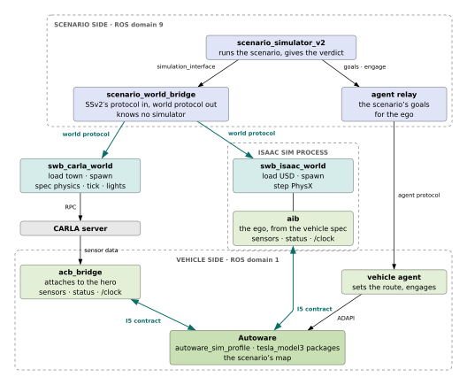
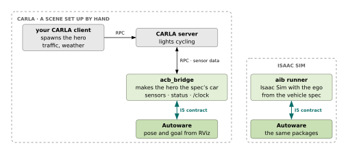
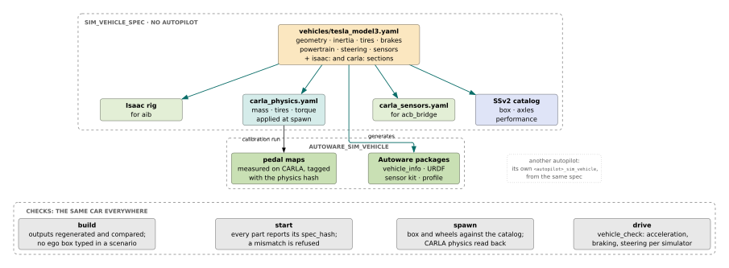

# scenario-world-bridge

Run [OpenSCENARIO](https://www.asam.net/standards/detail/openscenario/) scenarios in
[CARLA](https://carla.org/) or [Isaac Sim](https://developer.nvidia.com/isaac/sim) with
[Autoware](https://autowarefoundation.github.io/autoware-documentation/main/) driving on
**real sensor data**: the simulator's cameras and lidar feed Autoware's full perception,
localization, planning and control, while
[scenario_simulator_v2](https://github.com/tier4/scenario_simulator_v2) (SSv2) runs the
scenario and gives the verdict.

It also runs Autoware on CARLA or Isaac Sim **without a scenario runner**: you set the scene
up in the simulator yourself and drive. Both uses share one Autoware setup and one
description of the car.

> **Status.** This README describes the target layout of
> [roadmap 051](docs/roadmap/051-target-shape.md). Until it lands, some parts keep their
> old names and places: the world servers are `src/carla_world` and `src/isaac_world` in
> this repository, the vehicle packages are acb's `acb_vehicle` and aib's `aib_vehicle`,
> and the car is described in aib's spec only.

<p align="center">
  <br>
  <em>A starter scenario: the ego stops for a pedestrian crossing ahead and drives on (8x).</em>
</p>

<details>
<summary><b>▶ Two Autoware vehicles in one scenario</b> (2.5 MB animation)</summary>
<p align="center">
  <br>
  <em>Two complete Autoware stacks in one scenario, each driving its own vehicle (6x).</em>
</p>
</details>

## What it does

SSv2 normally tests Autoware against a lightweight simulator that hands it ground truth:
perfect detections and exact positions, so perception is never exercised. This project
makes CARLA and Isaac Sim SSv2 backends instead. The `.xosc` scenario files stay the same,
but Autoware has to *see* the pedestrian, the car ahead and the traffic light.

<p align="center">
  <br>
  <em>A scenario run. The two teal lines are the boundaries every simulator implements.</em>
</p>

- **Scenario side.** SSv2 runs the scenario and gives the verdict. The **bridge**
  (`scenario_world_bridge`) translates SSv2's requests into the **world protocol**. It
  knows no simulator. The **agent relay** passes the scenario's goals to whatever drives
  the ego.
- **World servers.** One per simulator: `swb_carla_world` for CARLA and `swb_isaac_world`
  for Isaac Sim. Each loads the map, spawns and moves the scenario's vehicles and people,
  sets the traffic lights and steps the simulation. Another simulator becomes a backend by
  implementing the world protocol and passing `swb_world_check conformance`.
- **Vehicle side.** Your Autoware, connected to the simulator through a **vehicle bridge**:
  acb (`autoware_carla_bridge`) for CARLA, aib (`autoware_isaac_bridge`) for Isaac Sim.
  The vehicle bridge publishes the simulator's sensors, the vehicle status and `/clock`,
  and drives the car from Autoware's commands. A **vehicle agent** takes the scenario's
  goals from the relay. The vehicle side can run on another host and in another ROS
  domain.

The vehicle bridge and Autoware meet at the **I5 contract**: the topics, frames and clock
rule Autoware expects of any simulated car. Autoware sees the same contract from CARLA and
from Isaac Sim, with or without SSv2.

## Autoware without a scenario runner

<p align="center">
  <br>
  <em>No SSv2, bridge, world server or relay: only the simulator, its vehicle bridge and Autoware.</em>
</p>

- **CARLA, a scene you set up by hand.** Start CARLA and build the scene with any CARLA
  client: spawn the ego as a Tesla Model 3 with `role_name=hero`, add traffic with CARLA's
  `generate_traffic.py`, set the weather. Then start acb's Autoware launch with the town's
  map. acb attaches to the hero when it appears, gives it the vehicle spec's physics, and
  Autoware takes its initial pose and goal from RViz.
- **Isaac Sim.** aib's runner opens a world with the ego built from the vehicle spec, and
  Autoware connects the same way.

Loading another town, or restarting the simulator, ends the Autoware stack. Start it again
with the new town's map.

## One car, described once

<p align="center">
  <br>
  <em>Every value about the car is edited in one file. The rest is generated or measured from it.</em>
</p>

The car's dimensions, mass, tires, powertrain, steering and sensors live in one file,
`vehicles/tesla_model3.yaml` in `autoware_sim_vehicle`. From it come:

- Autoware's vehicle and sensor kit packages (`tesla_model3_description`,
  `tesla_model3_launch`, `tesla_model3_sensor_kit_*`) and the shared launch profile
  (`autoware_sim_profile`);
- Isaac Sim's vehicle rig;
- CARLA's physics (`carla_physics.yaml`) and sensors (`carla_sensors.yaml`);
- SSv2's vehicle catalog, which every scenario's ego refers to.

Three checks keep them in agreement:

- **At build time**, every output is regenerated and compared with the committed one, and
  no scenario may type its own ego box.
- **At spawn**, the ego's measured box and wheels are compared with the catalog (2 cm), and
  CARLA's physics are read back.
- **While driving**, `vehicle_check` measures acceleration, braking and steering on each
  simulator against the spec.

## Repositories

| Repository | What it holds |
|---|---|
| [scenario-world-bridge](https://github.com/NEWSLabNTU/scenario-world-bridge) (this one) | The bridge, the agent relay and vehicle agent, launch files, run tools, starter scenarios with the vehicle catalog. Holds every repository below as a git submodule. |
| autoware_sim_vehicle | The vehicle specs, the generated Autoware packages, the launch profile, the I5 contract and `vehicle_check`. |
| swb_world_protocol | The world protocol, its Rust and Python server shells, and the conformance check. |
| swb_carla_world | The CARLA world server. |
| swb_isaac_world | The Isaac Sim world server. |
| [autoware_carla_bridge](https://github.com/NEWSLabNTU/autoware_carla_bridge) (acb) | The CARLA vehicle bridge, and running Autoware on CARLA without SSv2. |
| [autoware_isaac_bridge](https://github.com/NEWSLabNTU/autoware_isaac_bridge) (aib) | The Isaac Sim vehicle library and runner. |

acb and aib build on their own with only `autoware_sim_vehicle`, so neither needs SSv2.

## Supported versions

| Component | Version |
|---|---|
| ROS 2 | Humble (Ubuntu 22.04) |
| Autoware | 1.5.0 (binary packages), or your own build of the same release |
| scenario_simulator_v2 | bundled (a fork, as a submodule) |
| CARLA | **0.9.16 -- tested.** 0.9.14 and 0.9.15 build, untested ([Other CARLA versions](#other-carla-versions)) |
| Isaac Sim | 6.1 (pip install, Python 3.12) |

## Prerequisites

- **Ubuntu 22.04, ROS 2 Humble** ([install](https://docs.ros.org/en/humble/Installation.html)).
- **Autoware 1.5.0** ([install](https://autowarefoundation.github.io/autoware-documentation/main/installation/)),
  e.g. the binary packages under `/opt/autoware/1.5.0`.
- **CARLA 0.9.16** ([quick start](https://carla.readthedocs.io/en/0.9.16/start_quickstart/)),
  the packaged release, and an NVIDIA GPU that runs it beside Autoware.
- **Converted maps**: one Autoware map directory (Lanelet2 + point cloud) per CARLA town.
  The TUM pack this project uses has no working public download at the moment -- see
  [User Guide §2](docs/user-guide.md#2-prepare-a-map-directory). Nothing runs without them.
- **Rust** and colcon's Rust plugin, which rosdep cannot install, and CARLA's Python API
  (for `carla_poses` and `chase_view`; match your CARLA version):

  ```bash
  curl --proto '=https' --tlsv1.2 -sSf https://sh.rustup.rs | sh
  pip install colcon-cargo-ros2 carla==0.9.16
  ```

## Setup

```bash
git clone --recurse-submodules https://github.com/NEWSLabNTU/scenario-world-bridge.git
cd scenario-world-bridge
source /opt/ros/humble/setup.bash
source /opt/autoware/1.5.0/setup.bash        # your Autoware
rosdep install --from-paths src --ignore-src -y   # installs apt packages: needs sudo
colcon build --cmake-args -DCMAKE_BUILD_TYPE=Release --cargo-args --release
source install/setup.bash                    # in every terminal below, after Autoware's
```

Without sudo, rosdep's install fails; the packages it lists are the ones to ask an
administrator for (ROS and Autoware's own are normally present already; this workspace adds
`python3-pygame`, which `pip install pygame` also provides).

Once per machine, give Autoware a writable data directory (TensorRT writes its engines
there): `ros2 run acb_launch setup_autoware_data`.

## Quick start

Four terminals, each with Autoware's and this workspace's `setup.bash` sourced, and
`CARLA_MAPS` pointing at the directory that holds `Town01/`, `Town02/`, ...

```bash
# 1. CARLA (headless)
<CARLA_0.9.16>/CarlaUE4.sh -RenderOffScreen -nosound -carla-rpc-port=2000

# 2. Simulation side: CARLA's world server, the bridge and the agent relay (long-lived)
ROS_DOMAIN_ID=9 ros2 launch swb_launch carla_simulation.launch.xml

# 3. Vehicle side: Autoware on CARLA, its vehicle agent registered with the relay
ROS_DOMAIN_ID=1 ros2 launch swb_launch ego_av.launch.xml \
    map_path:=$CARLA_MAPS/Town01 relay:=tcp://localhost:5560

# 4. A scenario -- the launch ends with the scenario; the verdict is a JUnit file
ROS_DOMAIN_ID=9 ros2 launch swb_launch scenario.launch.xml \
    scenario:=$(ros2 pkg prefix swb_examples)/share/swb_examples/scenarios/basic/town01_ego_drive.xosc \
    output_directory:=/tmp/swb_run
cat /tmp/swb_run/scenario_test_runner/result.junit.xml
```

On Isaac Sim, the world server is its own long-lived launch and the simulation side is
`isaac_simulation.launch.xml`: [User Guide §4](docs/user-guide.md#4-run).

Without SSv2, Autoware on a CARLA scene you set up yourself is one launch, after CARLA
(terminal 1) is up and your client has spawned the hero:

```bash
ROS_DOMAIN_ID=1 ros2 launch acb_launch carla_simulator.launch.xml map_path:=$CARLA_MAPS/Town01
```

A whole directory of scenarios, with CARLA's own collision check next to SSv2's verdict:

```bash
ROS_DOMAIN_ID=9 ros2 run swb_launch run_suite \
    $(ros2 pkg prefix swb_examples)/share/swb_examples/scenarios/basic \
    --output ~/swb_results/basic --physical-verdict
```

Wait for each part before starting the next: CARLA serves port 2000; the bridge logs
`ZMQ server ready`; the relay logs `ego: agent up`. The [first-run
tutorial](docs/tutorials/01-first-run.md) shows what each looks like.

**Recommended: [play_launch](https://pypi.org/project/play-launch/) as a drop-in for
`ros2 launch`.** Same packages, files and arguments -- `play_launch launch swb_launch
simulation.launch.xml` -- plus a log directory per node and a web UI (`--web-addr
127.0.0.1:8084`) for the ~90 processes of an Autoware stack. `pip install
'play_launch>=0.15.1'`; `run_suite` uses it when it is installed.

## Learn more

**Tutorials** -- from a map directory to a demo of your own scenario:

1. [First run](docs/tutorials/01-first-run.md) -- bring up both sides, run a starter
   scenario, read the verdict.
2. [Prepare a scenario](docs/tutorials/02-prepare-a-scenario.md) -- pick poses on the map,
   write the `.xosc`, run it.
3. [Run and judge](docs/tutorials/03-run-and-judge.md) -- suites, CARLA's contacts in the
   verdict, the result files.
4. [Demo run](docs/tutorials/04-demo-run.md) -- two Autoware vehicles in one scenario,
   recording a screencast, and the demo tour (`just demo-tour`: six incidents in one
   five-minute drive through Town01, with captions).

**Reference** -- the [User Guide](docs/user-guide.md) (install, maps, scenario directories,
running, configuring the CARLA world, troubleshooting) and
[Writing scenarios](docs/design/scenario-authoring.md). To drive with another autopilot than
Autoware: [Writing an agent](docs/agent-interface.md). All documentation:
[docs/](docs/README.md).

## Other CARLA versions

The CARLA version is chosen at build time: [carla-rust](https://github.com/jerry73204/carla-rust)
has a different API per CARLA release, and the bridges refuse to talk to a server of another
version (both versions are named in the error). Build for another release by setting
`CARLA_VERSION` for the whole build:

```bash
CARLA_VERSION=0.9.15 colcon build --cmake-args -DCMAKE_BUILD_TYPE=Release --cargo-args --release
```

| CARLA | Status |
|---|---|
| 0.9.16 | tested: every starter scenario passes |
| 0.9.15 | builds; untested |
| 0.9.14 | builds; untested |
| 0.10.0 | not yet: the vehicle side does not build against 0.10's API on this branch (a port is in progress, [roadmap 019](docs/roadmap/019-ntu-campus-twin.md)) |

Each CARLA release needs its own server package and map directories.

## For developers

Building with `just`, running the tests, the repository layout, how a request flows from SSv2
through the bridge to a world server, and the design documents (architecture, the SSv2 protocol,
time and ticking, launch configuration): the [Developer Guide](docs/development.md).
The [roadmap](docs/roadmap/README.md) records what was built and why.

## Related projects

- [autoware_carla_bridge](https://github.com/NEWSLabNTU/autoware_carla_bridge) -- Autoware on
  CARLA: sensors and vehicle interface, with or without SSv2.
- [autoware_isaac_bridge](https://github.com/NEWSLabNTU/autoware_isaac_bridge) -- Autoware on
  Isaac Sim.
- [scenario_simulator_v2](https://github.com/tier4/scenario_simulator_v2) -- Autoware's
  scenario testing framework.
- [carla-rust](https://github.com/jerry73204/carla-rust) -- Rust bindings for CARLA's C++ API.
- [AWSIM](https://github.com/tier4/AWSIM) -- a Unity-based SSv2 backend, another alternative.
- [play_launch](https://pypi.org/project/play-launch/) -- a `ros2 launch` drop-in with
  per-node logs and a web UI.
