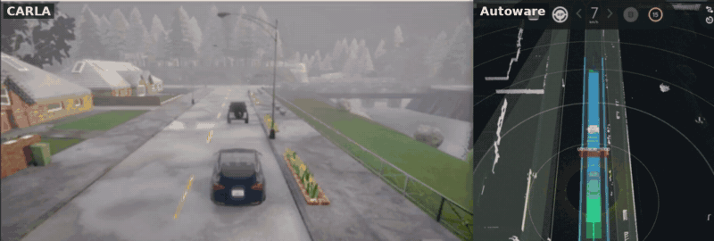
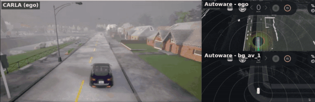
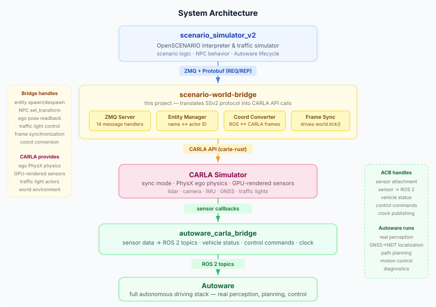

# carla-scenario-bridge

Run [OpenSCENARIO](https://www.asam.net/standards/detail/openscenario/) scenarios in
[CARLA](https://carla.org/) with [Autoware](https://autowarefoundation.github.io/autoware-documentation/main/)
driving on **real sensor data**: CARLA's cameras and lidar feed Autoware's full perception,
localization, planning and control, while
[scenario_simulator_v2](https://github.com/tier4/scenario_simulator_v2) (SSv2) runs the
scenario and gives the verdict.

<p align="center">
  <br>
  <em>A starter scenario: the ego stops for a pedestrian crossing ahead and drives on (8x).</em>
</p>

<details>
<summary><b>▶ Two Autoware vehicles in one scenario</b> (2.5 MB animation)</summary>
<p align="center">
  <br>
  <em>Two complete Autoware stacks in one scenario, each driving its own vehicle (6x).</em>
</p>
</details>

## What it does

SSv2 normally tests Autoware against a lightweight simulator that hands it ground truth --
perfect detections, exact positions -- so perception is never exercised. This project makes
CARLA an SSv2 backend instead: the same `.xosc` scenario files, but Autoware has to *see*
the pedestrian, the car ahead and the traffic light.

<p align="center">
  
</p>

- **Simulation side** -- SSv2 runs the scenario; **carla-scenario-bridge** (this project)
  translates SSv2's requests into CARLA (spawns, motion, traffic lights, time); an **agent
  relay** passes the scenario's goals to whatever drives the ego.
- **Vehicle side** -- your Autoware with
  [autoware_carla_bridge](https://github.com/NEWSLabNTU/autoware_carla_bridge): CARLA's
  sensors and clock in, Autoware's control out, and a **vehicle agent** that takes goals
  from the relay. It can run on another host and in another ROS domain.
- **CARLA** owns physics, sensors and simulation time.

## Supported versions

| Component | Version |
|---|---|
| ROS 2 | Humble (Ubuntu 22.04) |
| Autoware | 1.5.0 (binary packages), or your own build of the same release |
| scenario_simulator_v2 | bundled (a fork, as a submodule) |
| CARLA | **0.9.16 -- tested.** 0.9.14 and 0.9.15 build, untested ([Other CARLA versions](#other-carla-versions)) |

## Prerequisites

- **Ubuntu 22.04, ROS 2 Humble** ([install](https://docs.ros.org/en/humble/Installation.html)).
- **Autoware 1.5.0** ([install](https://autowarefoundation.github.io/autoware-documentation/main/installation/)),
  e.g. the binary packages under `/opt/autoware/1.5.0`.
- **CARLA 0.9.16** ([quick start](https://carla.readthedocs.io/en/0.9.16/start_quickstart/)),
  the packaged release, and an NVIDIA GPU that runs it beside Autoware.
- **Converted maps**: one Autoware map directory (Lanelet2 + point cloud) per CARLA town.
  The TUM pack this project uses has no working public download at the moment -- see
  [User Guide §2](docs/user-guide.md#2-prepare-a-map-directory). Nothing runs without them.
- **Rust** and colcon's Rust plugin, which rosdep cannot install, and CARLA's Python API
  (for `carla_poses` and `chase_view`; match your CARLA version):

  ```bash
  curl --proto '=https' --tlsv1.2 -sSf https://sh.rustup.rs | sh
  pip install colcon-cargo-ros2 carla==0.9.16
  ```

## Setup

```bash
git clone --recurse-submodules https://github.com/NEWSLabNTU/carla-scenario-bridge.git
cd carla-scenario-bridge
source /opt/ros/humble/setup.bash
source /opt/autoware/1.5.0/setup.bash        # your Autoware
rosdep install --from-paths src --ignore-src -y   # installs apt packages: needs sudo
colcon build --cmake-args -DCMAKE_BUILD_TYPE=Release --cargo-args --release
source install/setup.bash                    # in every terminal below, after Autoware's
```

Without sudo, rosdep's install fails; the packages it lists are the ones to ask an
administrator for (ROS and Autoware's own are normally present already; this workspace adds
`python3-pygame`, which `pip install pygame` also provides).

Once per machine, give Autoware a writable data directory (TensorRT writes its engines
there): `ros2 run acb_launch setup_autoware_data`.

## Quick start

Four terminals, each with Autoware's and this workspace's `setup.bash` sourced, and
`CARLA_MAPS` pointing at the directory that holds `Town01/`, `Town02/`, ...

```bash
# 1. CARLA (headless)
<CARLA_0.9.16>/CarlaUE4.sh -RenderOffScreen -nosound -carla-rpc-port=2000

# 2. Simulation side: the bridge and the agent relay (long-lived)
ROS_DOMAIN_ID=9 ros2 launch csb_launch simulation.launch.xml

# 3. Vehicle side: Autoware on CARLA, registered with the relay
ROS_DOMAIN_ID=1 ros2 launch acb_launch carla_simulator.launch.xml \
    map_path:=$CARLA_MAPS/Town01 vehicle_name:=hero relay:=tcp://localhost:5560

# 4. A scenario -- the launch ends with the scenario; the verdict is a JUnit file
ROS_DOMAIN_ID=9 ros2 launch csb_launch scenario.launch.xml \
    scenario:=$(ros2 pkg prefix csb_examples)/share/csb_examples/scenarios/basic/town01_ego_drive.xosc \
    output_directory:=/tmp/csb_run
cat /tmp/csb_run/scenario_test_runner/result.junit.xml
```

A whole directory of scenarios, with CARLA's own collision check next to SSv2's verdict:

```bash
ROS_DOMAIN_ID=9 ros2 run csb_launch run_suite \
    $(ros2 pkg prefix csb_examples)/share/csb_examples/scenarios/basic \
    --output ~/csb_results/basic --physical-verdict
```

Wait for each part before starting the next: CARLA serves port 2000; the bridge logs
`ZMQ server ready`; the relay logs `ego: agent up`. The [first-run
tutorial](docs/tutorials/01-first-run.md) shows what each looks like.

**Recommended: [play_launch](https://pypi.org/project/play-launch/) as a drop-in for
`ros2 launch`.** Same packages, files and arguments -- `play_launch launch csb_launch
simulation.launch.xml` -- plus a log directory per node and a web UI (`--web-addr
127.0.0.1:8084`) for the ~90 processes of an Autoware stack. `pip install
'play_launch>=0.15.1'`; `run_suite` uses it when it is installed.

## Learn more

**Tutorials** -- from a map directory to a demo of your own scenario:

1. [First run](docs/tutorials/01-first-run.md) -- bring up both sides, run a starter
   scenario, read the verdict.
2. [Prepare a scenario](docs/tutorials/02-prepare-a-scenario.md) -- pick poses on the map,
   write the `.xosc`, run it.
3. [Run and judge](docs/tutorials/03-run-and-judge.md) -- suites, CARLA's contacts in the
   verdict, the result files.
4. [Demo run](docs/tutorials/04-demo-run.md) -- two Autoware vehicles in one scenario, and
   recording a screencast.

**Reference** -- the [User Guide](docs/user-guide.md) (install, maps, scenario directories,
running, configuring the CARLA world, troubleshooting) and
[Writing scenarios](docs/design/scenario-authoring.md). All documentation:
[docs/](docs/README.md).

## Other CARLA versions

The CARLA version is chosen at build time: [carla-rust](https://github.com/jerry73204/carla-rust)
has a different API per CARLA release, and the bridges refuse to talk to a server of another
version (both versions are named in the error). Build for another release by setting
`CARLA_VERSION` for the whole build:

```bash
CARLA_VERSION=0.9.15 colcon build --cmake-args -DCMAKE_BUILD_TYPE=Release --cargo-args --release
```

| CARLA | Status |
|---|---|
| 0.9.16 | tested: every starter scenario passes |
| 0.9.15 | builds; untested |
| 0.9.14 | builds; untested |
| 0.10.0 | not yet: the vehicle side does not build against 0.10's API on this branch (a port is in progress, [roadmap 019](docs/roadmap/019-ntu-campus-twin.md)) |

Each CARLA release needs its own server package and map directories.

## For developers

Building with `just`, running the tests, the repository layout, how a request flows from SSv2
through the bridge to CARLA, and the design documents (architecture, the SSv2 protocol,
time and ticking, launch configuration): the [Developer Guide](docs/development.md).
The [roadmap](docs/roadmap/README.md) records what was built and why.

## Related projects

- [autoware_carla_bridge](https://github.com/NEWSLabNTU/autoware_carla_bridge) -- the
  vehicle side: sensors, vehicle interface and vehicle agent for Autoware on CARLA.
- [scenario_simulator_v2](https://github.com/tier4/scenario_simulator_v2) -- Autoware's
  scenario testing framework.
- [carla-rust](https://github.com/jerry73204/carla-rust) -- Rust bindings for CARLA's C++ API.
- [AWSIM](https://github.com/tier4/AWSIM) -- a Unity-based SSv2 backend, the alternative to
  CARLA.
- [play_launch](https://pypi.org/project/play-launch/) -- a `ros2 launch` drop-in with
  per-node logs and a web UI.
