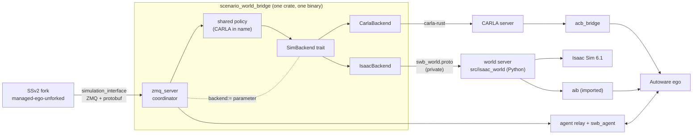
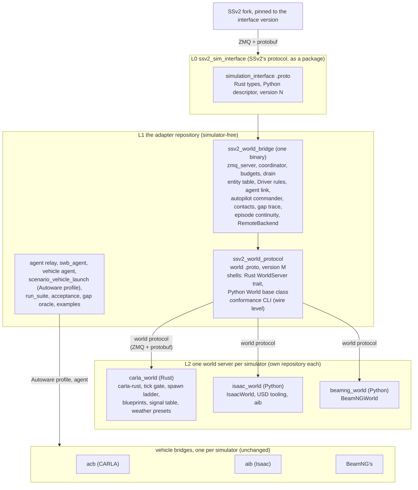
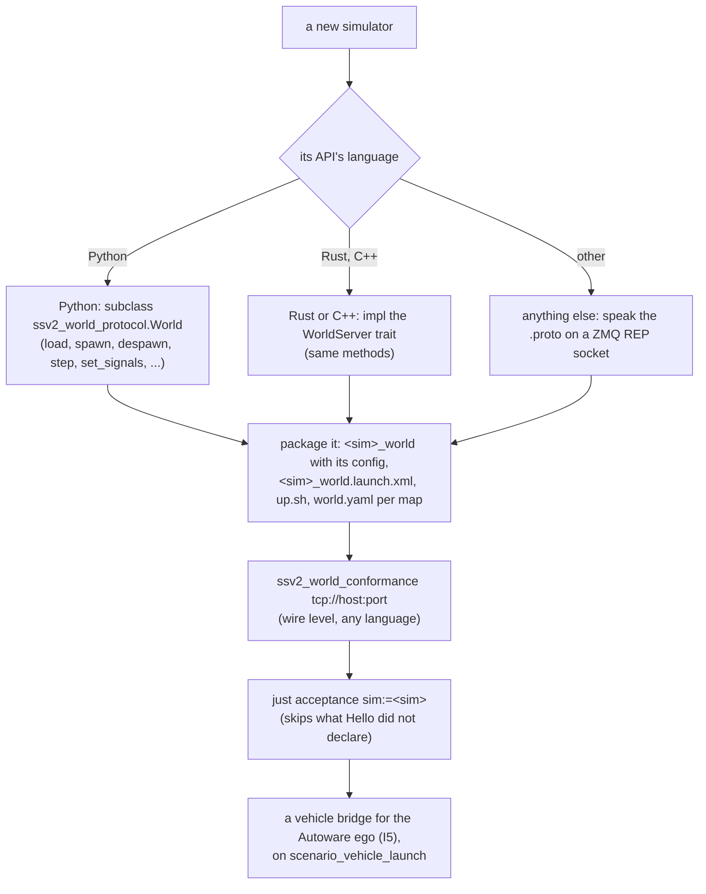
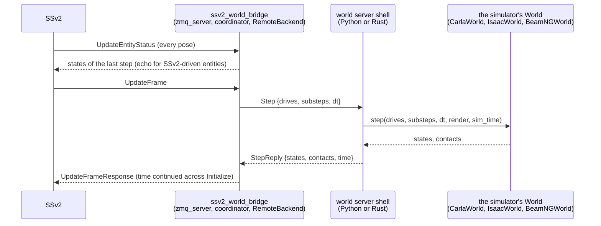

# One SSv2 simulator interface, one world server per simulator

**Date**: 2026-10-22, revised the same day after a porting walkthrough (below). **Status**:
proposal (user direction 2026-10-22: SSv2 and the simulators modular; swb is the CARLA glue,
a second glue for Isaac Sim, both standalone packages on one interface defined on SSv2's
side). Builds on [simulator-backends.md](simulator-backends.md) (the seam, roadmap 035) and
the as-built Isaac stack (037, 038, 043, 044, 045). Nothing here is implemented yet;
[roadmap 046](../roadmap/046-unified-world-interface.md) implements steps 1-6 inside this
repository (unify, test on both simulators) and then renames the project.

**Implemented** by [roadmap 046](../roadmap/046-unified-world-interface.md) (2026-10-22),
inside this repository and under the names `scenario-world-bridge` (`swb_`) after its part B.
Where the build departed from this design (two round trips per frame, who tracks and reads
back as capabilities, refusal rather than demotion, one config struct read from two files,
the bridge surviving a world server restart), the phase doc's "As built" says why.

The first draft of this document described the split as a move of today's modules into
three packages, with a Rust trait as the simulator interface. Walking a developer through
porting a fourth simulator against that draft (section "A porting walkthrough") showed that
the move alone leaves the next port as hard as the Isaac one was, and that a trait and a
wire protocol side by side are two interfaces where one is wanted (user direction, same
day: one unified way in). The revised design (section "Revised layering") makes the world
protocol the one simulator interface; the changes are listed under "What the walkthrough
changed".

## What exists

Roadmap 035 drew the seam as a Rust trait, `backend::SimBackend`, inside the one crate
`scenario_world_bridge`, and said that "a later split (an SSv2 adapter crate plus one crate
per simulator) is a move, not a rewrite". The crate today, by role (lines of Rust):

| role | where | size | depends on a simulator? |
|---|---|---|---|
| SSv2 protocol | `proto/` (SSv2's schemas + `swb_world.proto`), `build.rs`, `proto.rs` | | no (SSv2's), except `swb_world` (Isaac's) |
| adapter: socket, frame budget, panics, drain | `zmq_server.rs` | 826 | no |
| adapter: request to trait call to reply, `Driver` rules | `coordinator.rs`, `backend/mod.rs`, `backend/fake.rs` | 883 | no |
| policy both backends use | `agent_link`, `autopilot`, `budgets`, `body_clearance`, `contact_report`, `coordinate_conversion`, `entity_manager`, `gap_trace`, `map_resolver`, `npc_tracking`, `weather`, `world_services`, `config` | ~6 900 | no in substance, **CARLA in name and detail** (below) |
| policy only the CARLA backend uses | `actor_census`, `blueprint_boxes`, `episode_clock`, `clock_store`, `epoch_marker`, `lanelet_map`, `sensor_release`, `spawn_ladder`, `tick_gate`, `tick_watchdog`, `frame_stats` | ~3 300 | mostly CARLA (acb's epoch marker, CARLA's tick, blueprints) |
| CARLA glue | `backend/carla/` (backend, collision monitor, traffic-light mapper, resolved signals, version, weather) | 7 600 | carla-rust |
| Isaac glue, Rust half | `backend/isaac/` (`mod.rs` 1 567, `tracking.rs` 383, `signals.rs` 209, `tests.rs` 595) | 2 750 | `swb_world.proto` |
| Isaac glue, Python half | `src/isaac_world/` (`server.py` 188 and `protocol.py` 85 simulator-free; `world.py` 841 and the USD, physics, walker and catalogue modules Isaac's) + `scripts/` (Isaac install, town and vehicle export) | 2 260 | Isaac Sim, aib |

Around the crate: the SSv2 fork (`managed-ego-unforked`, 23 patches: the `agent` and
`simulator_autopilot` controllers, `UpdateEntityGoal`, the vehicle subtype in
`VehicleParameters`, bounded waits, `$(env)` in scenarios), the agent relay and `swb_agent`
(simulator-free), `swb_launch` (launch files for both simulators, `backend:=` chooses), the
justfile (CARLA and Isaac recipes side by side), one `bridge_config.yaml` holding both
simulators' keys, and the two vehicle bridges, already their own repositories: acb (CARLA)
and aib (Isaac, a submodule the world server imports). `proto/` is byte-identical to the
fork's `simulation_interface/proto` today (checked 2026-10-22), plus `swb_world.proto`.



## The gap

What stops swb and an Isaac glue from being two standalone packages on one interface:

1. **The interface is a trait inside one binary, not a package boundary.** Both backends
   are modules of `scenario_world_bridge`; the backend is chosen by a ROS parameter at run
   time; the binary links carla-rust whichever backend runs. Nothing a third party could
   depend on exists: no crate publishes `SimBackend`, no package publishes the protocol.
2. **The shared policy is written in CARLA's terms.** `episode_clock` ("simulation time as
   CARLA reports it", continued by acb's epoch marker), `contact_report` ("the run's CARLA
   contacts"), `gap_trace` ("SSv2's world and CARLA's"), `map_resolver` ("a CARLA town name
   from the map path", `map_alias`), `budgets` ("every time bound the bridge puts on
   CARLA"), `world_services` (`/scenario_world_bridge/set_weather`, `/scenario_world_bridge/get_weather`), and
   `coordinate_conversion` (the Y-flip) are all used by `IsaacBackend` too, with the CARLA
   parts stepped around. 035 noted this and left it to 037; 037 lifted what Isaac needed
   without renaming.
3. **Weather leaks through the trait.** `SimBackend::set_weather` takes
   `weather::WeatherRequest` and returns `world_services::WeatherReply`, both CARLA's
   parameter set (`swb_interfaces/Weather.msg` is CARLA's `WeatherParameters`). Isaac
   answers `Unsupported`. A sky or lighting preset is the general notion; CARLA's fourteen
   floats are its own.
4. **One configuration file for two simulators.** `bridge_config.yaml` has `carla:`,
   `isaac:`, `blueprint_map`, `traffic_manager`, `carla_tick_seconds`, `substeps`,
   `collision_monitor`, `npc_motion` side by side; `simulation.launch.xml` carries
   `isaac_*` and `carla_*` arguments both. A glue cannot ship its own schema.
5. **The Isaac glue is in two halves joined by a private protocol.** `IsaacBackend` (Rust,
   in swb) and the world server (Python, in swb) talk `swb_world.proto`. That is a fine
   internal shape, but today the protocol, its generator (`gen_world_proto.sh`,
   `swb_world.desc`), the Rust client and the Python server are spread over `proto/`,
   `backend/isaac/` and `src/isaac_world/`, and none of it can leave swb on its own.
6. **The protocol lives in the glue, not with SSv2.** `proto/` is a copy of SSv2's
   `simulation_interface` schemas plus the fork's additions. The fork and the copy drift
   independently; a second glue would copy them again. There is no package that says "this
   is the interface, version N".
7. **No conformance test for a glue.** The coordinator's tests run on `fake.rs`; each
   backend has its own unit tests; the only cross-simulator check is running the starter
   scenarios on both (`just acceptance ... backend:=`). Nothing says what a new backend must
   pass before it is a backend.
8. **Simulator-free Autoware-side pieces live in the CARLA repo.** aib depends on acb at
   run time for `acb_launch`'s Autoware profile and `acb_pilot` (the vehicle agent). The
   agent itself is already `swb_agent`'s (`acb_agent` runs `swb_agent`'s `AutowareAgent`);
   the launch profile is not.
9. **Launch and run tooling are entangled.** `swb_launch` holds `isaac_world.launch.xml`
   beside the CARLA launches; the justfile holds `isaac-*` recipes, `isaac_up.sh`, the
   world-server stack; `run_suite`, `acceptance.py` and the gap oracle are simulator-free but
   sit in the CARLA package.

Not a gap: the vehicle bridges (acb, aib) are already one package per simulator with the
same Autoware-facing contract; the agent protocol and relay are simulator-free; the trait's
vocabulary (entities by SSv2 name, map-frame poses, batched calls per request,
`BackendError` as a failed reply) is right and both backends honour it.

## A porting walkthrough

To test the first draft, this section follows a developer, call them Mina, who has a
BeamNG.tech licence and wants SSv2 scenarios with an Autoware ego on it. BeamNG.tech is a
fair stand-in for "the next simulator": a Python API only (no Rust or C++ client), lockstep
stepping, vehicles spawned and teleported by pose, lidar, camera, IMU and GNSS sensors on a
vehicle, its own vehicle physics, an AI traffic mode, no traffic lights and no Lanelet2 or
OpenDRIVE road network of its own. Every step below is written against the first draft's
three packages; the friction found at each is what the revision answers. The simulator's
name does not matter; a Gazebo or Webots port meets the same steps.

**Step 1, the first hour: what do I build, and in what language?** The draft gives Mina a
Rust crate `ssv2_sim_adapter` with a `SimBackend` trait and says "a third simulator is a
third binary on the same crate". BeamNG has no Rust API. Mina's choices are a Python
binding layer under a Rust backend, or what Isaac did: a Rust backend that talks to a
Python process over a socket. The second is the obvious one, and Isaac's two halves are
right there to copy, but `swb_world.proto`, `protocol.py`, `server.py` and `IsaacBackend`
are, in the draft, the Isaac glue's private property. Copying them means a second private
protocol, a second Rust client of 1 500 lines, and no shared conformance for either.

Reading `backend/isaac/mod.rs` with that question in mind gives the decisive finding: the
Rust half of the Isaac glue is almost entirely simulator-free. Its Isaac-specific content is
the `usd` field of `world.yaml`, the `isaac_version` string in `HelloReply`, the 60 Hz
physics substep constant and the `render` flag. The tracking law (`tracking.rs`) is the
adapter's `npc_tracking` applied through the wire's `TRACKED` motion; the signal table
(`signals.rs`) is the map's `traffic_lights.yaml` sent on `LoadWorld`; the world file is a
map-to-world lookup. The Python shell (`server.py`) already documents the six-method `World`
duck type it drives: `load`, `set_signals`, `spawn`, `despawn`, `step`, and a version
string. Mina needs exactly that shell with a `BeamNGWorld` behind it, and nothing in Rust.

*Friction 1*: the draft keeps the one thing a Python-API simulator needs inside one
simulator's glue.

**Step 2: the trait.** Suppose Mina does write Rust. `SimBackend` has 17 methods and no
default bodies. Six are lifecycle hooks (`before_serving`, `probe_connection_idle`,
`wedged`, `server_lost`, `abandon_after_hang`, `shutdown`, plus `take_tick_time`) whose
right answer for a first port is "nothing" or "none", and nothing says so. Four are things
BeamNG cannot do (`update_traffic_lights`, `attach_sensor`, `get_weather`, `set_weather`)
that must be hand-written to return `Unsupported`, and the adapter learns of the refusal
only by calling. `set_weather`'s types are CARLA's. Mina cannot tell the required core
from the optional surface by reading the trait.

*Friction 2*: no minimal implementation is visible, and the adapter cannot ask a backend
what it supports.

**Step 3: the map.** SSv2 sends `lanelet2_map_path`. The CARLA glue recovers a town name
from the directory name; the Isaac glue reads `<map dir>/isaac/world.yaml` (a USD path and
the map origin); both read `<map dir>/carla/traffic_lights.yaml` and `carla/map_origin.yaml`.
Mina has to author a BeamNG level that matches a Lanelet2 map, which is map work outside
any glue, and then tell the glue which level a map directory means. Nothing says where. The
`carla/` subdirectory name on files Isaac also reads says this grew rather than was designed.

*Friction 3*: the map directory's contract with a simulator is three ad-hoc conventions.

**Step 4: the vehicle side.** Autoware needs sensors, `/vehicle/status/*`, `/clock` and the
control subscription from a vehicle bridge (I5 in user-workflow.md). acb is a Rust node on
carla-rust; aib is a Python library imported by the process that owns the world, because
Isaac's sensors render there. BeamNG is the aib shape: sensors are polled through the same
Python connection that steps the world. aib's `aib.ros` (the Autoware vehicle interface and
sensor publishers in rclpy) and its spec-to-vehicle-description generator are simulator-free
in substance, and its Autoware launch profile is a 400-line include of acb's. Mina either
depends on acb and aib both, or copies.

*Friction 4*: the simulator-free Autoware-side pieces are spread over two simulator repos.

**Step 5: configuration, launch, bring-up.** Mina wants a `beamng:` section (host, port,
level, deterministic rate), a launch file that starts the bridge with the relay, and a
`just` entry that brings up world, bridge and ego in order and runs a scenario. Today each
of those is a hand edit to `config.rs`, `simulation.launch.xml`, the justfile's
`backend:=` branches and `isaac_up.sh`. The draft splits the config into adapter keys and a
`backend:` subtree but says nothing about launch or bring-up.

*Friction 5*: no stated shape for a glue's config, launch and bring-up, so each glue reinvents
them and the run tooling learns each by name.

**Step 6: am I done?** Mina runs the starter scenarios. `town01_pedestrian` passes;
`town01_signal_stop` fails because BeamNG has no lights; `town01_two_av` fails because
`simulator_autopilot` is unsupported. Whether those are bugs or expected is in Mina's head.
The draft names a conformance kit but not what a port that lacks a feature should report.

*Friction 6*: a conformance result cannot distinguish "wrong" from "not offered".

**Step 7: time.** acb publishes `/clock` as CARLA's frame time plus an episode epoch kept by
`episode_clock` and the epoch marker; the Isaac world server's clock is monotonic over its
lifetime and needs neither. Mina must learn which of the two shapes to copy. With a world
server, time is the server's and monotonic by construction, so the world-server path
answers this for free; the draft does not say so.
(Answered by roadmap 051: neither shape. Time is monotonic within an episode, and an
episode change ends the vehicle stacks, so no port keeps time across a world load.)

What did not hurt: the agent side. `swb_agent` and the relay need nothing from the
simulator; a BeamNG ego driven by Autoware registers with the relay exactly as the CARLA and
Isaac egos do. The trait's vocabulary (entities by SSv2 name, map-frame poses, one call per
request) also read as right at every step.

One more observation closes the walkthrough. Mina's cheapest path was the wire (a Python
world server), and the draft's trait-level path (a Rust backend linked into the adapter)
was never the better one for any simulator but CARLA, whose Rust client is already there.
Two ways in means two interfaces to keep conformant, two kits, and a choice at the start of
every port. The revision keeps one: the wire. (AWSIM, which implements SSv2's
`simulation_interface` natively in C#, is SSv2's concern and needs nothing from here.)


## What the walkthrough changed

1. **One way in: every simulator is a world server.** The world protocol (today
   `swb_world.proto`, the Isaac glue's private wire) becomes *the* simulator interface:
   language-neutral, versioned, published by the adapter. The adapter is one fixed binary
   that speaks SSv2 on one side and the world protocol on the other; the `SimBackend` trait
   becomes its internal seam (one implementation, `RemoteBackend`, and the fake for tests),
   not a public one. CARLA, Isaac and the next simulator are each a world server. A port is
   one process that implements the protocol, in whatever language its simulator's API has,
   with a shell provided in Python and in Rust.
2. **Declared capabilities.** A world server says in its `Hello` reply what it offers
   (signals, simulator autopilot, tracked NPC motion, weather, contacts); the adapter
   refuses what is not offered without asking, and the acceptance suite reports "skipped:
   needs signals" instead of a failure.
3. **The map directory's contract with a simulator is written down**:
   `<map dir>/<simulator>/world.yaml` (the world the map means, the map origin), and
   `<map dir>/traffic_lights.yaml` as an adapter-defined schema any simulator fills.
4. **A world server package has a fixed shape**: the server, its `backend:` config, a
   `<sim>_world.launch.xml`, a bring-up script `up.sh <map dir>` with the exit codes
   `isaac_up.sh` has today, and the package name `<sim>_world`. The run tooling dispatches
   on the name and never learns a simulator.
5. **The Autoware-side simulator-free pieces move to the adapter repository**: the launch
   profile out of acb, the vehicle agent `acb_pilot` beside `swb_agent` (it is `swb_agent`'s
   runner), and a written I5 contract. aib's pure generator and `aib.ros` are noted as the
   next candidates, not moved now.

Why one way and not three. A trait-level door (link a Rust backend into the adapter) and a
wire-level door (a world server) are two interfaces to keep conformant, two conformance
kits, two places a capability is declared, and a choice every port must make first. The
walkthrough's finding that the Isaac glue's Rust half is already a generic remote backend
means the wire-level door already carries everything the trait does, minus what only CARLA
needed (a tick gate, a spawn ladder, blueprint boxes, acb's sensor-release channel), and
those are CARLA's world server's business. The cost is one local ZMQ round trip per frame
for CARLA, which Isaac pays today without it showing in the budget (`frame_stats` measures
the SSv2 request end to end; the world server's step is the same thread's wait either way).
A simulator that already speaks SSv2's `simulation_interface` natively (AWSIM) is SSv2's
concern, not this design's: it needs nothing from here and gains nothing.

## Revised layering

Three layers, each a package someone else can depend on. "World server" is what the first
draft called a glue.



A port, in one sentence: implement the world protocol in a process that owns the simulator,
declare what it offers, drop a `world.yaml` beside each map, and pass the conformance CLI.



### L0: `ssv2_sim_interface`, SSv2's protocol as a package

One package holding the `simulation_interface` protobuf schemas exactly as the SSv2 fork
builds them (the fork's `simulation_interface` package points at it, or vendors a copy with
a test that the two are byte-identical; today they are), with a Rust crate (`prost` types,
today's `proto.rs`) and the Python descriptor. Its version is the interface version: the
fork's 23 patches define v1 (controllers `agent` and `simulator_autopilot`,
`UpdateEntityGoal`, the subtype, bounded waits). Upstreaming to tier4 is the long-term
home; until then this package is the spec, and the adapter states which version it
implements. Only the adapter depends on it; a simulator never sees it.

### L1: `ssv2_world_protocol`, the simulator interface

The one interface a simulator implements. It is today's `swb_world.proto` with the Isaac
details removed and the CARLA-only trait surface added, versioned on its own (M):

| message | today | change |
|---|---|---|
| `Hello` / `HelloReply` | protocol version, `isaac_version` | `simulator_name`, `simulator_version`, and `capabilities`: `SIGNALS`, `AUTOPILOT`, `TRACKED_MOTION`, `WEATHER`, `CONTACTS`, `EGO_PHYSICS` |
| `LoadWorld` | a USD path, ground paths, the map's signals | the `world.yaml` contents as the server's own string plus `map_origin`; `step_time` and `realtime_factor` from `Initialize`; same signals |
| `Spawn` / `SpawnReply` | kind, subtype, box, model, motion, pose | unchanged; `model` is the asset key after the adapter's asset map |
| `Despawn` | | unchanged |
| `Step` / `StepReply` | drives, substep count, render; states, contacts, time | the substep length sent, not a constant; `time` stays the server's, monotonic within an episode (051) |
| `SetSignals` | per-signal colour | unchanged |
| `SetGoal` | (none; `UpdateEntityGoal` is CARLA's Traffic Manager today) | new: entity, waypoints, clear, target speed; refused unless `AUTOPILOT` |
| `SetWeather` / `GetWeather` | (none; CARLA's fourteen floats through ROS) | new: preset name plus `map<string, double>`; reply with what was applied |
| `Shutdown` | | unchanged |

What the protocol fixes, as the trait does today: entities by SSv2 name (the handle is the
server's), poses at the entity origin in the world frame (the adapter applies `map_origin`;
a left-handed simulator flips inside its server), one `Step` per SSv2 frame carrying every
entity's drive, every failure a reply with text and never a success the simulator did not
deliver, time monotonic within an episode, with the episode's id beside it (roadmap 051:
an episode change ends the vehicle stacks, so no one carries time across it), contacts per step from whatever the server
senses, sensors never (the vehicle bridge owns them).

With it, in the same package:

- A Python shell: the `WorldServer` loop (today `server.py`, `protocol.py`, pure Python,
  tested on a fake world), a `World` abstract base class with the methods above, and
  `main(world_factory)` (today `world_server.py` minus its Isaac arguments).
- A Rust shell: a `WorldServer` trait with the same methods and the same loop, for a
  simulator with a Rust or C++ client (CARLA).
- The conformance CLI, `ssv2_world_conformance <endpoint>`: a wire-level client that runs
  the kit against any running server, whatever its language: hello and capabilities, load,
  spawn by name, step and read back, kinematic pose echo, tracked motion when declared,
  despawn of an unknown handle fails, signals set and read back through a second load when
  declared, weather round trip when declared, time monotonic across loads. One kit, because
  there is one interface.

### L1: `ssv2_world_bridge`, the adapter

One binary (an ament_cargo package) that is today's crate minus every simulator: it serves
SSv2 (`zmq_server`, `coordinator`, budgets, the drain and the hung-request exit), keeps the
entity table and the `Driver` rules, links agents through the relay, commands simulator
autopilots, writes contacts and the gap trace, keeps time continuous across `Initialize`,
and talks to exactly one world server through `RemoteBackend` (today's `IsaacBackend` with
`tracking.rs` and `signals.rs`, Isaac's four details gone). Inside, `SimBackend` remains as
the seam between the coordinator and `RemoteBackend`, with the fake for the coordinator's
tests; it is not exported.

- The policy modules renamed to what they are: `episode_clock` ("simulation time continued
  across reloads"), `contact_report`, `gap_trace` ("SSv2's world against the
  simulator's"), `map_resolver` (the map directory, its origin and the simulator's
  `world.yaml` under it), `budgets` (SSv2's deadlines, with the world request timeouts),
  `coordinate_conversion` (the ROS-frame helpers only; the Y-flip leaves with CARLA).
- Weather through the protocol: the ROS services become `/<node>/set_weather` and
  `/<node>/get_weather` on a generic message (preset plus parameters); `swb_interfaces`'
  CARLA `Weather.msg` goes with the CARLA server, which may serve CARLA's own service beside
  it if the fourteen floats are wanted.
- Configuration in two parts: the adapter's keys (`ssv2`, `world` endpoint and timeouts,
  `agent_relay`, `npc_motion`, `gap_trace_dir`, `contact_report_dir`, `weather`, `ego`,
  `asset_map`) and nothing else; a world server has its own config file, which is its
  business.
- The agent relay, `swb_agent`, the vehicle agent (today acb's `acb_pilot`, which runs
  `swb_agent`'s `AutowareAgent`), `run_suite`, `acceptance.py`, the gap oracle, the starter
  scenarios (`swb_examples`), `scenario.launch.xml` and `simulation.launch.xml` (the bridge
  plus the relay, taking the world endpoint): already simulator-free, they sit beside the
  bridge.

Cargo enforces the boundary: the adapter repository has no simulator dependency at all.

One SSv2 frame through the layers, the same for every simulator:



### L2: one world server per simulator, standalone

Each is a package `<sim>_world` with the same shape, in its own repository:

| the package ships | `carla_world` (Rust) | `isaac_world` (Python) | `beamng_world` (Python) |
|---|---|---|---|
| the server | the `WorldServer` trait on carla-rust: today's `CarlaBackend` plus `blueprint_boxes`, `actor_census`, `spawn_ladder`, `tick_gate`, `tick_watchdog`, `lanelet_map`, `sensor_release` (acb's channel), the collision monitor, the traffic-light mapper, the weather presets, the version pin | `IsaacWorld`: today's `world.py` and the USD, physics, walker and catalogue modules, importing aib for the ego | `BeamNGWorld` on the Python API |
| its config | `carla_world.yaml`: host, port, substeps, tick seconds, traffic manager, blueprint map | endpoint, render, physics rate, ego config | host, port, level, deterministic rate |
| `<sim>_world.launch.xml` | the server under play_launch, respawned | today's `isaac_world.launch.xml` | likewise |
| `scripts/up.sh <map dir>` | starts or reuses the simulator, the world server, the simulation side and the ego stack, in order, waiting for each; refuses another simulator's stack on the same web port; appends what it started to `$SIM_UP_STARTED` | today's `isaac_up.sh` | likewise |
| `<map dir>/<sim>/world.yaml` | `town`, `map_origin` | `world` (USD), `ground_paths`, `map_origin` | `world` (level), `map_origin` |
| its tooling | `carla-start`, `download_maps.sh`, the towns, `--generate-signal-table` | the Isaac install, town and vehicle export, `isaac-health`, `isaac-town` | |
| its vehicle bridge | acb, a separate ROS node | aib, a submodule the `World` imports | its own, on `scenario_vehicle_launch` |

The adapter repository's `just scenario|acceptance|e2e <xosc> sim:=<name>` finds
`<name>_world` in the sourced workspace, runs its `up.sh`, and starts the scenario;
`sim:=carla` is the default. The recipes know the contract, not the simulators. The
`backend` parameter goes.

### The map directory's contract

A map directory is Autoware's layout plus what the simulators need, each under its own
name:

```
<map dir>/  lanelet2_map.osm  pointcloud_map.pcd  map_projector_info.yaml  ...
            traffic_lights.yaml          adapter schema: Lanelet2 way id, regulatory
                                         elements, the simulator's signal id, position
            carla/world.yaml             town: Town01, map_origin: {x, y, z}
            isaac/world.yaml             world: Town01_physics.usda, ground_paths, map_origin
            beamng/world.yaml            world: west_coast_usa, map_origin
```

The adapter reads `<map dir>/<simulator name>/world.yaml` (the name from `HelloReply`),
takes `map_origin` for itself and sends the rest in `LoadWorld` as the server's string; a
missing file is the server's default (CARLA: the directory name as the town; a ground plane
elsewhere); a file that does not parse fails `Initialize`, as today. `traffic_lights.yaml`
moves up one level because every simulator with signals reads it; the CARLA server keeps
writing it with `--generate-signal-table`, and a server without signals never receives it.
`carla/map_origin.yaml` folds into `carla/world.yaml`; acb's `map_origin_path` default
follows. The map itself (a level that matches a Lanelet2 map in one frame, offset recorded
as `map_origin`) is map authoring, outside every world server; the user guide's section 2
says so for CARLA and gets a paragraph per simulator.

### The vehicle side

The vehicle bridges stay one per simulator. What moves to the adapter repository:

- `scenario_vehicle_launch`: acb's `carla_simulator.launch.xml` minus `acb_bridge`, the
  Autoware profile tuned for a simulated car, which acb's and aib's launches then include
  with their vehicle and sensor models. aib stops depending on acb.
- The vehicle agent (`acb_pilot`'s `acb_agent`), which is `swb_agent`'s `AutowareAgent`
  with a launch wrapper, beside `swb_agent`.
- The I5 contract written down in the adapter's docs: the topics and message set
  (`/sensing/*`, `/vehicle/status/*`, `/control/command/*`, `/clock`, the signal V2X
  table from `traffic_lights.yaml`), the frames, and the clock rule: one `/clock` per
  domain, carrying the world server's time, so that the vehicle bridge and the adapter
  agree without an epoch marker: time is the frame's time plus a constant, monotonic
  within an episode, and an episode change ends the vehicle stack (roadmap 051,
  time-and-ticking "Episodes and vehicle stacks").

Later candidates, named so the next port can ask for them: aib's pure spec-to-description
generator (`aib.gen`, `aib.spec`) and `aib.ros` (the rclpy vehicle interface and sensor
publishers), which a Python world server would import as they are.

### The walkthrough, replayed on the revised design

Mina's port: a `beamng_world` package with a `BeamNGWorld` class (`load` opens the level
named by `beamng/world.yaml`, `spawn` adds a vehicle or a static prop at the pose, `step`
calls the lockstep step for the substeps and reads every vehicle's pose back, `despawn`
removes it; `hello` declares `CONTACTS` and `TRACKED_MOTION`, not `SIGNALS` or
`AUTOPILOT`), a vehicle bridge that publishes the ego's sensors and status from the same
connection, `beamng/world.yaml` beside each map, `beamng_world.launch.xml`, `up.sh`, and
its own config file. `ssv2_world_conformance` passes against the running server before the
adapter is ever started; `just acceptance sim:=beamng` reports the signal and autopilot
scenarios as skipped for a declared reason and the rest as passed or failed. No Rust, no
copy of another simulator's package, no edit to the adapter, and no choice to make at the
start.

## How to get there

**2026-10-23**: steps 1-6 were done by [046](../roadmap/046-unified-world-interface.md).
Steps 7 and 8, and what 046 left (L0 as a package, the protocol in its own repository, the
clock), land together in [051](../roadmap/051-target-shape.md), the target shape in one
landing, with [vehicle-side.md](vehicle-side.md).

Package-level first, repository-level second: the first is a move inside this workspace
that the existing tests and exit runs can prove changed nothing; the second is then a
`git mv` with history. The CARLA path is the one with risk, so it goes last among the
servers and is measured.

1. **Protocol package** `ssv2_sim_interface` (proto, build, Rust types, Python descriptor);
   the SSv2 submodule's `simulation_interface` checked against it by a test.
2. **World protocol package** `ssv2_world_protocol`: `swb_world.proto` renamed and
   generalised (`simulator_name`, `capabilities`, the world string, `step_time` in
   `LoadWorld`, the substep length in `Step`, `SetGoal`, `SetWeather`/`GetWeather`); the
   Python shell from `server.py`, `protocol.py` and `world_server.py` with `World` as a
   base class; the conformance CLI grown from `test_server.py` and the coordinator's
   fake-backend tests. The Isaac world server runs on it with no behaviour change (the
   043/045 exit runs: `town01_ego_drive` 5/5, tracking within `acceptance.py`'s limits).
3. **Adapter binary** `ssv2_world_bridge`: `IsaacBackend` renamed `RemoteBackend` and made
   the only backend; `CarlaBackend` and the CARLA-only modules move out to step 5's crate;
   the policy modules renamed; generic weather; the config reduced; `backend:=` removed.
   Checked on Isaac as in step 2.
4. **Map contract**: `map_resolver` reads `<map dir>/<simulator>/world.yaml`; CARLA's town
   and origin move into `carla/world.yaml` with the old files read as a fallback for one
   release; `traffic_lights.yaml` moves up with a fallback likewise; acb's defaults follow.
5. **CARLA as a world server** `carla_world`: the Rust `WorldServer` shell wrapping today's
   `CarlaBackend` and its modules; `UpdateEntityGoal` through `SetGoal`; the weather presets
   behind `SetWeather`; the sensor-release channel and the signal-table generator inside it.
   Checked by the CARLA suite, the 033 demo tour, and `frame_stats` before and after (the
   added hop must not show against the 10 ms budget; Isaac's numbers say it will not).
6. **Isaac as a package** `isaac_world` in this workspace: `IsaacWorld` and its modules,
   the USD tooling, the launch, `up.sh` from `isaac_up.sh`; the recipes dispatch on
   `sim:=`.
7. **Vehicle launch profile** out of acb into `scenario_vehicle_launch`, the vehicle agent
   beside `swb_agent`; aib's `isaac_simulator.launch.xml` and acb's
   `carla_simulator.launch.xml` include the profile; the I5 contract written.
8. **Repositories**: `isaac_world` and `carla_world` to their own repositories (aib and acb
   as their submodules), then the adapter layer (interface, world protocol, bridge, relay,
   agent SDK and agent, vehicle launch, examples, run tooling) to a `scenario_sim_adapter`
   repository that every world server pins for its tests. Each server repo builds as acb
   does today (its own colcon workspace).

Open points for the user: the names (`ssv2_world_bridge` says what it is; the repo could
keep "swb" for the adapter and name the CARLA server `carla_world`); whether to upstream
the SSv2 interface patches to tier4 before or after the split; whether the gap campaign
(024-026, 039) wants the gap oracle in the adapter repo or beside the scenarios; whether
`aib.ros` and the generator move with step 7 or wait for the first Python port that asks.

## Risks

- **The CARLA hop.** CARLA's world server adds a local ZMQ round trip to every frame and
  moves `tick_gate`, `tick_watchdog` and the hung-tick exit (034) into the server, where a
  hung LibCarla call now wedges the server, and the adapter sees a request timeout as it
  does with Isaac. Same outcome (the adapter drains, exits 75, the supervisor restarts), one
  more process to restart. Measured in step 5; the Isaac path has run this way since 037.
- **The world protocol becomes a public contract.** Today a `swb_world` change bumps
  `PROTOCOL_VERSION` on both halves in one commit; with three servers, the proto needs a
  compatibility rule (additive fields only within a major version, as the `model` field was
  added) and the conformance CLI as its test.
- **Capabilities can lie.** A server that declares `SIGNALS` and ignores `SetSignals` passes
  a shallow kit and fails scenarios silently. The kit must read a signal back through the
  server's own state, and the acceptance suite must include one scenario per capability.
- **ament_cargo across repositories**: the Rust shell is a library crate the CARLA server
  depends on; across repositories it is vendored as a submodule or published. To be tried
  in step 5 before the repository split.
- **Trait churn is over, protocol churn begins**: 044's trait changes have landed
  (2026-10-22); the next Isaac phase (039: several egos, V2X) will want protocol additions.
  Do them on the split packages, not on both layouts at once.
- **The renames are large diffs** over code with measured behaviour (budgets, episode clock,
  npc tracking). Rename without reflowing; keep each module's tests; re-run the CARLA
  suite and the Isaac exit runs after each step, not at the end.
