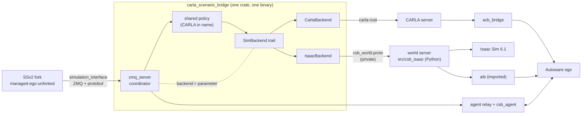
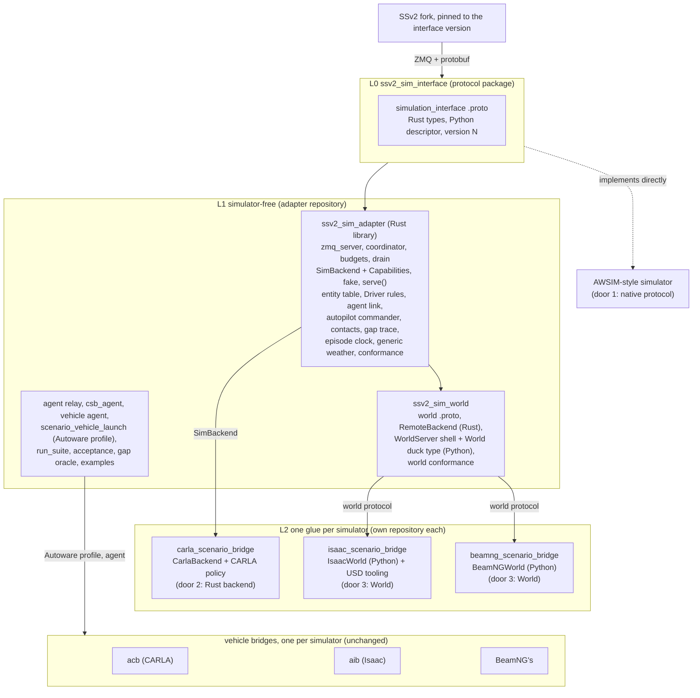
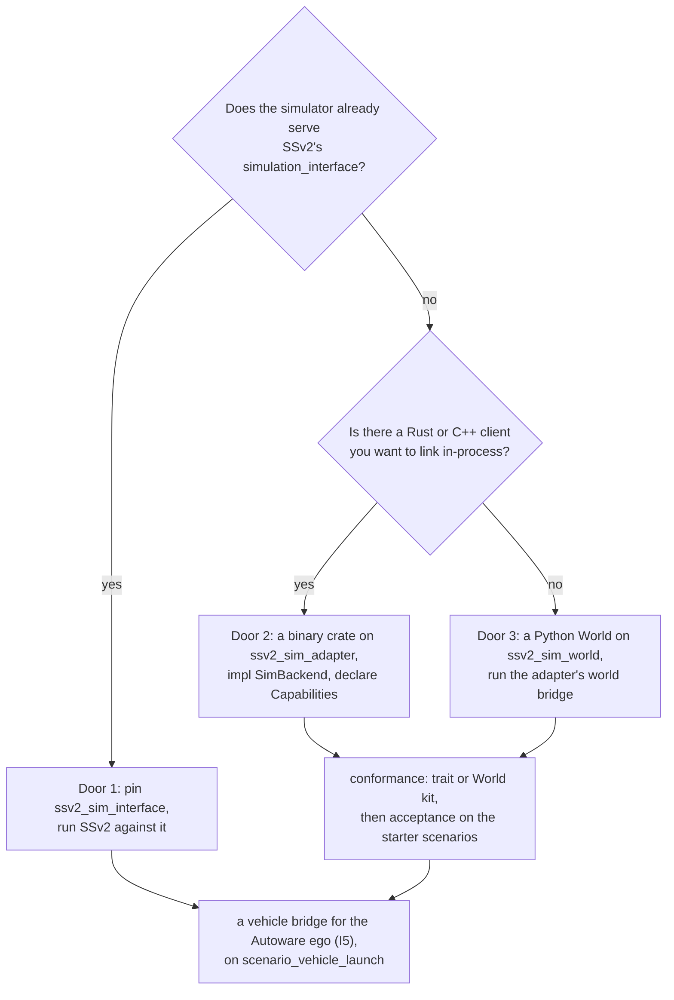
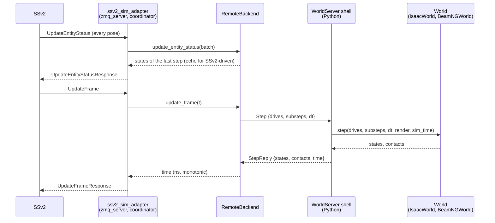

# One SSv2 simulator interface, one glue per simulator

**Date**: 2026-10-22, revised the same day after a porting walkthrough (below). **Status**:
proposal (user direction 2026-10-22: SSv2 and the simulators modular; csb is the CARLA glue,
a second glue for Isaac Sim, both standalone packages on one interface defined on SSv2's
side). Builds on [simulator-backends.md](simulator-backends.md) (the seam, roadmap 035) and
the as-built Isaac stack (037, 038, 043, 044, 045). Nothing here is implemented yet.

The first draft of this document described the split as a move of today's modules into
three packages. Walking a developer through porting a fourth simulator against that draft
(section "A porting walkthrough") showed that the move alone leaves the next port as hard as
the Isaac one was. The revised design (section "Revised layering") changes five things,
listed under "What the walkthrough changed".

## What exists

Roadmap 035 drew the seam as a Rust trait, `backend::SimBackend`, inside the one crate
`carla_scenario_bridge`, and said that "a later split (an SSv2 adapter crate plus one crate
per simulator) is a move, not a rewrite". The crate today, by role (lines of Rust):

| role | where | size | depends on a simulator? |
|---|---|---|---|
| SSv2 protocol | `proto/` (SSv2's schemas + `csb_world.proto`), `build.rs`, `proto.rs` | | no (SSv2's), except `csb_world` (Isaac's) |
| adapter: socket, frame budget, panics, drain | `zmq_server.rs` | 826 | no |
| adapter: request to trait call to reply, `Driver` rules | `coordinator.rs`, `backend/mod.rs`, `backend/fake.rs` | 883 | no |
| policy both backends use | `agent_link`, `autopilot`, `budgets`, `body_clearance`, `contact_report`, `coordinate_conversion`, `entity_manager`, `gap_trace`, `map_resolver`, `npc_tracking`, `weather`, `world_services`, `config` | ~6 900 | no in substance, **CARLA in name and detail** (below) |
| policy only the CARLA backend uses | `actor_census`, `blueprint_boxes`, `episode_clock`, `clock_store`, `epoch_marker`, `lanelet_map`, `sensor_release`, `spawn_ladder`, `tick_gate`, `tick_watchdog`, `frame_stats` | ~3 300 | mostly CARLA (acb's epoch marker, CARLA's tick, blueprints) |
| CARLA glue | `backend/carla/` (backend, collision monitor, traffic-light mapper, resolved signals, version, weather) | 7 600 | carla-rust |
| Isaac glue, Rust half | `backend/isaac/` (`mod.rs` 1 567, `tracking.rs` 383, `signals.rs` 209, `tests.rs` 595) | 2 750 | `csb_world.proto` |
| Isaac glue, Python half | `src/csb_isaac/` (`server.py` 188 and `protocol.py` 85 simulator-free; `world.py` 841 and the USD, physics, walker and catalogue modules Isaac's) + `scripts/` (Isaac install, town and vehicle export) | 2 260 | Isaac Sim, aib |

Around the crate: the SSv2 fork (`managed-ego-unforked`, 23 patches: the `agent` and
`simulator_autopilot` controllers, `UpdateEntityGoal`, the vehicle subtype in
`VehicleParameters`, bounded waits, `$(env)` in scenarios), the agent relay and `csb_agent`
(simulator-free), `csb_launch` (launch files for both simulators, `backend:=` chooses), the
justfile (CARLA and Isaac recipes side by side), one `bridge_config.yaml` holding both
simulators' keys, and the two vehicle bridges, already their own repositories: acb (CARLA)
and aib (Isaac, a submodule the world server imports). `proto/` is byte-identical to the
fork's `simulation_interface/proto` today (checked 2026-10-22), plus `csb_world.proto`.



## The gap

What stops csb and an Isaac glue from being two standalone packages on one interface:

1. **The interface is a trait inside one binary, not a package boundary.** Both backends
   are modules of `carla_scenario_bridge`; the backend is chosen by a ROS parameter at run
   time; the binary links carla-rust whichever backend runs. Nothing a third party could
   depend on exists: no crate publishes `SimBackend`, no package publishes the protocol.
2. **The shared policy is written in CARLA's terms.** `episode_clock` ("simulation time as
   CARLA reports it", continued by acb's epoch marker), `contact_report` ("the run's CARLA
   contacts"), `gap_trace` ("SSv2's world and CARLA's"), `map_resolver` ("a CARLA town name
   from the map path", `map_alias`), `budgets` ("every time bound the bridge puts on
   CARLA"), `world_services` (`/carla/set_weather`, `/carla/get_weather`), and
   `coordinate_conversion` (the Y-flip) are all used by `IsaacBackend` too, with the CARLA
   parts stepped around. 035 noted this and left it to 037; 037 lifted what Isaac needed
   without renaming.
3. **Weather leaks through the trait.** `SimBackend::set_weather` takes
   `weather::WeatherRequest` and returns `world_services::WeatherReply`, both CARLA's
   parameter set (`csb_interfaces/Weather.msg` is CARLA's `WeatherParameters`). Isaac
   answers `Unsupported`. A sky or lighting preset is the general notion; CARLA's fourteen
   floats are its own.
4. **One configuration file for two simulators.** `bridge_config.yaml` has `carla:`,
   `isaac:`, `blueprint_map`, `traffic_manager`, `carla_tick_seconds`, `substeps`,
   `collision_monitor`, `npc_motion` side by side; `simulation.launch.xml` carries
   `isaac_*` and `carla_*` arguments both. A glue cannot ship its own schema.
5. **The Isaac glue is in two halves joined by a private protocol.** `IsaacBackend` (Rust,
   in csb) and the world server (Python, in csb) talk `csb_world.proto`. That is a fine
   internal shape, but today the protocol, its generator (`gen_world_proto.sh`,
   `csb_world.desc`), the Rust client and the Python server are spread over `proto/`,
   `backend/isaac/` and `src/csb_isaac/`, and none of it can leave csb on its own.
6. **The protocol lives in the glue, not with SSv2.** `proto/` is a copy of SSv2's
   `simulation_interface` schemas plus the fork's additions. The fork and the copy drift
   independently; a second glue would copy them again. There is no package that says "this
   is the interface, version N".
7. **No conformance test for a glue.** The coordinator's tests run on `fake.rs`; each
   backend has its own unit tests; the only cross-simulator check is running the starter
   scenarios on both (`just acceptance ... backend:=`). Nothing says what a new backend must
   pass before it is a backend.
8. **Simulator-free Autoware-side pieces live in the CARLA repo.** aib depends on acb at
   run time for `acb_launch`'s Autoware profile and `acb_pilot` (the vehicle agent). The
   agent itself is already `csb_agent`'s (`acb_agent` runs `csb_agent`'s `AutowareAgent`);
   the launch profile is not.
9. **Launch and run tooling are entangled.** `csb_launch` holds `isaac_world.launch.xml`
   beside the CARLA launches; the justfile holds `isaac-*` recipes, `isaac_up.sh`, the
   world-server stack; `run_suite`, `acceptance.py` and the gap oracle are simulator-free but
   sit in the CARLA package.

Not a gap: the vehicle bridges (acb, aib) are already one package per simulator with the
same Autoware-facing contract; the agent protocol and relay are simulator-free; the trait's
vocabulary (entities by SSv2 name, map-frame poses, batched calls per request,
`BackendError` as a failed reply) is right and both backends honour it.

## A porting walkthrough

To test the first draft, this section follows a developer, call them Mina, who has a
BeamNG.tech licence and wants SSv2 scenarios with an Autoware ego on it. BeamNG.tech is a
fair stand-in for "the next simulator": a Python API only (no Rust or C++ client), lockstep
stepping, vehicles spawned and teleported by pose, lidar, camera, IMU and GNSS sensors on a
vehicle, its own vehicle physics, an AI traffic mode, no traffic lights and no Lanelet2 or
OpenDRIVE road network of its own. Every step below is written against the first draft's
three packages; the friction found at each is what the revision answers. The simulator's
name does not matter; a Gazebo or Webots port meets the same steps.

**Step 1, the first hour: what do I build, and in what language?** The draft gives Mina a
Rust crate `ssv2_sim_adapter` with a `SimBackend` trait and says "a third simulator is a
third binary on the same crate". BeamNG has no Rust API. Mina's choices are a Python
binding layer under a Rust backend, or what Isaac did: a Rust backend that talks to a
Python process over a socket. The second is the obvious one, and Isaac's two halves are
right there to copy, but `csb_world.proto`, `protocol.py`, `server.py` and `IsaacBackend`
are, in the draft, the Isaac glue's private property. Copying them means a second private
protocol, a second Rust client of 1 500 lines, and no shared conformance for either.

Reading `backend/isaac/mod.rs` with that question in mind gives the decisive finding: the
Rust half of the Isaac glue is almost entirely simulator-free. Its Isaac-specific content is
the `usd` field of `world.yaml`, the `isaac_version` string in `HelloReply`, the 60 Hz
physics substep constant and the `render` flag. The tracking law (`tracking.rs`) is the
adapter's `npc_tracking` applied through the wire's `TRACKED` motion; the signal table
(`signals.rs`) is the map's `traffic_lights.yaml` sent on `LoadWorld`; the world file is a
map-to-world lookup. The Python shell (`server.py`) already documents the six-method `World`
duck type it drives: `load`, `set_signals`, `spawn`, `despawn`, `step`, and a version
string. Mina needs exactly that shell with a `BeamNGWorld` behind it, and nothing in Rust.

*Friction 1*: the draft keeps the one thing a Python-API simulator needs inside one
simulator's glue.

**Step 2: the trait.** Suppose Mina does write Rust. `SimBackend` has 17 methods and no
default bodies. Six are lifecycle hooks (`before_serving`, `probe_connection_idle`,
`wedged`, `server_lost`, `abandon_after_hang`, `shutdown`, plus `take_tick_time`) whose
right answer for a first port is "nothing" or "none", and nothing says so. Four are things
BeamNG cannot do (`update_traffic_lights`, `attach_sensor`, `get_weather`, `set_weather`)
that must be hand-written to return `Unsupported`, and the adapter learns of the refusal
only by calling. `set_weather`'s types are CARLA's. Mina cannot tell the required core
from the optional surface by reading the trait.

*Friction 2*: no minimal implementation is visible, and the adapter cannot ask a backend
what it supports.

**Step 3: the map.** SSv2 sends `lanelet2_map_path`. The CARLA glue recovers a town name
from the directory name; the Isaac glue reads `<map dir>/isaac/world.yaml` (a USD path and
the map origin); both read `<map dir>/carla/traffic_lights.yaml` and `carla/map_origin.yaml`.
Mina has to author a BeamNG level that matches a Lanelet2 map, which is map work outside
any glue, and then tell the glue which level a map directory means. Nothing says where. The
`carla/` subdirectory name on files Isaac also reads says this grew rather than was designed.

*Friction 3*: the map directory's contract with a simulator is three ad-hoc conventions.

**Step 4: the vehicle side.** Autoware needs sensors, `/vehicle/status/*`, `/clock` and the
control subscription from a vehicle bridge (I5 in user-workflow.md). acb is a Rust node on
carla-rust; aib is a Python library imported by the process that owns the world, because
Isaac's sensors render there. BeamNG is the aib shape: sensors are polled through the same
Python connection that steps the world. aib's `aib.ros` (the Autoware vehicle interface and
sensor publishers in rclpy) and its spec-to-vehicle-description generator are simulator-free
in substance, and its Autoware launch profile is a 400-line include of acb's. Mina either
depends on acb and aib both, or copies.

*Friction 4*: the simulator-free Autoware-side pieces are spread over two simulator repos.

**Step 5: configuration, launch, bring-up.** Mina wants a `beamng:` section (host, port,
level, deterministic rate), a launch file that starts the bridge with the relay, and a
`just` entry that brings up world, bridge and ego in order and runs a scenario. Today each
of those is a hand edit to `config.rs`, `simulation.launch.xml`, the justfile's
`backend:=` branches and `isaac_up.sh`. The draft splits the config into adapter keys and a
`backend:` subtree but says nothing about launch or bring-up.

*Friction 5*: no stated shape for a glue's config, launch and bring-up, so each glue reinvents
them and the run tooling learns each by name.

**Step 6: am I done?** Mina runs the starter scenarios. `town01_pedestrian` passes;
`town01_signal_stop` fails because BeamNG has no lights; `town01_two_av` fails because
`simulator_autopilot` is unsupported. Whether those are bugs or expected is in Mina's head.
The draft names a conformance kit but not what a port that lacks a feature should report.

*Friction 6*: a conformance result cannot distinguish "wrong" from "not offered".

**Step 7: time.** acb publishes `/clock` as CARLA's frame time plus an episode epoch kept by
`episode_clock` and the epoch marker; the Isaac world server's clock is monotonic over its
lifetime and needs neither. Mina must learn which of the two shapes to copy. With a world
server, time is the server's and monotonic by construction, so the world-server path
answers this for free; the draft does not say so.

What did not hurt: the agent side. `csb_agent` and the relay need nothing from the
simulator; a BeamNG ego driven by Autoware registers with the relay exactly as the CARLA and
Isaac egos do. The trait's vocabulary (entities by SSv2 name, map-frame poses, one call per
request) also read as right at every step.

The AWSIM case closes the walkthrough: AWSIM implements SSv2's `simulation_interface`
natively, in C#, with no glue. A simulator that wants that path needs only the protocol
package. So there are three doors into SSv2, and the design should name all three.

## What the walkthrough changed

1. **The world protocol is promoted from the Isaac glue to the adapter layer** as its own
   package, `ssv2_sim_world`: the `.proto` (renamed from `csb_world`), the Python
   `WorldServer` shell with the `World` duck type, and a generic Rust `RemoteBackend` (today's
   `IsaacBackend` minus four Isaac details). A Python-API simulator ports by writing one
   Python class; the Isaac glue becomes the first `World`, and its Rust half disappears.
2. **The trait gets a required core, defaulted lifecycle hooks and declared capabilities.**
   `Capabilities` (signals, simulator autopilot, agent-driven vehicles, tracked NPC motion,
   weather, contacts) is declared once; the adapter refuses what is not declared without
   calling, and the acceptance suite reports "skipped: needs signals" instead of a failure.
3. **The map directory's contract with a simulator is written down**:
   `<map dir>/<simulator>/world.yaml` (the world the map means, the map origin), and
   `<map dir>/traffic_lights.yaml` as an adapter-defined schema any simulator fills.
4. **A glue has a fixed shape**: a `backend:` config subtree the glue owns, a
   `<sim>_simulation.launch.xml`, a bring-up script `up.sh <map dir>` with the exit codes
   `isaac_up.sh` has today, and a package name `<sim>_scenario_bridge`. The run tooling
   dispatches on the name and never learns a simulator.
5. **The Autoware-side simulator-free pieces move to the adapter repository**: the launch
   profile out of acb, the vehicle agent `acb_pilot` beside `csb_agent` (it is `csb_agent`'s
   runner), and a written I5 contract. aib's pure generator and `aib.ros` are noted as the
   next candidates, not moved now.

## Revised layering

Three layers, each a package someone else can depend on, with three doors into the system.
"Glue" is what this repository calls a scenario bridge.



### The three doors

| door | who | what they implement | what they depend on |
|---|---|---|---|
| 1. native protocol | a simulator with its own SSv2 server (AWSIM's shape) | `simulation_interface` v N | `ssv2_sim_interface` only |
| 2. Rust backend | a simulator with a Rust or C++ client worth linking (CARLA) | `SimBackend` core + declared capabilities | `ssv2_sim_adapter` |
| 3. world server | a simulator with a Python API or one whose sensors must render in the stepping process (Isaac, BeamNG, Gazebo through its Python bindings) | the Python `World` duck type | `ssv2_sim_world` (which brings the adapter) |

Door 3 is the default recommendation for a new port: one process owns the simulator, the
bridge binary is the adapter's own `ssv2_sim_world` executable, time is the world's and
monotonic, and the port's Rust content is zero.



### L0: `ssv2_sim_interface`, the protocol

One package holding the `simulation_interface` protobuf schemas exactly as the SSv2 fork
builds them (the fork's `simulation_interface` package points at it, or vendors a copy with
a test that the two are byte-identical; today they are), with a Rust crate (`prost` types,
today's `proto.rs`) and the Python descriptor. Its version is the interface version: the
fork's 23 patches define v1 (controllers `agent` and `simulator_autopilot`,
`UpdateEntityGoal`, the subtype, bounded waits). Upstreaming to tier4 is the long-term
home; until then this package is the spec, and a glue states which version it implements.
The world protocol is not here: it is the adapter's, below.

### L1: `ssv2_sim_adapter`, the simulator-free core

A library crate (ament_cargo package, path dependency for the glues) that is everything in
the crate that knows no simulator, made to say so:

- `zmq_server`, `coordinator`, `SimBackend` and its types, `fake` (exported, for tests), and
  a `serve(config, backend)` entry that is today's `main.rs` minus the backend choice.
- **The trait, restated.** A required core: `initialize`, `update_frame`,
  `update_step_time`, `spawn`, `despawn`, `update_entity_status`, `entity_count`,
  `capabilities`. Capability-gated methods with default bodies that answer `Unsupported`:
  `update_entity_goal` (needs `SimulatorAutopilot` or `AgentDriven`),
  `update_traffic_lights` (`Signals`), `set_weather`/`get_weather` (`Weather`),
  `attach_sensor` (never: the vehicle bridge owns sensors; the default refusal stays).
  Lifecycle hooks with default bodies: `before_serving`, `probe_connection_idle`,
  `take_tick_time`, `wedged`, `server_lost`, `abandon_after_hang`, `shutdown`. The
  coordinator checks `capabilities()` before a gated call, so a refusal never reaches a
  backend that did not opt in, and `Driver::of_vehicle` demotes `SimulatorAutopilot` to
  `Scenario` with a logged reason when the capability is absent rather than failing the
  spawn.
- The policy modules both backends use, renamed to what they are: `episode_clock`
  ("simulation time continued across reloads"; the epoch marker becomes a backend hook,
  `fn epoch_marker(&self) -> Option<...>`, default none), `contact_report` (the report
  format; who produces contacts is the backend), `gap_trace` ("SSv2's world against the
  simulator's"), `map_resolver` (the map directory, its origin and the simulator's
  `world.yaml` under it; see the map contract), `budgets` (SSv2's deadlines; the backend
  declares its own inner bounds), `coordinate_conversion` (the ROS-frame helpers; the
  Y-flip moves into the CARLA glue).
- Weather as a generic request: a preset name plus an optional `map<string, double>` of
  parameters, replied with what the backend applied; the ROS services become
  `/<node>/set_weather`, `/<node>/get_weather` on a generic message (`csb_interfaces`
  keeps `Weather.msg` for CARLA's parameter set, declared by the CARLA glue). The adapter
  re-applies "the requested weather after every map load and reconnect" as today, by name.
- Configuration split in two: the adapter's keys (`ssv2`, `agent_relay`, `npc_motion`,
  `gap_trace_dir`, `contact_report_dir`, `sensor_release`, `weather`, `ego`) and a
  `backend:` subtree handed to the glue as an opaque YAML value it parses with its own
  schema (`carla:` host, port, `blueprint_map`, `traffic_manager`, `substeps`,
  `carla_tick_seconds`, `collision_monitor`; `isaac:` endpoint, timeouts, render).
- A conformance kit, `ssv2_sim_adapter::conformance::run(backend, capabilities)`: the
  coordinator's fake-backend tests restated as "what a backend must do" (spawn by name,
  echo or read back poses as its `Driver` says, refuse what it cannot do with `Unsupported`,
  report time monotonic across `initialize`, batched calls, despawn of an unknown name
  fails), with the gated groups run only for declared capabilities.
- The agent relay, `csb_agent`, the vehicle agent (today acb's `acb_pilot`, which runs
  `csb_agent`'s `AutowareAgent`), `run_suite`, `acceptance.py`, the gap oracle, the starter
  scenarios (`csb_examples`) and the scenario launch (`scenario.launch.xml`): already
  simulator-free, they belong beside the adapter.

Cargo enforces the boundary: the adapter crate has no simulator dependency, so the
"`carla::` appears nowhere outside `backend/carla/`" test becomes the dependency graph.

### L1: `ssv2_sim_world`, the world protocol and its shell

The second adapter-layer package, for door 3. It is today's Isaac glue with the four Isaac
details removed, which is why it costs little:

- `world.proto` (today `csb_world.proto`): `Hello`, `LoadWorld` (a `world` string the glue
  interprets, today `usd`; ground paths; the map's signals), `Spawn` with kind, subtype,
  box, model and motion (`KINEMATIC`, `TRACKED`), `Despawn`, `Step` with every entity's
  drive and the substep count, `StepReply` with states, contacts and the server's monotonic
  time, `SetSignals`, `Shutdown`. The physics substep is sent, not a constant, and
  `HelloReply.simulator_version` replaces `isaac_version`. Versioned on its own.
- `RemoteBackend` (Rust, today's `IsaacBackend` with `tracking.rs` and `signals.rs`): a
  `SimBackend` over the wire. It derives its `Capabilities` from the `HelloReply`, so a
  `World` that has no signals says so once.
- A Python package `ssv2_sim_world` with the `WorldServer` shell (today `server.py` and
  `protocol.py`, pure Python, tested on a fake world), the descriptor set, the `World`
  duck type as a documented abstract base, and `main(world_factory)`, which is today's
  `world_server.py` without the Isaac arguments.
- A `World` conformance kit in Python: load, spawn, step, read back, despawn, contacts,
  signal refusal, run against a `World` without the adapter.
- The executable the glue launches: `ssv2_sim_world` (the adapter's binary with
  `RemoteBackend`), configured by `backend: {endpoint, request_timeout_seconds,
  load_timeout_seconds}`.



### L2: one glue per simulator, standalone

Each glue is a package named `<sim>_scenario_bridge` with the same shape, in its own
repository in time:

| the glue ships | door 2 (CARLA) | door 3 (Isaac, BeamNG) |
|---|---|---|
| the backend | a binary crate: `CarlaBackend`, `blueprint_boxes`, `actor_census`, `spawn_ladder`, `tick_gate`, `tick_watchdog`, `lanelet_map`, `sensor_release` (acb's channel), the CARLA weather presets and `Weather.msg`, carla-rust and its version pin | a Python package with its `World` (`IsaacWorld`: today's `world.py` and the USD, physics, walker and catalogue modules; `BeamNGWorld`), importing its vehicle bridge where sensors render in-process (aib) |
| `backend:` schema | `carla:` keys | `isaac:` or `beamng:` keys, plus the world endpoint |
| `<sim>_simulation.launch.xml` | the glue binary + the adapter's relay launch | the adapter's `ssv2_sim_world` binary + relay, and `<sim>_world.launch.xml` for the world server |
| `scripts/up.sh <map dir>` | starts or reuses the simulator, the simulation side and the ego stack, in order, waiting for each; refuses another glue's stack on the same web port; appends what it started to `$SIM_UP_STARTED` | same contract (today's `isaac_up.sh`) |
| `<map dir>/<sim>/world.yaml` reader | `town`, `map_origin` | `world` (a USD stage, a BeamNG level), `ground_paths`, `map_origin` |
| its tooling | `carla-start`, `download_maps.sh`, the town maps, `--generate-signal-table` | the Isaac install, town and vehicle export, `isaac-health`, `isaac-town` |
| its vehicle bridge | acb, a separate ROS node | aib as a submodule, imported by the `World` |

The backend is chosen by which glue's launch a run starts, never by a parameter: the
`backend` parameter goes. The adapter repository's `just scenario|acceptance|e2e <xosc>
sim:=<name>` finds `<name>_scenario_bridge` in the sourced workspace, runs its `up.sh`, and
starts the scenario; `sim:=carla` is the default. The recipes know the contract, not the
simulators.

### The map directory's contract

A map directory is Autoware's layout plus what the simulators need, each under its own
name:

```
<map dir>/  lanelet2_map.osm  pointcloud_map.pcd  map_projector_info.yaml  ...
            traffic_lights.yaml          adapter schema: Lanelet2 way id, regulatory
                                         elements, the simulator's signal id, position
            carla/world.yaml             town: Town01, map_origin: {x, y, z}
            isaac/world.yaml             world: Town01_physics.usda, ground_paths, map_origin
            beamng/world.yaml            world: west_coast_usa, map_origin
```

The adapter resolves `<map dir>/<glue name>/world.yaml` and hands the parsed file to the
backend; a missing file is the backend's default (CARLA: the directory name as the town;
world server: a ground plane); a file that does not parse fails `Initialize`, as today.
`traffic_lights.yaml` moves up one level because every simulator with signals reads it; the
CARLA glue keeps writing it with `--generate-signal-table`, and a glue without signals
ignores it. `carla/map_origin.yaml` folds into `carla/world.yaml`; acb's `map_origin_path`
default follows. The map itself (a level that matches a Lanelet2 map in one frame, offset
recorded as `map_origin`) is map authoring, outside every glue; the user guide's section 2
says so for CARLA and gets a paragraph per door.

### The vehicle side

The vehicle bridges stay one per simulator. What moves to the adapter repository:

- `scenario_vehicle_launch`: acb's `carla_simulator.launch.xml` minus `acb_bridge`, the
  Autoware profile tuned for a simulated car, which acb's and aib's launches then include
  with their vehicle and sensor models. aib stops depending on acb.
- The vehicle agent (`acb_pilot`'s `acb_agent`), which is `csb_agent`'s `AutowareAgent`
  with a launch wrapper, beside `csb_agent`.
- The I5 contract written down in the adapter's docs: the topics and message set
  (`/sensing/*`, `/vehicle/status/*`, `/control/command/*`, `/clock`, the signal V2X
  table from `traffic_lights.yaml`), the frames, and the clock rule (one `/clock` per
  domain, the simulator's time continued across reloads, with the epoch marker as CARLA's
  way and the world server's monotonic clock as door 3's).

Later candidates, named so the next port can ask for them: aib's pure spec-to-description
generator (`aib.gen`, `aib.spec`) and `aib.ros` (the rclpy vehicle interface and sensor
publishers), which a door-3 port would import as they are.

### What the interface guarantees (unchanged, now written down)

Entities by SSv2 name; poses in the map frame at the entity origin, in SSv2's message types;
`Episode` carries SSv2's map path and the backend finds its world and origin for it through
`<map dir>/<glue>/world.yaml`; one call per SSv2 request, batched as SSv2 batches; `Driver`
decided by the adapter from the controller and the declared capabilities, executed by the
backend; every failure a `BackendError` with text, never a success the simulator did not
deliver (006); sensors answered by the adapter's policy (refused: the vehicle bridge owns
them); time reported by the backend, kept continuous by the adapter; contacts in the
adapter's report format from whatever the backend senses; weather by preset name. The
lifecycle hooks stay, with defaults.

### The walkthrough, replayed on the revised design

Mina's port, door 3: a `beamng_scenario_bridge` package with a `BeamNGWorld` class
(`load` opens the level named by `beamng/world.yaml`, `spawn` adds a vehicle or a static
prop at the pose, `step` calls the lockstep step for `substeps` and reads every vehicle's
pose back, `despawn` removes it, no `set_signals`; `HelloReply` declares contacts and
tracked motion, not signals or autopilot), a vehicle bridge that publishes the ego's
sensors and status from the same connection and imports `aib.ros`-style publishers,
`beamng/world.yaml` beside each map, `beamng_simulation.launch.xml`, `up.sh`, and the
`backend: {beamng: {host, port}}` schema. The Python conformance kit passes without the
adapter running; `just acceptance sim:=beamng` reports the signal and autopilot scenarios
as skipped for a declared reason and the rest as passed or failed. No Rust, no copy of
another glue, no edit to the adapter.

## How to get there

Package-level first, repository-level second: the first is a move inside this workspace
that the existing tests and exit runs can prove changed nothing; the second is then a
`git mv` with history.

1. **Protocol package** `ssv2_sim_interface` (proto, build, Rust types, Python descriptor);
   the SSv2 submodule's `simulation_interface` checked against it by a test.
2. **Adapter crate** `ssv2_sim_adapter`: lift `zmq_server`, `coordinator`, `backend/mod.rs`,
   `fake`, the shared policy modules; rename as above; the trait restated with defaults and
   `Capabilities`; generic weather; the config split with the opaque `backend:` subtree;
   `serve()`; the conformance kit from the coordinator tests. `carla_scenario_bridge`
   becomes a binary crate using it with no behaviour change (the CARLA suite and the 033
   demo tour as the check).
3. **World package** `ssv2_sim_world`: `csb_world.proto` renamed and generalised (the
   `world` string, the substep in `Step`, `simulator_version`), `IsaacBackend` renamed
   `RemoteBackend` with its Isaac details moved behind the wire, `server.py` and
   `protocol.py` as the Python shell with `World` as a base class, the Python conformance
   kit from `test_server.py`. The Isaac world server runs on it with no behaviour change
   (the 043/045 exit runs: `town01_ego_drive` 5/5, tracking within `acceptance.py`'s
   limits).
4. **Map contract**: `map_resolver` reads `<map dir>/<glue>/world.yaml`; CARLA's town and
   origin move into `carla/world.yaml` with the old files read as a fallback for one
   release; `traffic_lights.yaml` moves up with a fallback likewise; acb's defaults follow.
5. **Isaac glue as a package** `isaac_scenario_bridge` in this workspace: `IsaacWorld` and
   its modules, the USD tooling, `isaac_world.launch.xml`, `isaac_simulation.launch.xml`,
   `up.sh` from `isaac_up.sh`; `backend:=` removed; the recipes dispatch on `sim:=`.
6. **Vehicle launch profile** out of acb into `scenario_vehicle_launch`, the vehicle agent
   beside `csb_agent`; aib's `isaac_simulator.launch.xml` and acb's
   `carla_simulator.launch.xml` include the profile; the I5 contract written.
7. **Repositories**: `isaac_scenario_bridge` to its own repository (aib as its submodule),
   then the adapter layer (interface, adapter, world, relay, agent SDK and agent, vehicle
   launch, examples, run tooling) to a `scenario_sim_adapter` repository that both glues
   pin; csb keeps CARLA. Each glue repo builds as acb does today (its own colcon workspace,
   the adapter as a submodule or a released crate).

Open points for the user: the names (`ssv2_sim_adapter` says what it is; the repo could keep
"csb" for the adapter and rename the CARLA glue instead); whether to upstream the interface
patches to tier4 before or after the split; whether the gap campaign (024-026, 039) wants the
gap oracle in the adapter repo or beside the scenarios; whether `aib.ros` and the generator
move with step 6 or wait for the first door-3 port that asks.

## Risks

- **ament_cargo with path dependencies**: `cargo-ament-build` builds one Cargo package per
  colcon package; a library crate the glue depends on by path works when both are in one
  workspace (acb's workspace has several Rust packages), and across repositories needs the
  adapter vendored as a submodule or published. To be tried in step 2 before the rename.
- **Trait churn**: 044 added tracked NPCs, signals and contacts on Isaac and touched
  `SimBackend`; its trait changes have landed (2026-10-22). Do the split on the landed
  trait; a further Isaac phase on the split crate, not both at once.
- **The world protocol becomes a public contract.** Today a `csb_world` change bumps
  `PROTOCOL_VERSION` on both halves in one commit; once a second `World` exists, the proto
  needs a compatibility rule (additive fields only within a major version, as the `model`
  field was added) and the conformance kit as its test.
- **Capabilities can lie.** A `World` that declares signals and ignores `set_signals` passes
  the trait kit and fails scenarios silently. The Python kit must drive a signal and read it
  back through the world's own state, and the acceptance suite must include one scenario
  per capability.
- **The renames are large diffs** over code with measured behaviour (budgets, episode clock,
  npc tracking). Rename without reflowing; keep each module's tests; re-run the CARLA
  suite and the Isaac exit runs after each step, not at the end.
