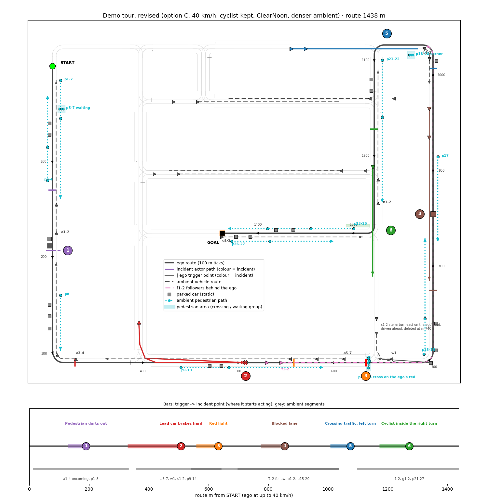

# Phase 033: Demo Tour

One continuous 5-8 minute drive through Town01 in which Autoware meets a sequence of
incidents -- a car braking hard ahead, a pedestrian darting out from behind a parked car, a
red light, a blocked lane, crossing traffic at a turn, a cyclist on the inside -- and handles
each, for an audience watching the CARLA view and Autoware's RViz side by side.

**Source**: user direction 2026-10-14: a demo run "going through many scenarios so the
audience can see many incidents and handling"; decisions the same day: **one continuous
tour** (not a playlist of scenarios), **Town01 only** for now, **ramp merge deferred**
(needs a highway town, [031](031-maps-for-scenarios.md)), **5-8 minutes**. Revised
2026-10-18 (user, after options A/B/C): **route C**, **40 km/h** cruise, **cyclist kept**
(CenterPoint + the [042](042-autoware-overlay.md) overlay), **one weather for the whole run
(ClearNoon)**, and **ambient traffic and walkers, dense** -- see "The tour, revised" below,
which supersedes the route, clock and empty-town parts of the sections after it.
**Depends on**: [020](020-starter-scenarios-and-suites.md) (starter scenarios the incidents
grow from), [023](023-npc-motion-parity.md) / [032](032-npc-tracking-fixes.md) (tracked NPCs
that move like vehicles on camera), [024](024-gap-trace-and-oracle.md) (rehearsal judged by
the oracle), [027](027-user-documentation.md) tutorial 4 (`chase_view`, RViz layouts,
recording).

## What the audience sees

One window layout (tutorial 4's: CARLA chase camera left, ego RViz right), plus a caption
strip naming the incident as it starts and how Autoware handled it ("Pedestrian darts out
-- emergency stop, 4.1 m to spare"). The ego never teleports, the screen never goes blank,
and the tour ends at a goal with a closing caption.

## Why Town01, and what it limits

Town01 is the town this stack is proven on. Its Lanelet2 map has 36 signals, T-junctions
and two-lane roads, but **no crosswalk lanelets and no multi-lane same-direction roads**
(counted 2026-10-14). So: a pedestrian incident is a dart-out handled by `run_out` /
`obstacle_stop`, not a crosswalk yield; a blocked lane cannot be passed by a lane change;
cut-ins and lane changes wait for a multi-lane town (a later tour). Ramp merge needs a
highway town (CARLA Town04 / Town06) that the map pack lacks -- deferred with 031.

## The tour, revised (2026-10-18)



Design sketch (scratch `tour_opts/design2.py`); sidewalk offsets are approximate and are
fitted to CARLA's sidewalks in step 8.

**Route C, 1438 m.** Start on the west road at (-2, -20) heading south (the step 3 route
began at y -150), then the step 3 lanelets unchanged: round the bottom-left corner, east
along the bottom road, north up the east road, left at the top-right T, left into the x 337
road, right at y -198 to the goal (175.67, -195.15). The pedestrian dart moves to the west
road, so the tour opens on an incident ~25 s in.

| Route order | Incident | Site | Incident at (route m) | Ego trigger (route m) |
|---|---|---|---|---|
| 1 | 2 pedestrian dart | west road; a van and a second car parked at the ego-side kerb, the walker steps out from behind the van, stands, then crosses to the far side | 190 | 130 |
| 2 | 1 lead car brakes | lead merges from the x 90 stem, brakes 6 m/s^2 near x 200 | 508 | 329 |
| 3 | 3 red light | signal 43757, stop line x 325.7 | 633 | 558 (75 m before) |
| 4 | 4 blocked lane | east road at y -175, broken car in the ego's lane, oncoming pair | 855 | 775 |
| 5 | 5 crossing traffic, left turn | two cars eastbound on y -2, 15 m apart | 1075 | 1007 |
| 6 | 6 cyclist inside the right turn | cyclist from (333.2, -125.8) south in the ego's lane, 1.4 m right of centre, straight on | 1272 | 1172 |

Triggers are rescaled for 40 km/h: from 11.1 m/s at 2.5 m/s^2 the ego needs ~25 m plus
latency to stop, against ~4 m at 15 km/h. Gaps between incidents are 125-318 m.

**Clock.** ~3.2 min of driving (corners still ~3-4 m/s) plus ~2 min of handling: **~5-5.5 min
of simulation time**, inside 5-8; wall time longer on a loaded host (step 3).

**40 km/h.** The 15 km/h cap is Autoware's `max_vel: 4.17` in autoware_launch's
`common.param.yaml` (the external velocity limit cannot exceed it; Town01's Lanelet2 map has
no `speed_limit` tags). acb gets a `max_velocity` launch argument through a generated copy of
that file (the sync-script pattern of `carla_control` / `object_recognition` / the tracker
param), **default 4.17**, so every suite keeps 15 km/h; the tour passes 11.11, and the ego's
`Performance maxSpeed` in the scenario sits above it (13.89: SSv2 fails a run whose ego
exceeds maxSpeed, and the CARLA ego overshoots the cap; step 4d).

**Perception: CenterPoint + the 042 overlay, for the whole tour** (user decision): clustering
labels everything UNKNOWN, which `blind_spot` ignores, so incident 6 needs CenterPoint.
CenterPoint lost 7 of 9 UC-AEB variants on this host, so incidents 1-5 are rehearsed again
on it, at 40 km/h; ground-truth objects (`perception:=false`, acb labels BICYCLE) are the
fallback if they do not hold, decided then with the user. (2026-10-21: the user chose CenterPoint with
the lidar merger, `use_multi_channel_tracker_merger:=false`, acb issue 028; all six 5/5, step 4d.)

**Weather: ClearNoon**, the bridge's `weather` parameter, for the whole run (no change
mid-tour).

### Ambient traffic and walkers

The town is no longer empty between incidents: about 18 moving vehicles, 17 parked cars and
27 walkers over the tour, with ~10-15 actors in CARLA at any time. All are **SSv2 NPCs
scripted in the tour** (no CARLA autopilot, no Traffic Manager): deterministic, tracked
(`npc_motion: tracked`), each with a name of its own, added before its segment and deleted
after it, like the incident actors. None may make the ego stop outside an incident; step 8
checks that.

| Group | Who | Where / path (route m) | Role |
|---|---|---|---|
| a1-a4 | oncoming cars, two pairs | west road, 175 -> 15 early, 330 -> 205 after incident 1 | traffic in the other lane |
| a5-a7 | oncoming cars | bottom road, 610 -> 360, after the lead clears | |
| w1 | oncoming car | waits at its own red across the junction (incident 3) | the light holds both sides |
| s1-s2 | cars from the x 337 stem | turn east on the ego's red, drive ahead, deleted at 740 (before incident 4's trigger) | the green phase is visible |
| f1-f2 | followers | join behind the ego at ~545, queue behind it at the red light and the blocked lane, deleted at ~1035 | a queue forms on camera |
| b1-b2 | oncoming cars | east road, 1035 -> 990, after incident 4 | |
| n1-n2 | oncoming cars | x 337 road, 1250 -> 1110, clear before the cyclist's trigger | |
| g1-g2 | oncoming cars | closing road, goal -> 1290 | |
| cross | 8 cars, 4 pairs | inner-block roads y -57 / -54 / -129.5 / -133, past the x 337 junctions before the ego reaches them | |
| parked | ~17 static cars, **MiscObjects** (vehicle NPCs stall SSv2), 3.6 m right of the lane centre, >= 25 m from corner exits, clear of kerb furniture (step 4d) | kerbs: west road (incl. incident 1's two), bottom road, east road, x 337 road, closing road | clutter for perception |
| p1-p8 | walkers | west road: two on the far sidewalk with the ego, two on the ego side towards it, a group of three waiting near the start, one after incident 1 | sidewalk walkers do not stop the ego |
| p9-p10 | walkers | bottom road ego-side sidewalk, 440 -> 590 | |
| p11-p14 | walkers | cross the ego's road just past its stop line **on the ego's red**, clear before green | |
| p15-p17 | walkers | east road sidewalks; p17 passes the broken car | |
| p18-p20 | walkers | a group waiting at the top-right T corner, not crossing | |
| p21-p22 | walkers | x 337 road, oncoming-side sidewalk only | |
| p23-p27 | walkers | closing road, both sidewalks | closing scene |

Town01 has no sidewalk or crosswalk lanelets, so walkers follow fixed polylines
(`FollowTrajectoryAction`, as `town01_pedestrian` does), and cars off the route follow
lanelet routes. The **inside of the cyclist's right turn stays clear** of walkers (green strip
in the sketch), and the stem cars s1-s2 only turn east, away from p11-p14. This is the most
CenterPoint has to see in one run; if perception or the frame budget suffers, density goes
down group by group (parked cars and far-side walkers first).

## Incidents

Numbers are ids; along the step 3 route they come in the order 1, 3, 2, 4, 5, 6. Each is a
self-contained **incident template** (a short `.xosc` that runs on its own under
`run_suite`, then is composed into the tour).

| # | Incident | What the actors do | Autoware's expected handling (module) | Pass in rehearsal |
|---|---|---|---|---|
| 1 | **Lead car brakes hard** | an NPC merges ahead from a side street, cruises at 3 m/s, then brakes 6 m/s² to a stop when the ego is within 12 m (or at a brake point); drives off once the ego has stood 4 s | follows, then stops behind it (`obstacle_stop`; step 4b) | no contact; stop gap ≥ 2 m |
| 2 | **Pedestrian darts out** | a car parked half on the kerb hides a pedestrian who steps out (ramping to 1.5 m/s at 1.5 m/s²) when the ego is ~7 s away (origin 30 m from its line; step 4c), stops in the lane 4 s, then crosses | brakes for the emerging pedestrian (`obstacle_stop`; step 4b) | no contact; min distance reported |
| 3 | **Red light** | the signal at the next junction turns red as the ego approaches | stops at the light, goes on green (`traffic_light`); as `town01_traffic_light` already does | stops before the junction; resumes on green |
| 4 | **Blocked lane** | a broken-down vehicle stands in the ego's lane (hazards not commanded: no light action on this path), oncoming traffic in the other lane | waits behind it (`obstacle_stop`; no avoidance attempted) -- after 12 s standing the tow truck "clears" it (the watchdog, on camera) | no contact; waits, then proceeds |
| 5 | **Crossing traffic at a turn** | two NPCs, 15 m apart, cross the junction the ego turns into | yields to both, then turns (module not observable: `intersection` RTC safe throughout, no planning factor; step 4b) | no contact; turns after them |
| 6 | **Cyclist on the inside** | a cyclist rides alongside on the inside as the ego turns | waits for the cyclist (`blind_spot`) -- dropped in step 4b (clustering reports it UNKNOWN; `blind_spot` misjudged right turns, step 4c); **back in the tour 2026-10-18**: CenterPoint + the 042 overlay, 3/3 PASS | no contact |

Each incident is triggered by the ego's arrival at a point on the route (OpenSCENARIO
`ReachPositionCondition` / `DistanceCondition`), so its timing holds whatever the ego's
speed was on the way. Its actors are added when it starts (`AddEntityAction`, proven by
UC-ACC / UC-AEB on this bridge) and removed when it is over (`DeleteEntityAction`), so the
town stays empty between incidents and CARLA is never carrying a crowd (revised 2026-10-18:
ambient actors fill the gaps, added and deleted the same way; see above). **Every actor gets a
name of its own** (`i1_lead`, `i2_ped`, ...): SSv2 never lets a deleted name be added again
(step 2 spike), so no name is reused across incidents.

## The route and the clock

*As first planned (15 km/h, step 3's route); superseded by "The tour, revised" above.*

- One route through Town01, picked with `carla_poses` and the Lanelet2 map, passing the six
  incident sites: about 5-6 min of driving plus ~1-2 min of incident handling -- inside
  5-8 min. The ego cruises at **15 km/h** on Town01 (4.17 m/s measured in the step 2 spike,
  4.0 m/s average with three turns; the same 15 km/h as every 020 run), not the ~30 km/h
  first assumed, so 5-6 min of driving is **~1.2-1.4 km**, not 2.5-3 km -- unless step 3 raises
  the cruise (the Town01 Lanelet2 map carries no `speed_limit` tags; find where the 15 km/h
  comes from first).
- The ego gets the whole route once, as waypoints (`AssignRouteAction`; the relay already
  passes `waypoints` to the agent), so Autoware never stops at an intermediate goal --
  proven in the step 2 spike (one Autoware route through all four waypoints, no stop); the
  chained-goals fallback is not needed.
- Incident sites are at least ~300 m apart (~70 s at 15 km/h; ~200 m if the route must
  stay near 1.3 km), so each starts from cruise and the audience
  gets a breath between them.

## Never stall

A demo must finish even when one incident goes wrong.

- **Collisions are logged, not fatal**: `CollisionCondition` raises a caption and a log
  line, never the scenario's stop trigger.
- **Watchdog per incident**: if the ego has stood still for N s (per incident, e.g. 20 s)
  while the incident is active, its actors are removed (the "clears" in incident 4 is this
  watchdog, staged deliberately) and the tour continues; the watchdog firing is logged as a
  degraded incident.
- **One stop trigger**: the final goal reached, or a global timeout (10 min).
- The stack is the proven one: Town01, `npc_motion: tracked`, ego through the relay.

## Captions

A small `demo_captions` window (Python, ROS) shows the current incident's title and, when
it ends, how it went (stop distance, min gap, time waited) -- from SSv2's storyboard state
and the bridge's per-incident numbers. The storyboard state is `/simulation/context`
(`openscenario_interpreter_msgs/msg/Context`, scenario domain 9, transient-local depth 1,
one ~4.5 KB JSON snapshot of the whole storyboard per frame at 20 Hz; step 2 spike), so
`demo_captions` subscribes to that and diffs `Event.currentState` by event name. Captions
are text on a plain background, positioned in the tutorial-4 layout's free strip so the
recording picks them up.

## Rehearsal and acceptance

- Each incident template alone: 5 runs, 5 passes by its row's criterion, gap trace on,
  `gap_oracle` clean (no G1 / G2; G3 only of the known artefact kind).
- The full tour: 3 runs in a row, each finishing in 5-8 min with every incident passed and
  no watchdog firing except incident 4's staged one.
- One recorded take (tutorial 4's recording), cut with `scripts/make_showreel.sh` into a
  short GIF / MP4 for the README if it is good.

## Steps

1. [x] **Docs.** This phase doc; README entry.
2. [x] **Spike: the SSv2 features the tour needs** on this bridge, in a scratch scenario:
   `DeleteEntityAction` mid-run (actor gone from CARLA, sensors first), a multi-waypoint
   `AssignRouteAction` for the ego through the relay (Autoware drives through without
   stopping), and where SSv2 publishes storyboard event states for captions.
3. [x] **Route.** The Town01 route and the six sites, as poses in a scratch file; one drive
   of the bare route (no incidents) timed. Cruise: **15 km/h kept** (user decision
   2026-10-14) -- a ~1.2-1.4 km route, sites ~200 m apart; raising the cap is left for a
   later tour.
4. [x] **Incident templates** 1-6, each runnable alone; 5/5 rehearsal each; drop 6 if the
   cyclist does not track. Placed at the step 3 sites (route order 1, 3, 2, 4, 5, 6). The
   Town01 map has **no `turn_direction` tag on any lanelet**, so Autoware's `intersection`
   and `blind_spot` modules never launch on it. **Decision (2026-10-14): tag them.** First
   (4a) `scripts/repair_lanelet_turn_direction.py`, the fourth repair pass beside the other
   three: tags every lanelet that lies inside a junction (OpenDRIVE junction connector:
   a driveable lanelet that leaves a fork -- a predecessor with more than one successor --
   or joins a merge -- a successor with more than one predecessor; Autoware's map
   requirement vm-03-02 asks for the tag on every lanelet in an intersection, and nothing
   else is needed to launch the modules) `turn_direction=left|right|
   straight` from its heading change, text insertion, idempotent, `.orig` kept; wired into
   `download_maps.sh` and the user guide; pytest on a small synthetic map; verified on
   Town01 by listing the route's junction lanelets and by Autoware launching
   `intersection` / `blind_spot` at them (planning debug or `/planning/scenario_planning/
   status/...` module states). Then re-run the Town01 starters once (the modules now slow
   the ego at junctions) and note any change. **4a done (2026-10-14)**: 72 Town01 lanelets
   tagged, both modules launch at the route's junctions, starters 6/6 unchanged (Results).
   Then the incident templates. **4b done (2026-10-14)**: incidents 1-5 in
   `src/csb_examples/scenarios/demo/incidents/` (generated by `scripts/gen_demo_incidents.py`),
   5/5 each, judged by `csb_launch incident_judge`; **6 dropped** -- the bicycle tracks, but
   Autoware turns across it (Results).
4d. [x] **Revised design (2026-10-18).** This doc section ("The tour, revised"); then
   - [x] acb: `max_velocity` launch argument (generated `common.param.yaml` copy, default 4.17,
     sync-script check), pushed and pinned. acb `7d1b1ce`: planning from a generated component
     copy (`sync_planning_component.sh`) whose common parameter file `planning_common_param`
     picks: upstream's own at 4.17 (default dump 207/207 nodes as before), a max_vel-only copy
     otherwise; `ros2 param get` 11.11 / 4.17. Still binding at 11.11: corner lateral
     acceleration (1.0 m/s^2), `obstacle_slow_down` (at most 8 m/s past an obstacle beside the
     path), `obstacle_velocity_limiter`;
   - [x] sites: `scripts/demo_town01_sites.yaml` re-cut for route C (incident 2 on the west road,
     incident 4 alone on the east road), triggers rescaled for 40 km/h, templates regenerated
     (2026-10-20, Results);
   - [x] each template 5/5 on **CenterPoint + overlay at 40 km/h**, ClearNoon; incident 6 back in
     the judged set. If CenterPoint does not hold 1-5, stop and take the fallback question to
     the user. **2026-10-20: 1, 3, 5, 6 5/5; 2 0/5 and 4 3/5, both CenterPoint's range.
     2026-10-21, option (b) (user): with `use_multi_channel_tracker_merger:=false` all six
     5/5** (Results). The tour's ego stack is now `just ego-av max_velocity:=11.11
     lidar_detection_model:=centerpoint use_multi_channel_tracker_merger:=false`.
5. [x] **Compose the tour** (`src/csb_examples/scenarios/demo/town01_tour.xosc`): route,
   triggers, add / delete, watchdogs, the single stop trigger. One ManeuverGroup per
   incident holding its add, delete and watchdog events: a `StoryboardElementStateCondition`
   naming an event in another ManeuverGroup by its bare name fails the load (step 2), and the
   runner then ends in ~2 s with no junit and no log line. (Step 4b: actors that move
   differently need groups of their own -- a group's private actions apply to all its actors
   -- and those groups are tied by global parameters, which every group sees; compose the
   tour from `gen_demo_incidents.incident_groups`.) Load-check every edit with
   `openscenario_preprocessor`'s `load` service (it returns the reason) before a full run.
   Remove the ~300 ms frame stall each NPC despawn costs (step 2: `sensor_release` waits out
   its timeout for an ack nobody sends for an NPC).
6. [x] **Captions** (`demo_captions`, subscribing `/simulation/context` in domain 9) and a
   `demo` launch / justfile recipe bringing up the layout. Per-incident numbers from the
   bridge: see the step 2 results for what it has and what it would need.
7. [x] **Rehearsal**: 3 full tours; one recorded take; README / tutorial 4 updated.
8. [x] **Ambient layer** (between 5 and 7): the groups in "Ambient traffic and walkers" as
   their own ManeuverGroups in the tour (generated, unique names), walker polylines fitted to
   CARLA's sidewalks (`get_waypoint(..., lane_type=Sidewalk)`), each segment checked to cause
   no ego stop or slowdown outside an incident (planning factors), and the bridge's frame
   time at the densest point within budget. Rehearsal (7) runs with it.

## Later

A second tour on a multi-lane town with crosswalks (Town05 or Town10) once a drive spike
there passes: crosswalk yield, cut-in, lane change, blocked lane passed by a lane change.
Ramp merge with 031's highway maps.

### Results

**Step 2 spike (2026-10-14).** Town01, the running bridge (`just run`, 8084, current build), a
fresh `just ego-av`, three runs of two scratch scenarios (not in the repo): `spike_route_delete`
(a four-waypoint ~600 m loop with three turns: road 4 west, left at x 92, road 12 east, left
up x 339; `npc_a` added at waypoint 1 and deleted at 2, `npc_b` added at 3 and deleted at
the 500 m mark) and `spike_readd` (`npc_a` added, deleted, added again under the same name, 5 s
apart). A read-only CARLA client polled `get_actors()` at 5 Hz; an rclpy subscriber logged
every storyboard state change.

| Question | Answer | Evidence |
|---|---|---|
| `DeleteEntityAction` mid-run | **Works.** SSv2 sends `DespawnEntity`; the bridge stops and destroys the tracked NPC's own collision sensor (`collision_monitor.detach_npc`, 032 step 5), announces the release, then `destroy_with_children()`. The run carries on (verdict PASS). | bridge: `Despawned 'npc_a' (actor_id=8945)` at frame 1832, `'npc_b' (8947)` at 2790. CARLA: vehicle and its `sensor.other.collision` (8945 + 8946, 8947 + 8948) left `get_actors()` on the same frame; a fresh client's `get_actors([ids])` returned `[]` and `get_actor(id)` `None` for all. (The polling client's own `get_actors(ids)` still returned them, alive-flagged: its episode cache, not the server.) |
| ... its cost | **One ~300 ms frame stall per despawned NPC.** | `Frame 1832 processing over 25 ms: processing 301.83`, `Frame 2790 ... 301.63`, `Frame 255 ... 412.23`. That is `sensor_release.timeout_ms: 300` paid in full: nothing acks an NPC's release (acb only cares about the ego). Six hitches in a tour, visible as a brief freeze on camera. Fix in step 5: skip the announcement for an NPC no sensor bridge has claimed, or have acb ack ids it does not hold. |
| Re-add a deleted name | **Not possible: SSv2 refuses it.** | junit: `SemanticError: Applying action AddEntityAction to an entity "npc_a" that has already been added.` `DeleteEntityAction` never clears `ScenarioObject::is_added` (`add_entity_action.cpp`). The bridge had cleaned up; CARLA was empty afterwards. Plan: a unique entity name per incident actor. |
| Multi-waypoint `AssignRouteAction` (Init) through the relay | **Works; no stop at intermediate waypoints. Chained goals not needed.** | SSv2 -> `SetRoutePoints` (goal = last waypoint, `waypoints` = the first three) -> relay `set_goal -> OK` -> agent `goal set: (338.83, -107.76)` -> Autoware `/planning/mission_planning/route`: start (299.2, -129.5), goal (338.83, -107.76), **9 segments covering the whole loop**. Ego speed never below 0.3 m/s between first move and goal; at the four waypoints 4.16-4.17 m/s (passed within 0.2-1.1 m). |
| ... timing | 604 m in **152.6 s** (first move to the goal check point), cruise **4.17 m/s = 15 km/h**, ~3.0 m/s through the turns, average 4.0 m/s. | set_goal OK -> first move 7.2 s. Waypoints at +24.8, +77.8, +102.0 s, the 500 m mark at +126.1, goal at +152.6 s. 15 km/h is the stack's usual Town01 cruise (020 proof screenshots); see "The route and the clock". |
| Caption source | **`/simulation/context`**, `openscenario_interpreter_msgs/msg/Context` (`stamp`, `data` = JSON string, `time` = simulation time, NaN before the start), published by `/simulation/openscenario_interpreter` in the **scenario domain (9)**, QoS reliable + transient-local depth 1, **every frame (20.0 Hz measured; `global_frame_rate` 20)**, ~4.5 KB. | Live subscriber on domain 9 with `config/cyclonedds-localhost.xml`. The JSON is the whole storyboard: `CurrentStates` (counts per state), then `OpenSCENARIO.Storyboard.Story.Act.ManeuverGroup.Maneuver.Event[]`, each with `name`, `currentState`, `currentExecutionCount`, `maximumExecutionCount`, `Action[]` (`name`, `currentState`, `type`) and `StartTrigger` conditions (`currentValue` and a human-readable `currentEvaluation`, e.g. the simulation-time comparison). |
| ... what an event looks like | An event of instant actions (add, delete) goes **`standbyState` -> `completeState` in one frame**; `runningState` is seen only when an action lasts (`exitSuccess`: `runningState` / `startTransition`). | `wp1_add_npc_a` complete at sim 26.55 s, `wp2_delete_npc_a` 79.1, `wp3_add_npc_b` 103.05, `wp4_delete_npc_b` 127.0, `goal_reached` running at 153.75; CARLA's actors appeared / vanished in the same frames. So `demo_captions` keys on an event's change to `completeState` (or a rise of `currentExecutionCount`), by event name; an incident's "start" caption is its add event completing, its "end" the delete event. |
| What the bridge can report per incident | Today, nothing per incident: per **ego run** it logs a CARLA collision summary (`CARLA collision summary for ego 'ego': no collisions`), per tracked NPC a tracking line (`Tracked 'npc_a': 1051 frames, error p95 0.000 m ...`, written at the ego's despawn, not the NPC's), and with 032's sensors any NPC contact by CARLA frame. | It already sees every entity's pose each frame (`UpdateEntityStatus`), so it can compute per NPC entity, from spawn to despawn: minimum ego-to-NPC gap (bounding boxes), ego speed at that moment, ego stopped time, contacts. A despawn is the incident's end, so the natural output is one line / message per despawned NPC (e.g. a `csb_interfaces` topic in domain 9 beside the weather services); stop distance follows from the minimum gap while the ego is stopped. A step 6 item. |

Also learnt: a scenario that fails to load ends in ~2 s with no junit and no log line --
`scenario_test_runner` drops the `openscenario_preprocessor/load` response's `message`. Here
it was a `StoryboardElementStateCondition` naming an event in another ManeuverGroup by its bare
name (`No such variable named "ev_delete_again" of type StoryboardElement.`), found by calling
the `load` service on a private domain.

Runs: `spike_route_delete` PASS (1 run); `spike_readd` twice, the first failing at load (above),
the second ending at the re-add with the `SemanticError`. Scratch: `/tmp/claude-1000005/
-home-aeon-repos-carla-scenario-bridge/f372598a-d329-483b-9e38-80a742b40cbd/scratchpad/s033_2`
(scenarios, generator, watchers, per-run logs).

**Step 3: route (2026-10-14).** One Town01 route, **1307 m**, four waypoints plus the goal,
picked from the Lanelet2 map (a lanelet graph walk) and checked against CARLA's
`get_waypoint`: every route lanelet's centreline is on CARLA's driving-lane centre to 0.00 m.
Start on the west edge road heading south (lanelet 24444, (-2.03, -149.96)); left round the
bottom-left corner; east along the bottom road (9379); left at the bottom-right corner, north
up the east edge road (13397, 309 m straight); left at the top-right corner, west along the
top (149); **left** into the x 337 road (35653) and south down it through three junctions;
**right** at y -198 (39793) onto the y -198 road west (21828) to the goal at (175.67, -195.15).
Waypoints on 9379, 13397, 149 and 28257. Autoware's `/planning/mission_planning/route` was
exactly the 19 lanelets planned (24444 31089 7768 36717 9379 38294 11783 23145 13397 19510 149
35653 27676 40484 28257 42063 28958 39793 21828). Three signals on the way (43751, 43784, 43793)
are not commanded and stay green.

| Route order | Incident | Site | Ego trigger (route m, lanelet) | Actors |
|---|---|---|---|---|
| 1 | 1 lead car merges, brakes | bottom-left T (x 90): ego straight through (36717) | 212 m, 7768 | `i1_lead` on the stem 33476 s 80, turns left (37233) into 9379 ahead; brake at 9379 s 55 (334 m); 224 m straight after the T |
| 2 | 3 red light | bottom-right T (x 337), straight-through approach | 429 m, 9379 | signal **43757** (reg 43852 on 9379; CARLA 373), stop line at 503 m |
| 3 | 2 pedestrian dart-out | east edge road, NB straight, kerb on the right | 601 m, 13397 | `i2_parked` 13397 s 80 at the kerb, `i2_ped` behind it (s 84, 3.6 m right); ped at ~665 m |
| 4 | 4 blocked lane | same straight, 160 m on; oncoming lane 15257 | 761 m, 13397 | `i4_broken` 13397 s 240 (821 m); oncoming on 15257 |
| 5 | 5 crossing traffic at a turn | top-right T: ego turns **left** from the through road (149) into the stem (35653), unsignalled | 871 m, 13397 | `i5_cross_a/b` EB on 2113 (s 95 / 60) through 35576 |
| 6 | 6 cyclist on the inside | T at x 337, y -198: ego turns **right** (39793) | 1082 m, 42063 | `i6_cyclist` SB on 28958 s 0, 1.4 m right of centre, straight on (39961) |

Spacing: brake 334 m, red light 503, pedestrian ~665, blocked lane 821, left turn 945, right
turn 1142 -- 125-200 m apart, not the 200 m hoped: 3 must sit at a signalled straight approach
and 5 / 6 at the route's only left and right turns into a stem, which fixes their places.
The order changed from the table's (1, 3, 2, ...): incident 2 needs a straight without
junctions and the only one after 3 is the east edge road. Exact poses (lanelet, s, world
x / y / yaw for each trigger and actor): `route_sites.yaml` in the scratch directory below.

**Timing (one bare drive, Autoware via the relay, no incidents): PASS.** set_goal -> first move
6.6 s; first move -> goal **321.4 s of simulation time (5.4 min), 1299 m, 4.04 m/s average**,
cruise 4.17 m/s, slowest 2.07 m/s in the right turn at y -198; **no stop** (no sample under
0.5 m/s between first move and goal); every site's trigger, turn entry and stop line passed
within 0.2-1.3 m (0.5 s sampling). Site passing times (s after first move): 52 (1 trigger),
81 (1 brake point), 105 / 122 (3 trigger / stop line), 147 (2), 186 (4), 211 / 231 (5 trigger /
turn), 265 / 279 (6 trigger / turn). With ~1-2 min of incident handling the tour is
**~6.5-7.5 min**, inside 5-8; no re-drive needed.

Wall clock is longer than simulation time when the host is loaded: this drive took 376.7 s of
wall time (real-time factor 0.85 overall, **0.19-0.42 for about 70 s** while other users'
builds held the disk: load 120-180, `/proc/pressure/io` some avg60 80). The demo is watched in
wall time, so rehearse and record on a quiet host; on this one, as loaded, the tour would run
~8 min.

Found on the way:
- **No `turn_direction` on any Town01 lanelet** (0 of 300; neither the repaired map nor
  `.orig`). Autoware's `intersection` and `blind_spot` modules key on it, so incidents 5 and
  6 as written cannot be handled by them; step 4 now says so.
- The map's `local_x` / `local_y` tags are not where the stack drives on east-west roads: they
  are stretched 0.67 % in y (2.2 m off CARLA's lane on the bottom road, 1.3 m on y -198, 0 on
  the top road), while the ego (this drive and the step 2 spike) runs on the lanes' projected
  lat/lon, which match CARLA to 0.00 m. Site poses here use the projected lat/lon; any tool that
  reads `local_*` (as `repair_lanelet_local_coords.py`'s note says Autoware does) puts things
  on the bottom road at the kerb. Not chased further here.

Runs: `tour_bare` PASS (1 run; junit 0 failures). Load-checked first with
`openscenario_preprocessor`'s `load` (success). Scratch: `/tmp/claude-1000005/
-home-aeon-repos-carla-scenario-bridge/f372598a-d329-483b-9e38-80a742b40cbd/scratchpad/s033_3`
(`route_sites.yaml`, the map tools `ll.py` / `route.py` / `sites.py`, `gen_bare.py`,
`tour_bare.xosc`, `analyse.py`, `run1/` with the CARLA track, Autoware route and timing).

**Step 4a: `turn_direction` (2026-10-14).** `scripts/repair_lanelet_turn_direction.py`, the
fourth repair pass (wired into `download_maps.sh` beside the other three and listed in the
user guide; `src/csb_launch/test/test_repair_lanelet_turn_direction.py`, 6 tests on a
synthetic fork-and-merge map, run by `just test`).

*The rule.* Autoware 1.5 (universe source read at 0.40, same code path) launches
`intersection` on any path lanelet whose `turn_direction` is `straight` / `left` / `right`
(`IntersectionModuleManager::launchNewModules`; anything else reads "else" and is skipped)
and `blind_spot` on `left` / `right`. Nothing else is required: no `right_of_way` means every
conflicting lanelet is an attention lane, a missing stop line is derived from the first
conflict, `intersection_area` is optional (`use_intersection_area: false`). The map
requirements (vm-03-01/02) want the tag on *every* lanelet in an intersection. Junction
lanelet = a road/highway lanelet that leaves a fork (a predecessor with > 1 successor, the
doc's first heuristic) **or** joins a merge (a successor with > 1 predecessor), succession
read as lanelet2 reads it (shared bound end points). In Town01/02 both clauses pick the same
set; the merge clause adds turn-only connectors in Town03/05/10. Direction from the
centreline's heading change entry -> exit, threshold **45 deg** (bisector of straight and a
right angle; every town's junction lanelets sit at 0 +- 20 and 90 +- 20 deg), geometry from
lat/lon. Known misses, in the docstring: straight-only middle lanes through multi-lane
junctions (6 in Town03, 7 in Town05) stay untagged; mid-road lane adds tagged as junctions
(15 in Town03); Town01's 11 converter-malformed connectors (stray first point, no
predecessor, unroutable anyway) stay untagged.

*Counts* (map pack, local only; second run tags 0, diff is insertions only):

| Town | tagged | straight | left | right |
|---|---|---|---|---|
| Town01 | 72 | 24 | 24 | 24 |
| Town02 | 48 | 16 | 16 | 16 |
| Town03 | 183 | 80 | 44 | 59 |
| Town05 | 248 | 116 | 64 | 68 |
| Town10 | 71 | 26 | 19 | 26 |

Town01 is twelve T junctions x 6 connectors. Checked against CARLA (read-only): all 72 match
a CARLA `get_topology()` junction segment turning the same way; of the 81 untagged 4 m road
lanelets, 79 have their midpoint outside any CARLA junction, the other 2 are malformed
connectors. Route junction lanelets: **36717 straight** (bottom-left T, site 1), **38294
straight** (bottom-right T, signalled, site 3), **35653 left** (top-right T, site 5), **40484
straight**, **42063 straight** (x 337 road), **39793 right** (y -198, site 6); CARLA yaw
change 0 / 0 / +90 / 0 / 0 / -90 deg, junction ids 87 / 143 / 26 / 222 / 278 / 194.

*Live* (a fresh `just ego-av` on the tagged map, `tour_bare.xosc` once; a watcher on domain 1
logging `/planning/cooperate_status/{intersection,intersection_occlusion,blind_spot}`,
planning factors and `/control/command/turn_indicators_cmd`): **PASS**. One `intersection`
(+ `intersection_occlusion`) instance at each of the six route junctions, created ~4 m before
each and gone after it, all `safe` throughout; **`blind_spot` at both turns** (35653 left,
39793 right). Turn signals now blink: left 228-246 s, right 277-295 s (wall time from the first odometry).
Timing: first move -> goal **322.2 s** (step 3: 321.4), 1300 m, 4.04 m/s average, **no
stop** (no sample under 0.5 m/s), slowest 1.89 m/s in the right turn (2.07 before); every
site passed within 0.9 s of step 3's times. No planning factor from either module
(nothing to yield to in an empty town; `occlusion.enable: false` in autoware_launch 1.5).

*Starters* (`run_suite` over the six Town01 `basic/` scenarios on the same ego stack): **6/6
PASS** (ego_drive 40 s, engage_state 44, pedestrian 129, rear_contact 72, simulator_autopilot
51, traffic_light 185), as before 4a; their routes passed 2 `intersection` and 1
`blind_spot` instances, no stop added. `just test`: 300 nextest + 169 pytest pass.

Scratch: `/tmp/claude-1000005/-home-aeon-repos-carla-scenario-bridge/f372598a-d329-483b-9e38-
80a742b40cbd/scratchpad/s033_4a` (`pre/` maps before 4a, `survey*.py`, `check_topology.py`,
`module_watch.py`, `analyse_modules.py`, `run1/` tour, `starters/` suite).

**Step 4b: incident templates (2026-10-14).** Incidents 1-5 as standalone templates in
`src/csb_examples/scenarios/demo/incidents/` (`town01_i1_lead_brake.xosc` ...
`town01_i5_cross_turn.xosc`, installed with `csb_examples`), generated by
`scripts/gen_demo_incidents.py` from `scripts/demo_town01_sites.yaml` (every pose, from the
map's projected lat/lon along the step 3 route). Each puts the ego ~125-145 m before its
site (60-110 m before its trigger), routes it through the site to a goal beyond it, adds the incident's actors when
the ego arrives and deletes them when the incident is over, has a watchdog per actor group
(ego stood still 20 s while live: actors deleted, `test(iN, watchdog, degraded)` in the
interpreter log; incident 4's is the staged 12 s "tow truck", logged `staged`), logs any
contact with `CollisionCondition` (never the stop trigger), and stops only on its goal or
a 300 s timeout. `gen_demo_incidents.incident_groups(n, sites)` returns an incident's entities and
groups, so step 5 composes the same pieces. Judge: `ros2 run csb_launch incident_judge
<trace> --incident N --context <context log>` (new; reads the gap trace for CARLA's bodies
and contacts and a `/simulation/context` state log for when each event ran, aligned on the
actors' spawn frames; 5 unit tests). `just test`: 300 nextest + 174 pytest pass.

*Rehearsal*: a fresh `just ego-av` (restarted after ~40 min), the sim side restarted on the
rebuilt bridge with `GAP_TRACE_DIR` for the runs and untraced again after; 5 runs per
incident, interleaved; `gap_oracle` on every trace.

| # | Pass | Numbers (5 runs) | Module (planning factor) | Oracle |
|---|---|---|---|---|
| 1 lead brakes | **5/5** | lead's peak deceleration **5.9 m/s²** (CARLA body); brake fired with the ego 13.4-13.6 m behind at 3.3 m/s; **stop gap 4.8-5.3 m**; ego stood 5.7-5.9 s, then followed the lead off | `obstacle_stop` | clean (G1 0, G2 0, G3 0) |
| 2 pedestrian | **5/5** | ego stopped every run; **min distance to the pedestrian 1.2-4.2 m**; stood 1.4-4.3 s; passed the parked car at 0.37 m (slowing) | `obstacle_stop` (not `run_out` / `dynamic_obstacle_stop`) | G1 0, G2 0; **G3 2 per run** on `i2_ped`: 0.27 m for 7 frames as the walker starts from rest, twice (new G3 kind, walker start-up lag) |
| 3 red light | **5/5** | front **0.08 m past to 0.48 m short of the stop line** at its furthest while red; green 8.1 s after it stood; moving 0.9-1.1 s after green | `traffic_light` | clean |
| 4 blocked lane | **5/5** | **stop gap 4.7-5.3 m** behind the broken-down car; waited 12.0 s (staged clear), moving 1.2-1.3 s after; oncoming traffic passed at 1.66 m | `obstacle_stop`; no avoidance attempted | clean |
| 5 crossing at a turn | **5/5** | stood 3.5-3.6 s for the pair, then turned; **min gap 1.0-1.2 m** (the ego stops close to the crossing lane) | not observable: `intersection` / `intersection_occlusion` / `blind_spot` RTC `safe` throughout, no planning or velocity factor | clean |
| 6 cyclist | **dropped** | 2/2 shakedown runs: contact, the ego turned right across the cyclist (min gap -0.6 / -0.7 m); one run ended in SSv2's acceleration bound (-19 m/s², the ego knocked) | `blind_spot` launched at 39793, `safe` the whole time; no factor, no slowing | cyclist tracking clean (G3 0): not a 022 problem |

Wall time per run 83-179 s (each includes SSv2 start-up and engage). No watchdog fired in the
25 runs except incident 4's staged one; no contact.

*Adjustments* (the Incidents table is updated): 1 -- the lead merges, slows to 3 m/s and brakes
when the ego is within 12 m freespace (or at 9379 s 70), then drives off once the ego has
stood 4 s; 2 -- the parked car stands 2.4 m right of the lane centre (half on the kerb), the
pedestrian steps out when the ego's origin is 24 m from its line (17 m was too late: a contact
at ~0 m/s in the shakedown), stops in the lane 4 s, then crosses; 4 -- no hazard lights (no
light action on this path), cleared after 12 s; 5 -- the two crossing cars 15 m apart, not 35
(at 35 the ego took the gap and was hit by the second, shakedown); 6 dropped. Triggers moved
for timing: 1 at route 205 m, 5 at 907 m (`demo_town01_sites.yaml`).

*SSv2 behaviours found (each cost a run; all handled in the generator, documented in it)*:
- `StoryboardElementStateCondition state="standbyState"` is **true for good**: the condition
  remembers standby from construction and only re-reads the element when that does not match.
  "Not yet happened" cannot be asked of an event; the templates keep each group's phase in a
  global parameter (`ParameterSetAction` / `ParameterCondition`, which every group sees --
  also the way to tie groups together in the tour).
- `StandStillCondition` never holds for the ego: SSv2 counts standstill only while
  |v| <= DBL_EPSILON, which a CARLA-physics ego never reports. Replaced by a chain of delayed
  `SpeedCondition < 0.1` (every 2 s).
- Deleting an entity while one of its actions still runs (a trajectory) ends the scenario
  (`Entity "i2_ped" does not exist`).
- A `SpeedAction` with `rate 6` is jerk-limited to ~3.7 m/s² peak (default
  `max_deceleration_rate` 3 m/s³, and every linear speed change resets the entity to the
  default constraints when it ends, so a controller property does not stick); the brake is a
  `SpeedProfileAction` with `DynamicConstraints` (6 m/s², 60 m/s³), measured 5.9 in CARLA.
- A walker on a timed `FollowTrajectoryAction` started late and then failed the scenario
  ("completed a trajectory to the nearest waypoint ... greater than this step distance");
  untimed vertices at a commanded speed work, and a hold `SpeedAction 0` on a walker before
  its trajectory kept it standing.
- An NPC added with a step `SpeedAction` (already moving) was, once in 3, declared blocked by
  the bridge before its body settled and handed to kinematic for the episode (032's
  fallback; 0 m/s along SSv2's 6 for 4 frames). NPCs are now added standing and driven off
  0.5 s later at 4 m/s².
- `openscenario_preprocessor`'s `load` writes `raw/` beside the file it loads: load-check a
  copy, not the repo's file.

*Found on the way (not fixed here)*:
- **A leaked vehicle in CARLA.** The first incident-1 run's ego spawn took 31 s and reported
  failure, but CARLA had created it: actor **9004** (`vehicle.tesla.model3`, `role_name=hero`)
  stands at CARLA (-1.98, 261.46), route m 110 on the west road; the retries then spawned the
  ego on top of it (contact, run failed). The bridge does not destroy an actor whose spawn
  call timed out. *Correction 2026-10-15*: the next `Initialize`'s reaper destroyed it at
  04:28:36Z ("Destroyed orphaned 'hero' (actor 9004)"), and a by-id query finds no 9004;
  moving incident 1's start to route m 125 was harmless but unneeded. Cause and fix:
  [034](034-bridge-failure-paths.md) step 4 (a timed-out spawn completes on the server).
- The acb submodule pin had moved (3883f86) without a rebuild: rebuilt acb's workspace, then
  this one, before the runs.

Scratch: `/tmp/claude-1000005/-home-aeon-repos-carla-scenario-bridge/f372598a-d329-483b-9e38-
80a742b40cbd/scratchpad/s033_4b` (`poses.py`, `run_one.sh` / `batch.sh`, `loadcheck.sh`,
`aggregate.py` and `agg_reh.txt`; `i<N>/reh_<k>/` the rehearsal runs with trace, context and
module logs, judge and oracle output; `shake*`/`pre_*` the shakedowns; `traces/`).

**Step 4c: the two open items of 4b (2026-10-17).** Plan first, results below it.

*A -- incident 2's G3 on `i2_ped`.* The 4b traces (reh_1, frames 672-692 and 813-830) show it
frame by frame: SSv2's walker goes from 0 to **1.50 m/s in one frame** (0.075 m per 0.05 s
step from the first moving frame) at the dart and again at the cross -- `speed()` in the
generator is a `step` SpeedAction. The bridge commands the walker at once (`WalkerControl`,
SSv2's velocity plus 6/s of the position error, no force bound on walkers), and CARLA's
walker body ramps 0.08, 0.19, 0.33, 0.49, 0.68, 0.88, 1.10 ... m/s, peaks 2.42 m/s to win the
lag back and settles in ~1 s; the error peaks 0.27 m at the 7th-8th frame. So the body
cannot follow an unbounded acceleration and the bridge already asks for all it can give:
**a scenario artefact of 032 N6's kind (a speed step), not a tracking gap**. Fix in the
generator: the walker's start speeds become `linear` at a pace a person (and CARLA's walker)
starts with, and the dart trigger moves out by what the ramp costs so the incident's timing
holds. Accept: `town01_i2_*` 3+ runs, 0 G3, judge PASS.

*B -- why `blind_spot` did not react to the cyclist.* Read in Autoware 0.48.0's module (the
1.5.0 package; `scene.cpp`, `util.cpp`): it keeps an object only if
`classification[0].label` is BICYCLE, PEDESTRIAN or MOTORCYCLE (CAR / TRUCK / BUS / TRAILER
optional by `detect_non_vru`, all false; **UNKNOWN never**), whose *centre* lies in the
attention area -- the strip from the ego path's right edge (path + ego width / 2 = 1.08 m)
to the right bound of the rightmost lane (or a right shoulder / bicycle lane if the map has
one) over the 100 m before the turn, carried through the junction -- and whose predicted
path crosses the turning path's right bound / entry line and then its left bound within
the TTC margins (2 s / 1 s) of the ego's own passage. The stack's perception is
`lidar_detection_model: clustering`, which labels what it finds UNKNOWN; incident 2's
walker was stopped for by `obstacle_stop`, never `run_out` (which also wants a VRU label),
consistent with that. Hypothesis: **the cyclist reaches planning as UNKNOWN and the module
filters it out before any geometry**. Check on a live run: the labels on
`/perception/object_recognition/objects`, the attention area (`.../behavior_velocity_planner/
debug/blind_spot` markers) against the cyclist's position, and
`~/debug/blind_spot/decision_state`. If it is the label: the map and the scenario cannot
fix it; the fix is a perception that classifies (or ground truth that labels a bicycle
BICYCLE -- acb's ground-truth path today labels every `vehicle.*` CAR).

*Results A (2026-10-17): a scenario artefact, fixed in the generator.* `WALKER_START_RATE =
1.5` m/s² on both of the walker's starts (`i2_ped_walk`, `i2_ped_walk_on`). SSv2 follows it
exactly (0.075 m/s per frame); the CARLA body still starts slowly (0.01-0.10 m/s per frame
over the first 10 frames, its own ramp: the bridge's command is already SSv2's speed plus
6/s of the error) and the walker's largest error is now **0.13 m** (was 0.27), under G3's
0.2. Not a bridge gap, so no bridge change: a walker's `WalkerControl` carries no force
bound to lift, and the lag is the body's. The ramp delays the pedestrian's arrival in the
lane by ~0.5 s and its clearing of the ego's path by ~0.4 s, which the timing felt: with
the dart trigger moved only 24 -> 26.5 m (the arrival delay at 4.17 m/s) the first run
touched the pedestrian (`reh_1`, -0.16 m): the ego stopped 3.0 m short, stood 1 s, then
crept on just as the pedestrian started across. The 4b runs show the same creep after ~1 s
standing in every run (Autoware), so their 1.2 m worst case was the pedestrian leaving in
time, not the ego waiting. **Dart trigger 30 m** (origin to the pedestrian's line; route m
635.6): the pedestrian arrives ~1 s earlier relative to the ego and leaves as it stops.

Runs (same stack, sim side traced): `reh_1` (26.5 m) FAIL contact, G3 0; at 30 m `d30_1`-
`d30_5` **4/5 PASS**, pedestrian min distance 1.12 / 3.75 / 2.43 / 2.00 m, ego stood
2.4-4.4 s, **G3 0 in all six runs**. The one failure (`d30_2`) is perception, not timing: the
ego slowed to 2.8 m/s and then accelerated into the standing pedestrian, which
`/perception/object_recognition/objects` reported only intermittently between 10 and 4 m
(clustering: present 877.88, gone 878.48-879.08, back at 879.38 -- the walker standing
still in the lane flickers in and out; a walking one does not). That failure mode exists
for any timing in which the pedestrian stands in the ego's lane while it approaches; it is
the incident's residual risk and is recorded here, not fixed (Autoware perception).

*Results A, the flicker (2026-10-18): Autoware's tracker parameters, fixed in acb.* Traced
stage by stage on live runs (bag in the ego domain, the walker's CARLA body per tick): the
lidar, ground removal, map filter, clustering and the obstacle pointcloud validator have the
standing walker in **every** frame; `multi_object_tracker` drops it. Its overlap pruning
merges two UNKNOWN trackers within 9 m when their generalized IoU (over the footprints'
convex hull) exceeds `pruning_generalized_iou_thresholds[UNKNOWN]`, -0.3 in Autoware 1.5.0
-- so pairs that do not overlap at all. The walker stands 1.4 m from the parked car's front
corner; GIoU of the car's track and the walker's detection hovers at -0.27..-0.37, and the
walker's track is published exactly when it is below -0.30: each crossing merges the young
walker track into the settled car track, and the next detection starts a new one -- the
flicker. Not CARLA (points on the walker 544 per frame), not the cluster size or the
validator. `obstacle_stop` stops for objects only (`check_inside.pointcloud: false`) and
holds a lost one 1 s, so a gap longer than that releases the stop. Upstream moved the
threshold to 0.1 itself (autoware_launch #1885, then #1907). Fix: acb 7429bbc (acb issue
027), acb_launch's generated copy of the tracker's parameters with UNKNOWN at 0.1, no code
change. Walker present while standing in the lane 2-30 m ahead: **0.30 before (69/230
frames, five bagged runs at 0.22-0.35; one contact in six runs) -> 1.00 after (276/276, six
runs, no contact, the ego stood 4.9-5.2 m short)**. AEB 9/9, starters 6/6, incident 6
unchanged (contact 2/2, as before).

*Results B (2026-10-17): Autoware, twice over; i6 stays a documented reproducer.*
1. **The cyclist never reaches `blind_spot` as a cyclist.** Live (`probe_1`, the stock
   stack): every object on `/perception/object_recognition/objects` is label 0
   (**UNKNOWN**, 84 603 of 84 603), and the cyclist's twist is 0 with a single predicted
   path ending where it stands (`multi_object_tracker`'s
   `enable_unknown_object_motion_output: false`). `blind_spot` keeps only BICYCLE /
   PEDESTRIAN / MOTORCYCLE (CAR / TRUCK / BUS / TRAILER by `detect_non_vru`; UNKNOWN never),
   so it filters the cyclist out before any geometry: decision `Safe` from launch to the pass
   judge line (ego 5 m before the turn at 4 m/s), then `OverPassJudge`. Geometry is not the
   problem: the attention area is the strip x 332.72-333.64 (ego path + 1.08 m to the lane's
   right bound; no shoulder or bicycle lane on Town01) and the cyclist rides at x 333.1-333.2,
   inside it.
2. **With a perception that classifies, the module still misjudges a right turn.**
   `EGO_LAUNCH_ARGS=lidar_detection_model:=centerpoint` (no code change): the cyclist is
   BICYCLE at 5.2-6.6 m/s with map-based predicted paths from ~7 m behind the ego, yet
   `blind_spot` stays `Safe`: its debug `ego_passage_interval` reads e.g. `[5.57, 5.52]` --
   exit *before* entry -- every frame. The module times the ego between two lines, the ego's
   own straight-on edge (`virtual_ego_straight_path_after_turning`, x 333.46 here) and the
   blind side's road edge carried through the junction
   (`virtual_blind_lane_boundary_after_turning`, x 328.36); for a **left** turn it takes
   entry at the first and exit at the second, for a **right** turn it swaps them
   (`scene.cpp` / `experimental/scene.cpp`, `first_line` / `second_line`), so on a right turn
   "entry" is the last moment and the interval collapses to the end of the turn; the
   cyclist's own passage (e.g. [2.8, 4.9] s, read in the fixed runs) then ends more than the 1 s
   margin before it and the module reads the
   cyclist as gone. The object side is mirrored correctly; only the ego side is not. The
   same lines are in Autoware 0.47.0, 0.48.0 (1.5.0's package), 0.49.0 and `main` as of
   2026-10-16 -- a right-hand-traffic bug in a module written for left-hand traffic, where
   the blind spot is on the left. (1.5.0 runs the module's `experimental` plugin.) Proof:
   the 0.48.0 module rebuilt in the scratch directory with the two lines in the left-turn
   order for both sides, overlaid with `EGO_OVERLAY`, on centerpoint: the interval reads
   `[5.13, 11.14]`, the decision goes `Unsafe` (collision 4.0 -> 1.4 s), and the ego stops
   ~4 m before the turn and lets the cyclist by: **3/3 PASS** (`cpfix_4`-`_6`, min gap
   0.13-0.15 m -- the cyclist passes the standing ego inside the same lane, which is the
   scenario's geometry -- ego stood 0.8-2.0 s, G1/G2/G3 0), against 2/2 contact on
   centerpoint with the stock module (`cp_2`, `cp_3`; `cp_1` ran before CenterPoint's
   engine finished building and saw no objects).

*Decision.* Nothing in csb, acb's sensor path, the map or the scenario causes this, and
neither fix belongs to this repo: incident 6 needs a classifying perception (CenterPoint
lost 7 of 9 UC-AEB variants on this host -- acb's launch note -- so the demo keeps
clustering) **and** a fixed `blind_spot`. Incident 6 stays out of the tour and out of the
judged set, generated to `scenarios/demo/town01_i6_cyclist_inside.xosc` as the reproducer
of both; the upstream report (Autoware universe, `blind_spot`: right-turn ego passage
interval uses the lines in left-turn-mirrored order) is a separate step, not filed from
here (filed since as autoware_universe#13509; the fix is carried by [042](042-autoware-overlay.md),
on by default, 3/3 PASS on centerpoint). Found on the way, not fixed: acb's ground-truth object path labels every `vehicle.*`
CAR, bicycles and motorbikes included (`ground_truth_objects.rs`; CARLA's `base_type`
attribute would give BICYCLE / MOTORCYCLE / TRUCK / BUS) -- irrelevant to the demo stack,
which runs real perception, but the same filter would drop a ground-truth cyclist.

*Verification (2026-10-17, a fresh stock `just ego-av`, sim side traced, then untraced
again).* Incidents 1-5, five interleaved rounds: **25/25 PASS** by `incident_judge`, every
trace G1 0 / G2 0 / G3 0, G4 agree; incident 2 pedestrian min distance 0.92 / 1.01 / 2.50 /
1.43 / 2.42 m, ego stood 3.1-3.9 s, the walker's largest SSv2-CARLA error 0.135 m in every
run (was 0.27). Starters (`run_suite`, six Town01 `basic/`): **6/6 PASS** (ego_drive 41 s,
engage_state 45, pedestrian 127, rear_contact 24, simulator_autopilot 48, traffic_light
184). Host load 7-82 (1 min) across the runs, no failure in a loaded one. `just test`:
329 nextest + 174 pytest pass; `just check` clean.

Scratch: `/tmp/claude-1000005/-home-aeon-repos-carla-scenario-bridge/f372598a-d329-483b-9e38-
80a742b40cbd/scratchpad/s_inc` (`run_one.sh` / `batch.sh` / `rounds.sh`; `bs_watch.py`, the
objects / blind_spot debug / path watcher; `pedtl.py`, `objnear.py`; `i2/{reh,d30,fin}_*`,
`i6/{probe,cp,cpfix}_*` with trace, judge, oracle and `bs.jsonl`; `bsfix/`, the 0.48.0
module with the line order fixed and a `[bs_probe]` print, built for the overlay;
`starters/`).

**Step 4d: first 40 km/h drive of route C (2026-10-19).** Plan first, results below it.
Route C bare (A) and with the design's 17 parked cars (B), on one `just ego-av
max_velocity:=11.11 lidar_detection_model:=centerpoint` (042 overlay on), ClearNoon via
`/carla/set_weather`, the ego's `Performance maxSpeed` 13.89 (11.11 failed the first run,
below). Scenario: step 3's four waypoints
and goal, start moved to lanelet 24444 s 10 (-2.03, -19.96) heading south, 1437.7 m. Parked
cars: static NPCs (`vehicle.tesla.model3`, 2.16 m wide like the ego) added in Init at route m
60, 72, 250, 262, 275, 470, 482, 712, 724, 740, 1015, 1120, 1132, 1363, 1381 at the kerb offset
under test, right of the route centre, and two on the closing road's far kerb (1408, 1423).
Two corrections to the design sketch: its route m 700 lies in the bottom-right corner's curve
(moved to 724), and its (205 | 190, -198.8) are in the oncoming lane's centre (CARLA lane -1 at
y -199.15; moved to the far kerb, mirrored). CARLA's lanes on these roads are 4.0 m wide and
the sidewalk starts ~2.3 m from the lane centre, so the design's 3.2 m puts a car's inner edge
at 2.12 m: just off the lane, its body on the sidewalk.

What should bind, read from autoware_launch 1.5's `obstacle_slow_down.param.yaml`: an object is
a slow-down target when its lateral margin to the ego's trajectory band (ego width 2.163 m)
is under `obstacle_filtering.max_lat_margin` 1.1 m (leaves at 1.3, `lat_hysteresis_margin` 0.2,
after 5 successive frames either way; `unknown: false`, so only a classifying perception's
cars count), and the target speed is interpolated from 4 m/s at 0.2 m margin to 8 m/s at
1.0 m (`static`, both sides). A model3 at offset *d* has margin d - 2.16; at 3.2 m that is
1.04 m, so B should cap the ego at ~8 m/s beside each car and an offset of ~3.3 m or more
should not bind at all. `obstacle_velocity_limiter` only sees static map obstacles
(`dynamic_source: static_only`, `guard_rail` tags; Town01 has none), so it should not bind
here. Measure: speed profile per segment (straights, corners, junctions), peak, first move
-> goal, stops, the planning / velocity factors where the ego is below cruise, real-time
factor and host load; for B the speed beside each car, and the same at other offsets until
it stops binding.

*Found on the way (fixed in csb, below)*:
- A **vehicle blueprint spawned as a misc object** (`MiscObject model3d="vehicle.tesla.model3"`,
  the parked-car form these runs settle on, below) has its CARLA box read as a prop's: CARLA
  reports a prop's `bounding_box()` in world axes at 90° (`prop_box_in_actor_frame`), but a
  vehicle's in its own frame, so the bridge turns a correct box: `Body outside tolerance ...
  'vehicle.tesla.model3' is 2.16 x 4.79 x 1.49 m` for every parked car heading north or south,
  and the gap trace's CARLA box for it is turned the same way. Fix: read the box as a prop's
  only when the actor is a `static.*` blueprint. The same spawn logs `gets 'static.prop.slide'
  by size` although the asset key's blueprint is spawned: log the size match only when it is
  the blueprint used.
- A spawn that collides on every lift ends with `A leftover actor may be occupying the spawn
  point`. Here it was CARLA's street furniture (a hedge and lamp on the west road's kerb at
  route m 262), and the bridge can tell: no vehicle within 2.5 m. Fix: the failure names the
  vehicle on the point when there is one, otherwise says nothing stands there but the static
  world (a pole, tree, hedge or prop: an off-road pose).

*Results (2026-10-19).* Junit verdict, first move -> goal in simulation seconds, CARLA ego
track (10 Hz) projected on route C; the factors from `/planning/planning_factors/*` and each
planning stage's speed at the ego (`path_with_lane_id`, `path`, `path_optimizer`, motion
velocity planner, scenario selector, velocity smoother). RTF 0.96-1.00 except where noted;
host load 25-600 (1 min) over the session, IO pressure 40-98 %.

| Run | Parked cars | Verdict | Goal (s) | Avg m/s | Peak m/s | Stops | Speed beside parked cars on straights |
|---|---|---|---|---|---|---|---|
| A1 | none | PASS | 184.3 | 7.78 | 11.25 | none | - |
| A2 | none | PASS | 183.5 | 7.81 | 11.25 | none | - |
| B 3.6 m (x2) | 16 misc | PASS, PASS | 183.3, 184.7 | 7.82, 7.76 | 11.22, 11.58 | none | cruise; **no slow-down factor at all** |
| B 3.4 m | 17 misc | PASS | 184.9 | 7.75 | 11.22 | none | cruise; one `obstacle_slow_down` (2.3-5.4 m/s) just after the left turn (pk12, route m 1121) |
| B 3.2 m (x2) | 17 misc | PASS, PASS | 188.2, 188.0 | 7.62, 7.62 | 11.24, 11.26 | none | `obstacle_slow_down` 7.4-8.4 m/s at each; ego to **0.8 / 1.8 m/s** in the bottom-right corner (pk08) |
| B 2.8 m (x2) | 17 misc | PASS, PASS | 232.0*, 201.9 | 6.18*, 7.10 | 11.46, 11.22 | `obstacle_stop` 4.2 / 2.0 s at the corner exit (pk08, m 709) | `obstacle_slow_down` 6.3-7.2 m/s; 5.2 m/s after the left turn |
| B 3.2 m vehicles | 17 vehicle NPCs | timeout | - | - | 8.0 | - | RTF **0.02** (SSv2, below) |

\* B 2.8 m run 1 also stood 28 s at route m 315 in the bottom-left corner with every planning
stage upstream of the velocity smoother at full speed and no factor: motion planning stopped
publishing for 31.6 s (host IO stall, load 300, my own cargo build running beside it), not
the parked cars; run 2 has no such stop.

Bare route C at 40 km/h, per segment (A1 / A2 agree to 0.1 m/s): west road 0-298 m peak
11.2 m/s; corners **3.0-3.3 m/s** (bottom-left, bottom-right, top-right; the left turn 2.9,
the right turn at y -198 1.9-2.0); straights reach the 11.11 cap after ~70 m (bottom road
409-633 holds 11.1 for 20 s, east road 711-1020 peaks 11.2); the signalled T at 633 slows
to 9.4 only because the corner 60 m on begins. **What limits speed**: the cap (`max_vel`
11.11; the ego overshoots to 11.25), and in corners the velocity smoother's lateral
acceleration limit (no planning factor; every stage before the smoother carries the cap
through the corners). `traffic_light` / `intersection` / `blind_spot` report themselves at
the route's junctions (all green, nothing to yield to) and never slow the ego; no
`obstacle_velocity_limiter` factor anywhere (`static_only`, no guard rails in Town01).
**183.5-184.3 s of driving** for 1433 m (step 3 at 15 km/h: 321 s), so with ~2 min of
incident handling the tour is ~5 min, the low end of 5-8.

Parked cars (CenterPoint saw every one as CAR, at 1.83-2.12 m wide): the binding module is
`obstacle_slow_down`, exactly as its parameters predicted. At **3.2 m** (the design) each
car caps the ego near 7.4-8.4 m/s for ~50 m (factor velocity 7.4-8.4), +4 s over the route;
at **3.4 m** nothing binds on a straight (margin 1.24 m > `max_lat_margin` 1.1), only where
the ego's turning path sweeps towards a car just after a turn; at **3.6 m** nothing binds
anywhere (both runs as fast as bare). At **2.8 m** the slow-down drops to ~6-7 m/s and
`obstacle_stop` stops the ego for 2-4 s where a car stands 5 m after the bottom-right
corner's exit. Separately, a car at a corner exit (pk08, route m 714-716) makes the velocity
smoother take the ego to 0.8-1.8 m/s inside that corner at 3.2 m, although
`obstacle_slow_down`'s own limit there is 7.7 and every upstream stage carries it: the
smoother's dip, not a module's limit (not chased further).

**Recommendation**: parked cars at **3.6 m** right of the lane centre (inner edge 2.52 m,
past the 2.3 m kerb, so the car stands on the sidewalk; Town01 has no parking lane) and
**at least ~25 m from a corner or turn exit**; no Autoware parameter change needed. The
parameters that govern it, should a tour ever want cars closer: `obstacle_slow_down`
`obstacle_filtering.max_lat_margin` (1.1 m; + `lat_hysteresis_margin` 0.2) and the
`slow_down_planning.object_type_specified_params.default.{left,right}.static` speed ramp
(4 m/s at 0.2 m margin to 8 m/s at 1.0 m), in autoware_launch's `obstacle_slow_down.param.yaml`;
a tour-only copy would ride acb's generated-parameter pattern with the defaults unchanged.
Not done: 3.6 m makes it unnecessary.

Found and settled by these runs:
- **The ego's `Performance maxSpeed` must sit above `max_vel`, not equal it** (the design said
  "matches"): SSv2 checks every frame that the ego's speed is within ±maxSpeed and ends the
  run with an `InternalError` when it is not (`entity_base.cpp:707`, "current velocity (which
  is 11.124) is out of range"); the CARLA ego overshoots the cap by up to 0.4 m/s. maxSpeed
  13.89 (50 km/h), which also becomes the external velocity limit Autoware clamps to 11.11.
- **Parked cars must be MiscObjects** (`<MiscObject model3d="vehicle.tesla.model3">`), not
  vehicle NPCs. 17 standing vehicle entities off the lane made SSv2's own frame take ~1.9 s
  (`Your machine is not powerful enough ... 1877.5 milliseconds`) from the moment the ego
  moved, while the bridge's processing stayed under 1 ms a frame: RTF 0.02, the run timed
  out. As misc objects (no behaviour; the bridge spawns the blueprint the key names with
  physics off and teleports it) the same 17 cost nothing measurable (RTF 0.96-1.00). Two
  runs, the same result. Likely the vehicle behaviour plugin's per-frame lanelet matching of
  an off-lane pose; not chased into SSv2.
- **Kerb-side street furniture blocks spawns**: Town01's kerb line (~2.3-2.9 m from the lane
  centre) carries lamps, sign and signal poles, bollards, bins, and the west road a hedge row;
  a car whose body covers one fails to spawn (pk04 at route m 262, 3.2 m). The scratch
  generator picks each slot clear of CARLA's environment-object boxes (moving it up to 15 m;
  one slot dropped at 3.6 m), which step 8 should reuse. My first attempt to find slots by
  `try_spawn_actor` from a side client while csb held CARLA synchronous leaked 46 probe
  vehicles (the client never saw them, so `destroy()` was skipped as "already dead"); csb
  then stacked parked cars on them and named them in its log (`because actor 2069
  ('slot_probe') is already on that point`). Removed by id with `DestroyActor` commands.
  Never probe a synchronous CARLA from outside csb.
- The CenterPoint TensorRT engines were rebuilt at this stack's start (11 min, 07:23-07:31)
  although built before; budget for it. *(Cause, found 2026-10-21: the host's TensorRT 10.9
  built them and Autoware, compiled against 10.8.0, rejected them at every start. `just
  setup-tensorrt` gives the stacks a 10.8.0 runtime, and CenterPoint is now ready 19 s after
  start instead of 189 s. See CLAUDE.md, "Autoware's TensorRT is 10.8.0".)*

Runs: `A1`, `A2`, `B36m_1/_2`, `B34m_1`, `B32m_1/_2`, `B28m_1/_2` (and the failed `A1_fail_maxspeed`,
`B32_fail_spawn`, `B32_invalid_probes`, `B32_veh_stall`), each with the CARLA track, ego-domain
planning log, context log, scenario logs. Scratch: `/tmp/claude-1000005/-home-aeon-repos-
carla-scenario-bridge/f372598a-d329-483b-9e38-80a742b40cbd/scratchpad/s_40kmh` (`gen.py`,
`routec.py`, `analyse.py`, `ego_watch.py`, `carla_watch.py`, `run.sh`, `furniture_bb.json`).

Bridge fixes (both "Found on the way" items above): `box_reads_in_world_axes` reads the
box as a prop's only for a `static.*` actor; the size match is logged only when it is the
blueprint spawned; a spawn whose every lift collided ends in `spawn_ladder::Outcome::Blocked`
and its error says `<actor> stands on the spawn point` or `No vehicle stands there: the static
world blocks this pose (a pole, tree, hedge or prop -- is it off the road?)`. `just test`:
359 nextest + 177 pytest pass; `just check` clean. Verified on the rebuilt bridge (`V36m`,
3.6 m, PASS): every parked car's `Body ... 'vehicle.tesla.model3' is 4.79 x 2.16 x 1.49 m
(difference +0.00 / +0.00 / -0.00 m)`, no `Body outside tolerance`, no `by size` line. That
run also stood 45 s at route m 1164 and 1 s at 1095 with nothing in the way: motion planning
published nothing for **52 s** (behaviour planning kept publishing) while the host's load went
from 94 to 537 and IO pressure to 99 %, nothing of mine running -- the same signature as B
2.8 m run 1. The motion-planning chain is the part of the ego stack that stalls under other
users' IO storms; a demo take needs a quiet host (step 7), and which of its nodes blocks
on the disk is worth finding before then.

Left for 4d: the sites re-cut for route C and the templates regenerated (incident 2's van
and second car as misc objects at the new offset), and the CenterPoint + overlay 5/5
rehearsal of incidents 1-6 at 40 km/h.

**Step 4d: incidents re-sited for route C, rehearsed at 40 km/h (2026-10-20).** Plan first,
results below it.

Sites (`scripts/demo_town01_sites.yaml`, now in route C metres = step 3's + 130; poses from
the map's projected lat/lon as before). The incident places are the revised table's; where a
trigger moved, the reason is the ego's own speed profile on route C, read from the 4d bare
drives (A1/A2: cruise 11.1 m/s from ~70 m after a start or corner exit, corners 3.0-3.3 m/s,
the right turn 2.5) and the time each actor needs:

| # | Template start (route m) | Trigger (ego, route m) | Actors | Why there |
|---|---|---|---|---|
| 2 | 0 (the tour's start) | 30 adds the actors; **121** the dart (ego 60 m before the walker's line) | `i2_van` (sprinter, 2.56 m tall) and `i2_parked` (model3) as misc objects at 3.5 / 3.6 m right, the walker in the 2.6 m gap between them at route m 181 | lamps at m 171 and 192 bound the kerb slot (the design's 190 has a lamp); the van is taller than the lidar and the walker, so he is hidden from any point behind it; 60 m ~ 5.4 s at cruise leaves ~25 m of braking after he is in the lane |
| 1 | 200 | **310** (corner entry) | lead from the x 90 stem (33476 s 82), merges at 6 m/s, on to **8 m/s**; brakes 6 m/s^2 at x 200 (m 507) or when the ego is within 18 m | the lead needs ~10 s to the bottom road: merged ~45 m ahead of the ego, which closes in behind it before x 200; the corner fixes the ego's state, so the start only needs to precede it |
| 3 | 440 | 558 (75 m before the line at 633) | signal 43757 | cruise from ~510 |
| 4 | 665 | 775 | broken car at y -175 (m 855); oncoming pair 39 / 69 m beyond it at **8 m/s** | the corner at 692-711 sets the ego's state; 80 m at cruise |
| 5 | 860 | **1007** (before the top-right corner) | the crossing pair spawn at x 216 / 201 on the top road (2113 s 48 / 33), 8 m/s | the ego needs ~15 s from 1007 to the turn (the corner); the pair, 45 m further back than in 4b, reach the conflict ~1.5 s after it gets to the turn entry |
| 6 | 1105 | **1228** (ego decelerating for the turn; **1240** after the shakedown, below) | cyclist spawned 1.6 m right of centre at m 1212 (16 m behind the ego), timed trajectory at **8 m/s** | at 40 km/h the ego outruns a cyclist ahead of it on the straight and would overtake it in its own lane (slow-down, not `blind_spot`); spawned behind it as it brakes, the cyclist comes up on the inside and reaches the turn ~0.6 s after the ego, as in 4c |

Generator (`gen_demo_incidents.py`): the ego's `maxSpeed` 13.89; parked vehicles as
`MiscObject`s (`parked()`, box from the blueprint table); incident 6 back in the installed
set (`scenarios/demo/town01_i6_cyclist_inside.xosc` stays as 042's frozen reproducer); the
lead's, oncoming pair's and cyclist's speeds read from the sites file. Judge: incident 6 also
reports whether the ego yielded (stood or slowed below 1 m/s before the cyclist crossed its
turn) and fails a run in which the two never met.

Rehearsal: one `just ego-av max_velocity:=11.11 lidar_detection_model:=centerpoint` (042
overlay on; first objects on `/perception/object_recognition/objects` before any run counts),
the sim side `just run weather:=ClearNoon gap_trace_dir:=<scratch>`; a shakedown per incident
to tune actor timing, then 5 runs each, `incident_judge` + `gap_oracle` on every trace. Host
load and `/proc/pressure/io` logged per run; a run spoiled by the host (motion planning silent
for seconds, the 4d stall) is re-run and reported apart, not counted. If CenterPoint loses an
incident after a reasonable diagnosis, stop tuning it and take the ground-truth fallback to the
user.

*Changes on the way (before the rehearsal):*
- **Incident 6's cyclist is added already riding** (7.5 m/s, a step `SpeedAction` with the
  add, untimed trajectory), 8 m behind the ego as it brakes for the turn (trigger route m
  1240, spawn 1232). The first cut (spawned from rest 16 m behind at 8 m/s on a timed
  trajectory) failed twice over in the shakedown: SSv2 ended the run because the bicycle,
  ramping from rest at its 4 m/s^2, missed its first vertex time ("completed a trajectory to
  the nearest waypoint ... 0.5504 ... greater than this step distance: 0.5503"), and
  CenterPoint first reported it as BICYCLE only 9 m behind the ego, when the ego was 4 m
  from the turn and `blind_spot` was already `OverPassJudge`: contact. A cyclist further back
  cannot catch a 40 km/h ego, so it starts where CenterPoint sees it.
- **The walker faces the way he walks** (yaw from his kerb towards the far side; the generator
  had pi for step 4b's east road, which on the west road is backwards: G3 yaw 162-180 deg on
  `i2_ped` in the shakedown).

*Results (2026-10-20).* One `just ego-av max_velocity:=11.11 lidar_detection_model:=centerpoint`
(042 overlay on; the CenterPoint engines rebuilt at start again, ~10 min), the sim side
`just run weather:=ClearNoon gap_trace_dir:=...` on a build of `7749756`; five interleaved
rounds (1 3 5 6 2 4) after one shakedown each. Host load (1 min) 8-87, IO pressure (avg10)
0-2 % throughout: **no run spoiled by the host**, no motion-planning stall. Wall time 67-120 s
per run. Every run `incident_judge` + `gap_oracle`.

| # (route order) | Pass | Numbers (5 runs) | Oracle |
|---|---|---|---|
| 2 pedestrian (1) | **0/5** (and the shakedown and one diagnostic run: 0/7) | contact every run, the ego at 4.9-9.8 m/s at its slowest after the dart; pedestrian in the ego's band with the ego ~38 m away | G1 1 (the contact), G3 yaw on `i2_ped` (before the walker fix) |
| 1 lead brakes (2) | **5/5** | brake with the ego 22.6-27.2 m behind at 7.6-8.2 m/s; lead's peak 6.0 m/s^2; **stop gap 4.9-5.6 m**; stood 5.8-5.9 s, then followed | clean |
| 3 red light (3) | **5/5** | front **0.45 m short to 0.05 m past** the line at its furthest while red; green 8.1 s after it stood, moving 0.9-1.0 s later | clean |
| 4 blocked lane (4) | **3/5** (shakedown also failed) | passes: stop gap 3.05 / 3.33 / 5.0 m, waited 12 s (the staged clear), moving 1.4 s after; failures: contact at walking pace (gap -0.04 m, impulse 7.0-9.8 kN s), then the same wait | G1/G2 1 in the failures (the contact), else clean |
| 5 crossing at a turn (5) | **5/5** | stood 2.8-3.1 s for the pair, then turned; min gap 1.53-1.61 m | clean |
| 6 cyclist inside (6) | **5/5** | the ego yielded every run: stood 0.9-1.1 s ~4 m before the turn, the cyclist passing inside it at **0.14-0.16 m** (the scenario's geometry, as in 4c); CenterPoint's first BICYCLE track 6.4-7.9 m from the ego | G3 1 per run: `i6_cyclist` 0.28 m for 6 frames as it is added at 7.5 m/s (the speed-step artefact of 032 N6's kind: the CARLA body starts from rest) |

**Why 2 and 4 fail: CenterPoint's range on this lidar, and nothing behind it.** Traced stage by
stage (`centerpoint/objects`, `clustering/objects`, `tracking/objects`, per run, against the
actor's pose; scratch `firstdet.py`):

| | clustering sees it at | CenterPoint first at | tracked from |
|---|---|---|---|
| broken-down car (4), 7 runs | 67-76 m | 36-40 m (CAR) | **28-35 m**: every run tracked from >= 33 m passed, every one from <= 30 m hit it |
| pedestrian (2), 6 runs | 34-37 m (as he steps out) | 17-22 m (PEDESTRIAN) | 9-12 m, or never |

At 11.1 m/s the ego needs ~25 m to stop at 2.5 m/s^2 plus ~0.5-1 s of latency, so a track at
~30 m is the edge, and one at 10 m is a collision whatever the timing. The objects that
clustering finds much further out never reach planning: in this stack's CenterPoint mode
the tracker subscribes to `centerpoint/validation/objects` and `detection_by_tracker/objects`
only (`ros2 node info`; `clustering/objects` has no subscriber). That is Autoware 1.5's
`use_multi_channel_tracker_merger: true` (autoware_launch's default): the multi-channel
tracker takes the DNN channel and detection-by-tracker, and the lidar merger that would add
clustering's UNKNOWN objects to CenterPoint's is switched off; detection-by-tracker only
re-finds objects already tracked. So an object CenterPoint has not yet classified does not
exist for planning, and on CARLA's lidar CenterPoint classifies cars from ~38 m and people
from ~20 m. On clustering (step 4c, on the east road at 15 km/h) the walker was tracked as UNKNOWN
while he stood in the lane. The scenario is not the cause: the broken-down car stands in the lane 80 m before
the ego; moving the dart earlier only lets the pedestrian stand longer unseen.

**Stopped tuning 2 and 4 here; the fallback is the user's decision.** Options, cheapest first:
(a) ground-truth objects for the tour (`perception:=false publish_ground_truth_objects:=true`;
acb labels every `vehicle.*` CAR, so the cyclist needs acb's ground-truth path to read
CARLA's `base_type` first -- 4c's note); (b) CenterPoint with the lidar merger instead of the
multi-channel tracker (`use_multi_channel_tracker_merger:=false` through acb: clustering's
UNKNOWN objects then reach the tracker beside CenterPoint's classes, which should give
incident 4 its 67 m and incident 2 its 35 m while keeping the BICYCLE label incident 6
needs; untested, an acb launch argument and a re-run of 1-6 and UC-AEB); (c) a slower tour
(the stop distance scales with v^2: at 30 km/h ~14 m plus latency). 1, 3, 5 and 6 hold as
they are.

Generator and judge: `gen_demo_incidents.py` as in the plan, plus the two changes above;
`incident_judge` incident 6: `ego_yielded`, `ego_min_mps_cyclist_near`, and a FAIL when the
cyclist never came within 5 m (2 tests); `test_gen_demo_incidents.py` (new, 6 tests:
every template generates with its parameters declared, ego maxSpeed above the cap, parked
cars as misc objects with no SpeedAction, a step 4b-shaped sites file still generates, the
sites file's speeds reach the templates, incident 6 installed). `just test`: 360 nextest +
185 pytest pass; `just check` clean. All six templates load-checked with
`openscenario_preprocessor`'s `load`.

Runs: `i<N>/{shake,diag,reh}_<k>` with trace, context, judge, oracle, `ego.jsonl` (planning
stages and factors), `bs.jsonl` (objects, blind_spot), `det.jsonl` (every perception stage),
load. Scratch: `/tmp/claude-1000005/-home-aeon-repos-carla-scenario-bridge/f372598a-d329-
483b-9e38-80a742b40cbd/scratchpad/s_4d` (`sites.py` the pose tool, `regen.sh`, `run_one.sh` /
`batch.sh` / `rounds.sh`, `summ.py`, `det_watch.py`, `firstdet.py`, `profile.py`, `rounds.log`).

**Step 4d, option (b): CenterPoint with the lidar merger (2026-10-21).** User decision on the
fallback question above: (b). Plan first, results below it.

- acb: a launch argument `use_multi_channel_tracker_merger` (default **true**, Autoware 1.5's
  own, so every suite keeps today's graph) passed to acb's perception component, which
  already declares it. With **false**, Autoware's lidar mode switches to the lidar merger:
  `object_association_merger_alpha` (CenterPoint's validated objects + `clustering/objects`,
  priority by confidence) -> `object_association_merger_beta` (+ `detection_by_tracker`) ->
  the lanelet object filter -> `detection/objects` -> one-channel `multi_object_tracker`
  (`detected_objects`) -> `decorative_tracker_merger` (radar tracking fusion, no radar here)
  -> `tracking/objects`. Checked with `play_launch dump`: the default model identical to
  today's, and with false exactly that chain. acb issue 028 records the finding; a profile
  test pins the default.
- Live, on one stack with the argument false: UNKNOWN objects from clustering reach
  `/perception/object_recognition/objects` at their 35-70 m, CenterPoint's classes still
  come through (the cyclist as BICYCLE).
- Incidents 1-6, 5 runs each at 40 km/h, same judge and oracle. Watch for what the UNKNOWN
  objects may add: phantom stops or slow-downs for kerb furniture and the parked misc
  objects, the issue 027 merging of a walker into a parked car, and `blind_spot` ignoring an
  UNKNOWN cyclist (it needs BICYCLE; the merger's confidence priority decides which label
  wins).
- Then UC-AEB-001 (9 variants, the suite CenterPoint lost 7/9 on) on the same stack.
- If it does not hold: diagnose briefly and report; ground truth stays the user's call.

*Results, option (b) (2026-10-21).* acb `5c544dc` (the argument; csb `c1e9534` pins it), one
`just ego-av max_velocity:=11.11 lidar_detection_model:=centerpoint
use_multi_channel_tracker_merger:=false` (042 overlay on; engines cached, CenterPoint up in
191 s), the sim side traced as before. Host load 8-47, IO pressure 0-7 %: no run spoiled.

*The graph* (`play_launch dump`): default identical to before but for the argument; with
false, 211 nodes instead of 208 -- `object_association_merger_alpha` (`centerpoint/objects`,
CenterPoint's raw output, + `clustering/objects`, priority 2 = confidence) ->
`object_association_merger_beta` (+ `detection_by_tracker/objects`) -> `object_lanelet_filter`
-> `detection/objects` -> `multi_object_tracker` on one channel (`detected_objects`). No
radar tracking merger in lidar mode. acb issue 028.

*Live* (stage by stage, `firstdet.py`): the broken-down car now tracked (UNKNOWN) from
**66-79 m** (was 28-35 m), the pedestrian from **32-35 m** as he steps out (was 9-12 m or
never); CenterPoint's own detections unchanged (car ~38 m, pedestrian ~19 m), its class
taking over when it comes. The cyclist reaches `/perception/object_recognition/objects` as
**BICYCLE** (64 of 65 frames near the ego, the first one UNKNOWN), and `blind_spot` goes
`Unsafe`: merger alpha keeps CenterPoint's class where the two overlap.

| # (route order) | Pass | Numbers (5 runs) | Oracle |
|---|---|---|---|
| 2 pedestrian (1) | **5/5** (+1 diagnostic) | the ego stopped every run, **5.3-5.8 m** from the pedestrian; stood 5.9-6.6 s | G1/G2 0; G3 4 per run on `i2_ped`, yaw only (below) |
| 1 lead brakes (2) | **5/5** | brake at the brake point with the ego **45.3-45.7 m** behind at 7.9 m/s (it now follows further back); stop gap 5.3-5.4 m; stood 5.6-5.9 s | clean |
| 3 red light (3) | **5/5** | front 0.47 m short to 0.09 m past the line; moving 0.9-1.0 s after green | clean |
| 4 blocked lane (4) | **5/5** (+1) | stop gap **4.75-5.39 m**; waited 12 s (staged), moving 1.4-1.5 s after | clean |
| 5 crossing at a turn (5) | **5/5** | stood 2.8-2.9 s; min gap 1.57-1.60 m | clean |
| 6 cyclist inside (6) | **5/5** (+1) | yielded every run, stood 1.0-1.2 s, cyclist past at 0.14-0.15 m | G3 1 (the added-moving artefact, as before) |

*Side effects looked for, none found:* route C with the 17 parked misc cars at 3.6 m
(`route_c_parked36m`, 4d) ran first move -> goal in 183.6 s with no stop (183.3-184.7 s
before), so neither kerb furniture (clustering's UNKNOWNs on the far kerb are visible in
`objects`) nor the parked cars stop or slow the ego; incidents 3 and 5 kept their numbers;
the walker standing 1.4 m from the parked car was never lost (issue 027's case: present in
every run, the ego stood 5.3-5.8 m short of him).

*`i2_ped`'s G3*: while the walker stands in the lane for 4 s, its CARLA body oscillates
+-0.01 m around SSv2's pose and its velocity changes sign each ~1.5 s (+-0.05 m/s, at the
bridge's `WALKER_SPEED_FLOOR`), and CARLA turns the walker round with it: yaw 180 deg off,
xy 0.011 m, three 24-frame windows. A limit cycle of the walker's position correction around
the speed floor (roadmap 032 gap C's kind), not chased here; the incident is unaffected.

*UC-AEB-001* (9 variants, same stack): **7/9** (CenterPoint with the multi-channel tracker
was 2/9 on 2026-10-10, clustering 9/9). Failed: variants 3 (8.33 m/s, pedestrian 15 m ahead)
and 6 (9.72 m/s, 15 m), both contact; the 15 m variants leave 2.3-3.2 m/s^2 of braking with
no latency at all. Not diagnosed further.

Runs: `i<N>/{diagb,rehb}_<k>`, `routec/B36m_b`, `aeb/b_1` in the scratch directory above
(`rounds_b.log`).

**Step 5: the tour composed (2026-10-21).** Plan first, results below it.

- `scripts/gen_demo_tour.py` (new) writes `src/csb_examples/scenarios/demo/town01_tour.xosc`
  from the same sites file and the same `gen_demo_incidents.incident_groups(n, sites)` the
  templates use, so a template and its incident in the tour cannot drift apart. The ego: route
  C's start (route m 0, heading south), Performance maxSpeed 13.89, one `AssignRouteAction`
  through step 3's four waypoints to the goal (the 4d drives' route, 1438 m). One Act holds the
  ego's group (goal reached: `exitSuccess`; 600 s of simulation time: `exitFailure` -- the only
  stop trigger) and every incident's groups unchanged: their triggers (the ego reaching a
  pose), adds and deletes, per-group watchdogs (20 s standing while live: actors deleted,
  `test(iN, watchdog, degraded, ...)`; incident 4's 12 s `clear`, logged `staged`) and contact
  logs (`CollisionCondition`, never fatal). Global parameters: the union of the incidents'.
  Template-only parts (each template's own start, goal and 300 s timeout) are not used.
- Load-check every generated file with `openscenario_preprocessor`'s `load` (on a copy, private
  domain) before a run; a test (`test_gen_demo_tour.py`) checks the composition: every
  incident's groups present, parameters declared, names unique, one exitSuccess and one
  exitFailure, no `CollisionCondition` in a stop path.
- **The despawn stall** (step 2: ~300 ms per despawned NPC, `sensor_release` waiting out its
  timeout for an ack nobody sends): the bridge announces a release only when somebody may be
  listening -- the ego, an agent's vehicle, or an actor with a child that is not the
  bridge's own collision sensor (read from the actor list the despawn already fetches; the
  collision sensor it has just destroyed is still listed until the next tick, so it is
  excluded by id). An SSv2 NPC then despawns with no wait. Check: no `Frame N processing over
  25 ms` at the tour's despawns.
- One tour on the step 4d option (b) stack and the sim side on the rebuilt bridge
  (ClearNoon, gap trace on): every incident in order, the junit verdict, the per-incident
  `incident_judge` numbers, watchdog lines, wall and simulation time.

*Results (2026-10-21).* `scripts/gen_demo_tour.py` and `town01_tour.xosc` as planned (17
entities, 9 incident groups + the ego's; `test_gen_demo_tour.py`, 5 tests). Load-checked with
`openscenario_preprocessor`'s `load`: success. One tour (`r5_1`) on the option (b) stack and
the sim side on the rebuilt bridge (ClearNoon, gap trace on): **PASS** (junit 0 failures),
first move -> goal **274.2 s of simulation time** (293 s wall; RTF 0.94), every incident in
route order, `incident_judge` on the tour's trace **6/6 PASS**:

| # (route order) | Ego (judge, CARLA bodies) |
|---|---|
| 2 pedestrian (1) | stopped **5.5 m** from the pedestrian (route m 171), stood 5.5 s |
| 1 lead brakes (2) | brake with the ego 45.5 m behind at 7.9 m/s; lead's peak 6.0 m/s^2; **stop gap 5.3 m**, stood 6.2 s |
| 3 red light (3) | front 0.47 m short of the line; green 8.0 s after it stood, moving 1.1 s later |
| 4 blocked lane (4) | **stop gap 5.35 m**; 12 s staged clear (the only watchdog), oncoming pair past at 1.74 m |
| 5 crossing at a turn (5) | stood 3.3 s for the pair, min gap 1.56 m |
| 6 cyclist inside (6) | yielded: stood 1.5 s, cyclist past at 0.15 m (the scenario's geometry) |

No stop outside an incident (six stops, one per incident, each with its module's factor). No
contact. **4.6 min of simulation time**: under the 5-8 min the tour was sized for, before the
ambient layer (step 8) adds its queues.

*The despawn stall: gone.* The bridge now skips the release notice for an actor no sensor
bridge can be listening to (`release_needed`: the ego or an agent's vehicle always; otherwise
only a child that is not the bridge's own, just-destroyed collision sensor; 1 test). Eleven
NPC despawns in the run, none of them in a `Frame N processing over 25 ms` line (step 2: 300 ms
each). The frames over budget are now **spawns**: 33-67 ms per added group, and **561 ms** once
when incident 4 added three cars, 460 ms of it inside one `spawn_actor` call (`i4_oncoming_b`;
CARLA's side, not chased). `just test`: 361 nextest + 195 pytest pass; `just check` clean.

Run: `r5_1` (context, ego planning log, trace, judge per incident) in the scratch directory
`/tmp/claude-1000005/-home-aeon-repos-carla-scenario-bridge/f372598a-d329-483b-9e38-80a742b40cbd/scratchpad/s_tour`
(`run_tour.sh`, `tour_summ.py`, `loadcheck.sh`).

**Step 8: the ambient layer (2026-10-21).** Plan first, results below it.

- `scripts/demo_town01_ambient.yaml` (new, data like the sites file): every ambient actor's
  poses, made by a scratch pose tool (`s_tour/amb.py`) from route C, the Lanelet2 map (lanes
  off the route), CARLA's environment-object boxes along the route (4d's `furniture_bb.json`,
  read-only) and the **OpenDRIVE sidewalks read offline** (`carla.Map("Town01", xodr)` in the
  Python API, no server: `get_waypoint(..., lane_type=Any)` gives each point's lane type). On
  this map a sidewalk runs ~2.4-6.3 m right of the lane centre and ~8-10.3 m left of it (beyond
  the oncoming lane); walkers walk at -5.0..-5.9 / +8.4..+9.6 m, at the offset with the fewest
  object boxes along their path, and clear of the parked cars (3.6 m, outer edge 4.7 m).
- `gen_demo_tour.py` reads it (`ambient_groups`): each group is added when the ego reaches its
  trigger pose (optionally also once an incident's phase parameter has a value: the stem cars
  and the crossing walkers wait for incident 3's red, the east-road oncoming pair for incident
  4's clearing) and deleted when it is done -- cars when the last reaches its end pose, parked
  cars and standing walkers when the ego has passed, walkers when their walk is done and the
  ego has passed (they stop and stand at the end of the path, so none vanishes in front of the
  camera). No watchdog: nothing ambient may hold the ego up. Every actor's contact with the
  ego is logged.
- The groups, against the design table: oncoming pairs on the west road (a_west1, a_west2),
  three on the bottom road (a_bottom), two stem cars turning east on the red (s_stem, 10 m/s,
  gone before the broken car), two followers from m 495 that queue behind the ego at the red
  and the blocked lane (f_follow), oncoming pairs on the east road after the clearing (b_east),
  on the x 337 road (n_stem) and the closing road (g_close), four inner-block pairs at the
  x 337 T junctions (x_57w/e, x_133w/e, never entering the junction); 18 parked misc cars in
  five segments; 27 walkers (far and near sidewalks on the west road, a waiting group of three
  at the start and at the top-right corner, four crossing the ego's road past its stop line on
  its red, the bottom, east, x 337 and closing roads). Not done: w1 (an oncoming car held by
  its own red) -- the westbound approach at that T has no signal in the Lanelet2 map, so SSv2
  has no light to hold it with.
- Check, on the same stacks: no ego stop or slow-down outside an incident (planning factors,
  speed along the route against the 4d bare drive), the bridge's frame budget and SSv2's
  real-time factor at the densest points, no contact; thin group by group (parked cars and far
  walkers first) if any fails.

*Results (2026-10-21).* **SSv2's own frame is the budget, not the bridge's.** The first full
layer (70 actors: 25 moving cars, 18 parked, 27 walkers; `r8_1`) ran at RTF ~0.5: the
interpreter warned "not powerful enough" every frame, while the bridge's processing stayed at
0.4-0.9 ms. SSv2's own split (`/simulation/interpreter/execution_time/{evaluate,update,output}`,
logged per run): `evaluate` 3-5 ms, `output` 7-10 ms (the `/simulation/context` JSON, 210 KB a
frame with ~250 events), **`update` 5 ms with only the ego and misc objects, ~10 ms more per
walking pedestrian and ~20-25 ms more per moving vehicle** -- `traffic_simulator`'s per-entity
update (behaviour trees, lanelet matching); a pedestrian standing at the end of its walk costs
almost nothing. So the incidents alone already overrun at times: incident 4 (three cars)
takes SSv2's frame to ~85 ms for ~35 s, incident 5 (two) to ~60 ms -- in the step 4 templates
too (`s_4d/i4/rehb_1`: 409 overrun warnings), unnoticed until now. Not chased into SSv2 here;
a bridge experiment (not echoing NPC statuses back, so SSv2 skips re-canonicalising them)
changed nothing and was reverted (it also emptied the gap trace of NPCs).

The layer was thinned to what the frame holds, cheapest form first:

- **Standing people are misc objects** with a walker blueprint (`standing_walker`): physics
  off, posed where SSv2 puts them, free for SSv2. Moving people are pedestrian entities with
  two-vertex straight paths (multi-vertex untimed polylines twice ended a run in SSv2's
  FollowTrajectory controller at the last vertex: "Contradictory acceleration limits",
  `p_bottom_2`, `r8_1` and `r8_2`), adult blueprints only (0009-0014 are children).
- **At most ~2 moving ambient NPCs at a time, none while incident 4 or 5 runs**: single
  oncoming cars instead of pairs, one stem car on the red, no followers (they would have
  overlapped incident 4's three cars) and one inner-block pair instead of four.
- Placement fixes found on the way: no oncoming car in a corner as the ego enters it (it took
  the ego to 1.1 m/s, `obstacle_stop` then `dynamic_obstacle_stop`; `r8_3`), none on the
  bottom road while incident 1's lead merges (a CARLA contact, `rh_0`), no parked car ~8 m
  before the bottom-left corner, no people standing on the closing road's ego-side sidewalk
  (a `road_user_stop` slow-down to 4.4 m/s, `rh_0`); a group's deletion "when the ego has
  passed" is a latched parameter (a ReachPositionCondition holds only while the ego is there,
  so walkers that ended their walk after it never went).

What remains (`scripts/demo_town01_ambient.yaml`, 21 groups): 17 parked cars (misc), 8 moving
cars (oncoming on the west, bottom, east, x 337 and closing roads; one stem car turning east
on the red; a pair leaving the y -57 T), 19 people (14 standing, 5 walking, two of them
crossing the ego's road past its stop line on its red).


*Checks on the thinned layer* (rehearsal `rh_1`, through `just demo-tour`, same stacks; the
full table is step 7's): **no stop or slow-down outside an incident** -- one stop per incident,
each with its module's factor, and the ego's speed along route C, 5 m bins, never more than
1.5 m/s under the 4d bare drive's except in an incident's own approach or departure; no
contact (CARLA or SSv2); `incident_judge` 6/6 PASS on the tour's trace; `gap_oracle` G1 0 / G2 0,
G3 only of known kinds (cars and the cyclist starting, the incident walker's turn-round, the
walking ambient people starting or held by a kerb -- the bridge then poses them kinematically,
032's fallback). SSv2's `update`, 5 s means: **31 ms outside incidents (worst 66 ms, the closing
road's oncoming car and walker), 56 ms inside them (worst 97 ms, incident 4's three cars)**;
real-time factor over the drive 0.81 (275 s of simulation in 338 s). The bridge: processing p50
0.5 ms, p95 under 1 ms; spawns are its only frames over 25 ms.

**Step 6: captions and the demo recipe (2026-10-21).** Plan first, results below it.

- `demo_captions` (`csb_launch`, Python, Tk): subscribes `/simulation/context` (transient
  local) and `/simulation/entity/status` in the scenario domain; diffs each event's state by
  name and acts on the change to `completeState` -- an incident's start group (`i2_ped_start`,
  `i1_start`, `i3_red`, `i4_broken_start`, `i5_start`, `i6_start`) shows its title, its end
  (`<group>_end`, `i3_green`) or watchdog (`_watchdog`, incident 4's `_clear`) how it went,
  `<actor>_contact` a contact in red, `goal_reached` (already on `runningState`: its exit ends
  the interpreter in the same frame) a closing tally. The numbers come from SSv2's own entity
  state, not the bridge (step 2's open question, answered without a new bridge topic): box to
  box gap from the ego to the incident's actor (incident 4: the broken car, not the oncoming
  pair), the ego's lowest speed and time stood. A live line shows the ego's speed, the gap and
  how long it has stood. `--headless` prints the captions only; `--log` keeps them as JSON
  lines. Unit tests on synthetic snapshots (`test_demo_captions.py`).
- `just demo-tour [record:=true] [rviz:=] [keep_stacks:=] [scenario:=] [output_directory:=]`:
  reuses or starts the simulation side (ClearNoon, set through `/carla/set_weather` either
  way) and the ego stack with the tour's arguments (RViz `autoware_cast.rviz` on the display
  when it starts it; a reused stack without `max_velocity:=11.11` gets a warning), then opens
  tutorial 4's layout on `RECORD_DISPLAY` / `DISPLAY` -- chase view at 70,28 (740x416),
  captions under it (740x190) -- records the display with ffmpeg when asked, and runs the
  tour; logs, captions and the video under `play_log/demo-tour/<time>/`.

*Results (2026-10-21).* Both as planned; every rehearsal below ran through `just demo-tour`
on a private 1920x1080 TurboVNC display. RViz needs GLX there: a bare `Xvnc :N` has none
(`couldn't find RGB GLX visual`, RViz crash-loops); started with TurboVNC's own
`-dridir /usr/lib/x86_64-linux-gnu/dri -registrydir /usr/lib/xorg` it renders on Mesa's
llvmpipe (~3 cores at 18 fps). The captions of one tour, as shown:

```
Incident 1 of 6: Pedestrian darts out from behind a parked van
Pedestrian darts out from behind a parked van -- Autoware braked and stopped 5.0 m short of the pedestrian
Incident 2 of 6: Lead car brakes hard
Lead car brakes hard -- Autoware stopped 5.6 m behind the braking car
Incident 3 of 6: Red light
Red light -- Autoware stopped at the line and went on green after 8 s
Incident 4 of 6: Blocked lane: a broken-down car
Blocked lane: a broken-down car -- Autoware stopped 5.6 m behind it, waited 12 s until the tow truck cleared it
Incident 5 of 6: Crossing traffic at a left turn
Crossing traffic at a left turn -- Autoware yielded to both cars (4 s), then turned
Incident 6 of 6: Cyclist on the inside of a right turn
Cyclist on the inside of a right turn -- Autoware yielded (1.2 s) and let the cyclist through on its inside
Tour complete: goal reached -- 6 of 6 incidents handled, 0 contacts, 4.6 min
```

(`rh_1`. Captions measure SSv2's declared boxes, the judge CARLA's bodies: pedestrian 5.0 / 4.9 m,
lead 5.6 / 5.35 m, broken car 5.6 / 5.3 m.)
The closing caption's time is simulation time; the tour plays ~20 % slower on the wall
clock (SSv2's frame, step 8). Tutorial 4 has a new section 4 (the tour, `just demo-tour`,
recording, GLX on a VNC display) and the README's tutorial entry mentions it.

**Step 7: rehearsal and the recorded take (2026-10-21).** Plan: three full tours in a row through
`just demo-tour` with the take's own setup (ego stack started with RViz `autoware_cast.rviz`
on a private 1920x1080 TurboVNC display with GLX, chase view, captions; sim side ClearNoon,
gap trace on), every incident judged by `incident_judge` on the tour's trace, `gap_oracle`,
planning factors and the ego's speed along route C against the 4d bare drive; host load
logged; a run spoiled by the host re-run and reported apart. Then one take, `just demo-tour
record:=true`, on a quiet host (load and `/proc/pressure/io` checked first), re-taken if
spoiled.

*Rehearsal (2026-10-21).* One `just ego-av max_velocity:=11.11 lidar_detection_model:=centerpoint
use_multi_channel_tracker_merger:=false rviz:=true rviz_config:=.../autoware_cast.rviz` (042
overlay on), the sim side on the build of `0fc5057`'s bridge, csb `abb73d3` tour:

| Run | Verdict | Drive sim / wall (s) | Scenario wall (s) | 2 ped stop | 1 lead stop | 3 red (line, wait) | 4 broken stop, wait | 5 stood, gap | 6 yielded, gap | Watchdogs | Contacts | Load max |
|---|---|---|---|---|---|---|---|---|---|---|---|---|
| rh_1 | PASS, judge PPPPPP | 275 / 338 | 372 | 4.94 m | 5.35 m | 0.44 m short, 8.0 s | 5.30 m, 12 s | 4.6 s, 1.58 m | yes, 0.15 m | i4 staged | none | 35 |
| rh_2 | PASS, judge PPPPPP | 275 / 339 | 372 | 5.39 m | 4.89 m | 0.47 m short, 8.0 s | 5.32 m, 12 s | 4.2 s, 1.61 m | yes, 0.12 m | i4 staged | none | 38 |
| rh_3b | PASS, judge PPPPPP | 275 / 397 | 436 | 5.36 m | 5.38 m | 0.49 m short, 8.0 s | 5.33 m, 12 s | 4.2 s, 1.61 m | yes, 0.15 m | i4 staged | none | 56 |

Drive = ego's first move to the goal; scenario wall = launch to verdict, SSv2's start-up and
the engage included. **3/3 PASS, 18/18 incidents by the judge, the only watchdog incident 4's
staged clear, no contact (CARLA or SSv2), no stop or slow-down outside an incident** (speed
along route C within 1.5 m/s of the bare drive's everywhere but the incidents' own approaches
and departures), `gap_oracle` G1 0 / G2 0 in all three. **Tour length: 4.6 min of simulation
time; 5.6-5.7 min of wall time on a quiet host (RTF 0.81), 6.2 min launch to verdict** -- 6.6 /
7.3 min with another user's 18-core job on the host (`rh_3b`, load 56). In between, `rh_3`
(another user's job had just started, load 70-83) ran at RTF ~0.55 and was ended by the
runner's 400 s wall-clock cap at simulation time 200 s (incidents 1-5 passed to then); `just
scenario` now takes `global_timeout:=` and `demo-tour` passes 1200 (bab85aa). Reported apart,
not counted; `rh_3b` is its re-run.

*The recorded take (2026-10-21, `take_1`).* `RECORD_DISPLAY=:7 just demo-tour record:=true` on the
same stacks, IO pressure 0 % (avg10 <= 0.2) but another user's ~10-core job still running
(load 20-69; it had not ended after an hour of waiting): **PASS**, `incident_judge` 6/6 --
pedestrian 5.37 m, lead 5.36 m, red light 0.43 m short of the line and green after 8.0 s,
broken car 5.34 m and the 12 s staged clear (the only watchdog), the crossing pair after 4.2 s
at 1.55 m, the cyclist yielded to at 0.14 m; no contact, no stop or slow-down outside an
incident, `gap_oracle` G1 0 / G2 0, G4 agree. Drive 274 s of simulation in 395 s of wall time
(RTF 0.69: SSv2's frame on a loaded host; the motion shown is real time for Autoware, which
runs on simulation time, but plays slower than it happened). The screencast: 1280x720,
15 fps, H.264, **424 s (7.1 min), 72.5 MB** as recorded; a copy cut to begin as the ego moves
off (the first 23 s are SSv2 starting and Autoware engaging, with the caption's stop timer
counting NaN time as 0.5 s a message -- fixed in `demo_captions`, 1 test) is **401 s (6.7 min),
64.2 MB**. RViz on llvmpipe drew at 7-15 fps. Quality: every incident is on camera with its
caption and outcome, RViz's planning factor (e.g. `obstacle_stop`) and the stop wall match
the chase view, ambient cars and people visible throughout; the standing people are posed
(no idle animation: misc objects), and the walking ones that a kerb held glide (kinematic
fallback). Kept as the take; not re-taken.

Files: `/mnt/wd/aeon/csb-demo-tour/2026-10-21/demo-tour-40kmh-take1.mp4` (cut) and
`...-take1-raw.mp4` (as recorded), with a README (commits, stacks, scenario, result);
`play_log/demo-tour/2026-10-21_11-46-51/` (captions, logs). The NAS copy was not made:
`~/nas/autoveh/logs` answers `Input/output error` (not remounted).

Runs: `rh_1`, `rh_2`, `rh_3`, `rh_3b`, `take_1` (context, ego planning log, SSv2 execution
times, trace, judge per incident, oracle, captions, load) and the step 8 runs `r8_1`-`r8_4`,
`rh_0` in the scratch directory `/tmp/claude-1000005/-home-aeon-repos-carla-scenario-bridge/
f372598a-d329-483b-9e38-80a742b40cbd/scratchpad/s_tour` (`amb.py` the ambient pose tool,
`rehearse.sh`, `run_tour.sh`, `tour_summ.py`, `slow.py`, `cost2.py`, `table.py`).
