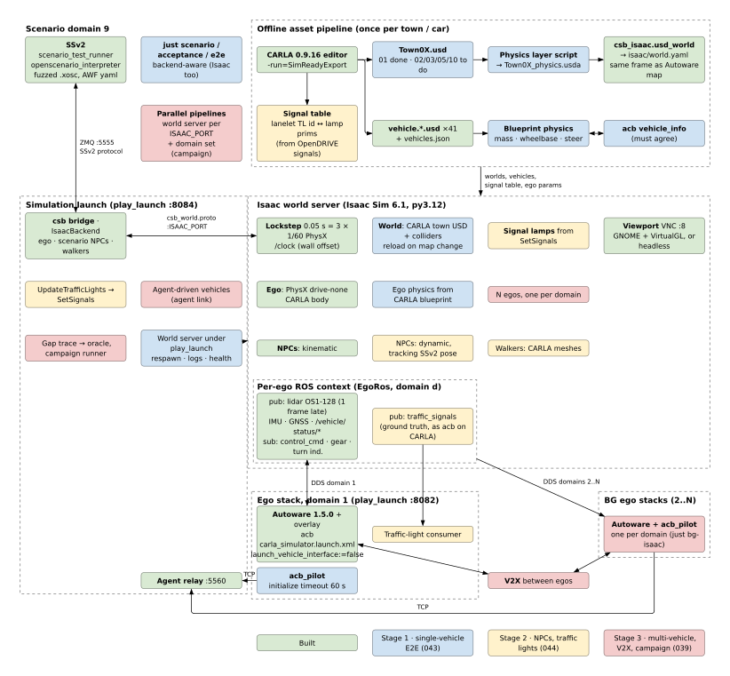

# Phase 043: Single-Vehicle End to End on Isaac Sim

One Autoware ego on Isaac Sim with the CARLA experience: CARLA's own towns and CARLA's own car,
driven through every scenario that needs no NPC and no traffic light, by the same recipes as
on CARLA, repeatably and unattended. Stage 1 of three toward the full SSv2 + Isaac + Autoware
stack ([design/isaac-stack.svg](../design/isaac-stack.svg)): this, then NPCs and traffic
lights ([044](044-isaac-npcs-and-traffic-lights.md)), then several vehicles, V2X and the gap
campaign ([039](039-isaac-multi-autoware.md)).

**Source**: user direction 2026-10-18 ("finish single vehicle end-to-end run first, in which
map, vehicle model and driving are done first. We then process npc and traffic lights. The
multiple vehicle and v2x the last.").
**Depends on**: [038](038-isaac-vehicle-bridge.md) (the ego, Town01 as a SimReady world,
CARLA's vehicles in Isaac).
**Feeds**: [044](044-isaac-npcs-and-traffic-lights.md), [039](039-isaac-multi-autoware.md),
[040](040-ntu-offroad-field.md).



Source of the diagram: `docs/design/isaac-stack.typ` (`typst compile` it to the SVG). Blue
boxes are this phase.

## Where 038 left it

- Town01 exported with NVIDIA's SimReady converter from a CARLA 0.9.16 editor build
  (`/mnt/disk1/carla-src`, `-run=SimReadyExport`) to `/mnt/disk1/carla-usd/Town01`. The export
  has no physics; a collider layer (`Town01_physics.usda`, sublayering the export and applying
  `PhysicsCollisionAPI` to its meshes) was written once by hand-run code, not by anything
  committed. `csb_isaac.usd_world` writes the world file beside the Autoware map.
- 41 vehicles exported (`/mnt/disk1/carla-usd/vehicles`, catalogue `vehicles.json`); the ego
  wears the Tesla Model 3 body. Its physics are acb's `vehicle_info` geometry plus a mass and
  centre of mass typed into `acb_ego.yaml`.
- `town01_ego_drive` 5/5 on the Town01 world, 0 MRM, tracking within acceptance.py's limits.
  Run by hand: `just isaac-world`, `just run backend:=isaac`, `just ego-isaac`, then
  `ros2 launch scenario_test_runner ...`; `just scenario`, `just acceptance` and `just e2e`
  refuse without CARLA.

## Design

### Map

- **Towns**: Town02, Town03, Town05 and Town10HD exported as Town01 was, one directory each
  under `/mnt/disk1/carla-usd/<Town>`. Each has an Autoware map in
  `data/carla-autoware-bridge/<Town>` already, in the same frame (SimReady converts
  centimetres to metres and flips CARLA's Y).
- **Collider layer as code**: `csb_isaac.physics_layer` writes `<Town>_physics.usda`: a
  sublayer of the export, `PhysicsCollisionAPI` on every mesh (triangle mesh, static), nothing
  copied. The export stays untouched.
- **One recipe**: `just isaac-town <Town>` exports (when the USD is missing), writes the
  collider layer and the world file. Paths come from the environment (`CARLA_SRC`,
  `CARLA_USD`), the town from the argument.
- **Checks per town**: the world loads in the world server, the ego settles on the road at
  the scenario's start pose (z within 5 cm of the lanelet), NDT converges on the town's
  `pointcloud_map.pcd` from the Isaac lidar.

### Vehicle model

- **Physics from CARLA's blueprint**: CARLA's `get_physics_control()` per vehicle (mass,
  centre of mass, drag, per-wheel radius, max steer angle, max brake torque, tire friction,
  suspension) dumped into `vehicles.json` under `physics`. The ego's `VehicleParams` take
  them from the catalogue for the ego's model; `acb_ego.yaml` names the model
  (`model: vehicle.tesla.model3`) instead of typing numbers.
- **One car, two descriptions that must agree**: Autoware plans with acb's `vehicle_info`
  (wheel base, tread, wheel radius, overhangs). The world server compares it with the
  catalogue at start and refuses a mismatch beyond 5 cm with both numbers in the message, so
  a different model cannot be driven with the Tesla's description by accident.
- **Same car, same response**: open-loop step responses (throttle, brake, steer) on CARLA
  and on Isaac from the same commands, compared: speed and yaw rate within 10 % after the
  first second.

### Driving and operations

- **The world server is supervised**: `isaac_world.launch.xml` (csb_launch) runs it under
  play_launch, `respawn`, logs in `play_log/`, a health probe (Hello round trip). `just
  isaac-world` starts that launch; launch args are project settings (`ego:=`, `world:=`,
  `follow:=`), port and display come from the environment (`ISAAC_PORT`, `DISPLAY`).
- **Backend-aware recipes**: `just scenario`, `just acceptance`, `just e2e` take
  `backend:=isaac` (default `carla`): the CARLA precheck becomes a check of the chosen
  backend, the ego stack is `ego-isaac`, the world server is started if absent.
- **The agent waits for slow starts**: acb's `autoware_port.py` gives `initialize` 8 s; NDT on
  a loaded host misses it and the pilot retries in a storm. Raised to 60 s (acb commit, pushed,
  then the pin).
- **Map change**: `town02_episode_change` swaps worlds mid-session. `LoadWorld` of a town that
  was not preloaded compiles its shaders (minutes): the load timeout covers it, and the world
  server preloads every town listed in `world:=` (comma separated).

## Steps

- [x] Phase docs, target diagram.
- [x] Collider layer generator, `just isaac-town`; Town02, 03, 05, 10HD exported and their
      world files written.
- [x] CARLA physics in the catalogue (reference); the ego a plausible real Model 3 instead
      of CARLA's car (user direction 2026-10-18: realism, not CARLA parity); the
      `vehicle_info` check;
      step-response comparison CARLA vs Isaac.
- [x] World server under play_launch with respawn; backend-aware `scenario`, `acceptance`,
      `e2e`; acb initialize timeout.
- [x] Exit runs ("Exit runs" at the end), recorded.
- [ ] Screencast of the demo.

## Acceptance

- [x] `town01_ego_drive`, `town01_engage_state`, `town02_episode_change` and one route per
  exported town: 5/5 PASS each on Isaac, 0 MRM, tracking within acceptance.py's limits.
  Met 2026-10-18/19, see "Exit runs".
- [ ] The same car on the same route on CARLA and Isaac: longitudinal and cross-track tracking of
  the same order (recorded here). Only Town01 so far (CARLA cross-track 0.04 m, Isaac
  0.03-0.04); the new towns' routes were not run on CARLA.
- [x] `just scenario <xosc> backend:=isaac` from a cold host (no world server, no ego stack) to
  a verdict with no other command. Met: `just e2e` 3/3 from cold (operations, below), and each
  town batch in "Exit runs" started from no world server and no ego stack.

### As built: vehicle

**Basis: a plausible real car, not CARLA parity.** The Isaac ego is meant to be realistic, not
to reproduce CARLA's vehicle (CARLA's grips at 3.5 g and brakes at 700 N m per wheel). A real
powertrain is a separate, later piece; the actuation stays "drive none" (acb's contract: the
requested acceleration and tire angle are realized, `vehicle.py`). `csb_isaac/vehicle_params.py`
(unit-tested in `test/test_vehicle_params.py`) holds the car:

| | value | basis |
|---|---|---|
| geometry | wheel base 3.005, tread 1.667, wheel radius 0.370 m, steer limit 0.70 rad | acb's `vehicle_info` = the CARLA Model 3 body the ego wears. A real Model 3 is 2.875 / 1.58 / 0.334 m (235/45R18); kept the description's so Autoware, the body and the physics are one car |
| mass | 1845 kg | Model 3 Long Range AWD curb mass 1830-1851 kg by model year ([evspecifications](https://www.evspecifications.com/en/model/9f3b3db)) |
| centre of mass | 48/52 front/rear, 0.46 m high: (1.442, 0, 0.46) in base_link | assumption: road-test weight splits around 47-48 % front; a floor battery pack puts the CoM low |
| tires | friction 1.0; lateral stiffness 17 x rest load at 2 rest loads; longitudinal 10 x rest load | dry asphalt; the PhysX vehicle's usual passenger-car tire |
| brakes | 3000 N m per wheel, split by the dynamic axle load (ideal distribution) | a stop is limited by the tires (~1 g), as on a real car, not by brake torque |
| drive | 1500 N m per wheel cap | ~8 m/s^2, beyond what Autoware asks |
| suspension | 1.6 Hz, damping ratio 0.45, 0.2 m travel, per axle on its sprung mass | a sedan's ride; each axle at one frequency, so the car sits level |
| inertia | box of the body, mass/12 x (l^2 + w^2) etc.: yaw 4097 kg m^2 | close to m a b = 4155 kg m^2, the usual estimate for a sedan |

The YAML's `vehicle:` overrides any field by name (empty in the shipped one).

**One car, two descriptions that must agree.** `acb_ego.yaml` names the body (`model:
vehicle.tesla.model3`). `IsaacWorld` compares vehicle_info's wheel base, tread and radius with
the catalogue's (CARLA's wheels, `physics` below) at start, and refuses more than 5 cm with
both numbers:

```
VehicleMismatch: the ego's vehicle description is not vehicle.lincoln.mkz_2020: wheel_base
3.005 m in vehicle_info, 2.860 m in vehicle.lincoln.mkz_2020's physics; wheel_tread 1.667 m
in vehicle_info, 1.593 m in vehicle.lincoln.mkz_2020's physics (tolerance 5 cm). ...
```

The ego wears the YAML's model whatever body the scenario names (a warning says so).

**A braking bug, fixed.** PhysX's vehicle at 1 substep above 5 m/s and a 0.1 m/s active slip
denominator (UE's settings too) went unstable under brake torque: the wheels locked and the car
stopped at the friction limit. A -3 m/s^2 request from 7.4 m/s stopped it in 0.7 s (about
-11 m/s^2). Every Autoware braking command on Isaac before this was realized several times
harder than asked. Now 8 vehicle substeps at every speed and a 4 m/s active slip denominator
(`physx_substeps`, `min_active_slip_denominator`).

**Step responses** (`src/csb_isaac/scripts/step_response/`, Isaac: `IsaacWorld` with the ego
YAML, flat ground, 0.05 s frames of 3 PhysX steps as csb steps it, commands into the ego's
command slot; data in `/mnt/disk1/csb-043-vehicle/out/isaac_real_*`):

| test | asked | Isaac |
|---|---|---|
| accelerate | +1.5 m/s^2 | +1.48 m/s^2 |
| brake from 7.4 m/s | -3 m/s^2 | -3.02 m/s^2, stopped at 8.50 s (CARLA 8.55 s) |
| AEB-like from 15 m/s | -8 m/s^2 | -8.05 m/s^2 (-7.86 mean to a stop in 1.9 s), no lock-up |
| beyond the tires from 15 m/s | -12 m/s^2 | -9.7 m/s^2: friction-limited at ~0.99 g |
| 5 m/s, steer 0.2 rad | yaw rate | 0.332 rad/s; kinematic 0.334; CARLA 0.333 |
| 10 m/s, steer 0.1 rad | yaw rate | 0.326 rad/s; kinematic 0.328; CARLA 0.329 |
| 15 m/s, steer 0.05 rad (3.6 m/s^2 lateral) | yaw rate | 0.245 rad/s; kinematic 0.247 |

The car is close to neutral steer up to 3.6 m/s^2 lateral (0.7 % short of kinematic): a real
Model 3 understeers a little more. Its tires are the stiff end of plausible.

**CARLA's vehicle, for reference** (CARLA 0.9.16 and its UE 4.26 under `/mnt/disk1/carla-src`).
`scripts/dump_vehicle_physics.py` writes `get_physics_control()` for all 41 blueprints into the
catalogue's `physics` and `physics.json` (actor frame, m, Y flipped; wheel positions come back
in world cm). `scripts/ue_vehicle_physics.py`, an editor commandlet script, dumps what the API
does not return (`/mnt/disk1/csb-043-vehicle/ue/ue_physics_all.json`, all 41). What it found,
traced through the source:

- Centre of mass: UE computes the chassis body's from its PhysicsAsset shapes at uniform
  density, then adds `COMNudge` (`Engine/Source/Runtime/Engine/Private/PhysicsEngine/BodyUtils.cpp:159`),
  and `get_physics_control().center_of_mass` is only that nudge
  (`carla/.../Vehicle/CarlaWheeledVehicle.cpp:464`). The Tesla's actual CoM, read from the body:
  (0.336, 0, 0.412) m from the actor origin, nudge (0.45, 0, -0.30) included = 1.72 m ahead of
  the rear axle (57 % front) and 0.47 m above the ground. Yaw inertia 2415 kg m^2 (the body's,
  scaled to 1845 kg).
- Suspension: sprung masses from `PxVehicleComputeSprungMasses`, spring = w^2 m_sprung
  (`PhysXVehicles/.../WheeledVehicleMovementComponent.cpp:449,460`); the Tesla's wheels: natural
  frequency 9.5 rad/s (1.5 Hz), damping ratio 1.0, 7.5 cm raise and drop, 20 kg.
- Tires: friction = surface friction x the tire config's scale (`TireConfig.cpp:122`); CARLA sets
  the scale to 3.5 on every vehicle (`CarlaWheeledVehicle.cpp:158`) on UE's default 0.7: 2.45.
  Lateral stiffness at rest is 20 x 0.70 = 14 x rest load per rad, longitudinal 3000 kg x g.
- Braking beyond 700 N m: engine braking through the clutch. PhysX solves wheels, clutch
  (strength 10) and engine (damping 2.0 at zero throttle, MOI 1) implicitly
  (`PhysX_3.4/.../PxVehicleUpdate.cpp:3850`); through the 9:1 drive the engine's inertia adds
  ~590 kg to the car. Coasting is ~0.35 m/s^2 per m/s, full brake ~9 m/s^2 at 15 m/s (acb's maps
  agree). Aerodynamic drag is 0.5 rho v^2 Cd w h with Cd 0.15 (`...MovementComponent.cpp:992`):
  ~0.1 m/s^2 at 24 m/s, negligible.
- The ~0.15 s brake onset on CARLA: two rate limiters in series (UE's `InterpInputValue`, PhysX's
  pad smoothing: throttle and brake rise 6/s, fall 10/s; `...MovementComponent.cpp:116`) and the
  engine side's time constant I/(K + D) = 1/12 s after a lift-off.
- Steering: inner wheel = command x 70 deg x steering curve(speed), outer by Ackermann
  (accuracy 1, `PxVehicleUpdate.cpp:1797`); steering input rises 2.5/s and falls 5/s
  (`...MovementComponent.cpp:120`), ~175 deg/s at the wheel. acb inverts the Ackermann mean and
  divides by the curve.

Open: the CoM (48/52, 0.46 m) and the tires are assumptions; a real Model 3's measured weight
split, CoM height and tire data would replace them. The wheel base and radius are the CARLA
body's, 13 cm and 3.6 cm off a real Model 3. Not yet measured with Autoware driving.

### As built: towns

`src/csb_isaac/scripts/isaac_town.sh <Town>` (2026-10-18): exports with SimReady when
`$CARLA_USD/<Town>/<Town>.usd` is missing (log `$CARLA_USD/<Town>/export.log`; done when the
log says "exported to USD!", the commandlet exits 1 on material warnings regardless), then
`csb_isaac.physics_layer` writes `<Town>_physics.usda` and `csb_isaac.usd_world` the world
file for the map (`Town10HD` -> `data/carla-autoware-bridge/Town10`). The layer: static
triangle-mesh colliders on every mesh except foliage `PointInstancer`s, invisible meshes
(CARLA's 2 mm crosswalk planes), the background cards and the water (Town01's `Lake`,
Town10HD's `SM_sea*`). Town01's regenerated world file is identical to the hand-made one
(1718 ground prims); its layer differs from `add_physics.py`'s only by the 40 crosswalk
planes.

Checks: a world server per town (headless, `--world` preload, an Autoware ego from
`acb_ego.yaml`), then six egos one after another on straight road lanelets (>= 30 m, spread
over the map, pcd ground flat across 2.4 m), each dropped from 0.3 m and stepped 4 s at 60
Hz; z of `base_link` at rest against the lanelet's `ele` and against the town's
`pointcloud_map.pcd` (median z within 1 m), which is CARLA's own surface.

| town | export | colliders | ground prims | preload (first render) | ego - pcd | ego - lanelet ele |
|---|---|---|---|---|---|---|
| Town01 | 17.5 min | 5965 | 1718 | 104 s (materials cached) | <= 0.3 cm | <= 0.3 cm |
| Town02 | 9.2 min | 3732 | 703 | 428 s | 0.0 cm (5 of 6) | +22.0 cm |
| Town03 | 16.3 min | 7258 | 1497 | 474 s | <= 0.1 cm | up to 83 cm |
| Town05 | 10.8 min | 7355 | 1585 | 207 s | <= 0.1 cm | <= 5.4 cm |
| Town10HD | 25.4 min | 3651 | 443 | 283 s | <= 1.1 cm | 0.0 cm |

Exports 0.9-1.9 GB each on /mnt/disk1. Preload times are with a CARLA server and two other
Isaac instances on the GPU, Town03 and Town05 also beside another town's export; a first
load compiles materials (Town01's first was about 9 min). Town01 and Town02 were checked
with their crosswalk planes still colliding (the rule came with Town03).

The USD and the pcd agree everywhere sampled (curb edges too: Town01's curb at y = -332.8 is
at the same place in both). Where the ego misses the lanelet's elevation, the lanelet map is
what is off:

- Town02's lanelets say `ele` 0; CARLA's road there is at z = 0.22 (pcd and USD alike).
- Town03's lanelet map has no elevation at all (every node `ele` 0) though the town has
  slopes: the ego rests at -0.83 and +0.80 on two of the six lanelets, on the pcd's surface.
- Some `subtype=road` lanelets are not on CARLA's road: Town01 has outer lanelets about 2 m
  off the carriageway, half on the 10 cm sidewalk (lanelet 7768 at y -334.8..-330.8, road
  edge at -332.7), and 16 of 59 candidates there have sidewalk-height or no pcd ground; Town02
  lanelet 11983 (198.0, -150.6) lies on a planted sidewalk (the ego lands on plant pots and
  a cypress). Town03 has 18 straight lanelets with no pcd points under them.

So the 5 cm criterion holds against CARLA's surface in every town, and against the lanelet
`ele` only where the lanelet map carries the true height (Town01, Town05, Town10HD). Not
yet checked: NDT on each town's pcd from the Isaac lidar.

### As built: operations

1. **The world server is a launch node.** `csb_launch isaac_world.launch.xml` runs
   `isaac_world_server` (installed by csb_launch, pointing at the `src/csb_isaac` it was built
   beside; `CSB_ISAAC_DIR` overrides), a wrapper that drops the launch's `--ros-args` and the
   system Humble environment, sources `isaac_env.sh` and runs `csb_isaac.world_server` in
   Isaac's venv. `respawn="true"` (10 s delay); output in `play_log/isaac/<run>/node/isaac_world/`.
   `just isaac-world` is that launch under play_launch on web 8085. Launch args: `ego:=`
   (`default`, `none` = 037's kinematic box, or a YAML; the recipe still maps `ego:=` empty to
   `none`), `world:=` (comma separated world files, map directories or USD files),
   `follow:=`, `render:=auto|window|headless` (auto: a window when `DISPLAY` is set, unless
   `ISAAC_HEADLESS=1`). Port and display are `ISAAC_PORT` and `DISPLAY`. `just run` now always
   hands csb `isaac_endpoint` on the same `ISAAC_PORT`.
2. **Several towns preloaded.** `world_server.py` resolves each `world:=` entry to its USD
   (a world file's `usd`, relative to its map directory as csb resolves it), checks them all
   before starting Isaac, loads and renders each with a throwaway ego (the lidar's material
   trace), and keeps the first listed loaded. Only one town is on the stage at a time; what
   a preload buys is the compiled shaders and traced materials, which later loads reuse.
   Measured: Town02 then Town01 preloaded in 126 + 52 s on a loaded host, 29 + 22 s on a
   quieter one; after that the switch Town01 -> Town02 -> Town01 for `town02_episode_change`
   costs 18-25 s at the next ego's spawn (sensors warm), against 54 s when Town01 had not
   been preloaded since the last switch, all inside csb's 120 s load timeout.
3. **Health probe**: `just isaac-health [wait:=SECS]` (`csb_isaac.health`, Isaac's venv
   python, no Isaac environment) sends one Hello and reports the Isaac version, or that
   nothing answered. A preloading server answers nothing; a Hello beside a running scenario
   is harmless.
4. **Backend-aware recipes.** `just scenario <xosc> backend:=isaac [worlds:=Town01,Town02]`
   runs `scripts/isaac_up.sh`: the world server if Hello fails (or waits for one whose launch
   is up), `just run backend:=isaac` unless 8084 already runs it, `just ego-isaac` with the
   scenario's map unless 8082 runs it; then `_require-ego-stack` and the agent's registration
   with the relay. A CARLA bridge on 8084 or a `just ego-av` on 8082 is refused, not
   replaced. The stacks stay up for the next run. `just e2e <xosc> backend:=isaac` does the
   same and stops what it started (`KEEP_STACKS=1` keeps them). `backend:=carla` (default)
   is unchanged: CARLA and ego prechecks for `scenario`, acb's acceptance.py, demo.launch.xml.
5. **Acceptance on Isaac** is `scripts/acceptance_bag.py` (`just acceptance <xosc> <runs>
   backend:=isaac`). acb's acceptance.py needs a CARLA client (the ego watcher, the health
   check) and a per-run ROS observer, which joins Isaac's domain too late (038, point 11).
   The bag version keeps its judgement and imports its limits and `dead_nodes`, records the
   ego's domain once across the batch (`tracking_probe.py`'s topics plus
   `/api/fail_safe/mrm_state`) and scores each run from message stamps: verdict, peak speed
   and distance, longitudinal, cross-track, EKF-to-GNSS, MRM entries, dead nodes. Not
   carried over: the route-start check and the diagnostics report.
6. **`_clear-stale-scenario` only clears its own domain.** The first cold run cleared two
   processes it had not started: on a host shared with other runs, `pgrep -f
   scenario_test_runner` finds theirs too. It now skips any process whose `ROS_DOMAIN_ID` is
   not the scenario domain.
7. **acb**: `initialize` gets 60 s (acb `fefb993`; the pin before it already had 30 s, the
   checkout here was a stale 8 s one).

**Exit runs** (2026-10-18, Town01 SimReady world, headless; the ego's physics as of
`4aefee8`, the realistic Model 3), tracking by acceptance_bag.py, medians per run (limits
0.35 m/s^2, 1.0 m, 10 m):

| scenario | runs | verdicts | longitudinal, m/s^2 | cross-track, m | EKF-GNSS, m | MRM |
|---|---|---|---|---|---|---|
| `town01_ego_drive` (cold host, `worlds:=Town01,Town02`) | 3 | 3 PASS | 0.034, 0.030, 0.023 | 0.03, 0.03, 0.04 | 1.06, 1.02, 1.02 | 0 |
| `town01_engage_state` | 3 | 3 PASS | 0.029, 0.025, 0.025 | 0.03, 0.03, 0.03 | 1.01, 1.02, 1.01 | 0 |
| `town02_episode_change`, each followed by `town01_ego_drive` | 3 + 3 | 6 PASS | | | | |
| `just e2e town01_ego_drive backend:=isaac` from a cold host | 3 | 3 PASS (182, 262, 107 s) | | | | |

Against 038 (voxel world, its vehicle): longitudinal 0.017-0.076 there, 0.023-0.036 here;
cross-track 0.06-0.28 there, 0.03-0.04 here, CARLA's 0.04; EKF-GNSS 0.74-0.83 there,
~1.0 here (another world). With the intermediate physics (`3f5b708`) the same batch measured
0.036/0.033/0.028 and 0.04/0.03/0.03: no change worth the name from either physics commit.
Frame cost at the world server rose with the SimReady world: 22-24 ms p50 on a quiet host,
45-50 ms (the whole 50 ms frame) at load 60-70.

**Open.** The world server holds 15-17.5 GB of RAM with Town01 loaded; twice on this shared
host (60 GB, two UE SimReady exports running beside) the kernel's OOM killer took it as the
ego stack started, 23 s and a few minutes after it was ready. play_launch respawned it and
csb's bridge waited for it, but the scenario under way failed (no simulator response, then a
failed frame): a cold run then needs that memory free. The respawned server's earlier log is
lost with play_launch 0.15.1 (out.1 is kept from 0.18.3 on; CLAUDE.md asks for that version).

### Exit runs

2026-10-18/19, headless world server, one town loaded at a time (`worlds:=<Town>`; Town01
with Town02 preloaded for the episode change), acb at `7429bbc`; play_launch went from 0.15.1 to 0.18.3 during the
Town01 batch, so every stack started after it runs 0.18.3. Every row is `just acceptance <xosc> 5
backend:=isaac worlds:=<Town>` (scored by `scripts/acceptance_bag.py`) except the episode
change, which is five `just scenario` pairs (`town02_episode_change`, then `town01_ego_drive`)
judged by their junit. Medians over the five runs, range in brackets; limits 0.35 m/s^2,
1.0 m and 10 m. "NDT" is acb_agent's "localized at the teleported pose after" per run: every
run localized on the first attempt, none retried. Frame time is the world server's wall time
per step, p50 per run.

| scenario | PASS | longitudinal, m/s^2 | cross-track, m | EKF-GNSS, m | MRM | NDT, s | frame p50, ms |
|---|---|---|---|---|---|---|---|
| `town01_ego_drive` | 5/5 | 0.028 (0.023-0.036) | 0.04 (0.03-0.04) | 1.02 (1.01-1.05) | 0 | 2.2-6.7 | 22-28 |
| `town01_engage_state` | 5/5 | 0.024 (0.022-0.026) | 0.03 (0.02-0.04) | 1.02 (1.01-1.03) | 0 | (as above) | (as above) |
| `town02_episode_change` + `town01_ego_drive` | 5/5 + 5/5 | | | | | | |
| `town02_ego_drive` (145 m, left turn) | 5/5 | 0.017 (0.017-0.017) | 0.01 | 1.35 (1.35-1.38) | 0 | 2.7-3.6 | 22.5 |
| `town03_ego_drive` (136 m, left turn) | 5/5 | 0.025 (0.022-0.030) | 0.01 (0.01-0.02) | 0.95 (0.89-0.95) | 0 | 3.0-6.7 | 33 (28-36) |
| `town05_ego_drive` (140 m, right turn) | 5/5 | 0.028 (0.023-0.030) | 0.03 | 0.71 (0.65-0.76) | 0 | 2.6-5.3 | 31 (26-42) |
| `town10_ego_drive` (100 m, right turn) | 5/5 | 0.031 (0.026-0.035) | 0.04 | 0.42 (0.39-0.49) | 0 | 2.1-7.3 | 52 (45-53) |

World server up from cold (Hello answering, first town rendered): Town01 + Town02 135 s,
Town05 148 s, Town10HD 173 s, Town02 110 s. The Town03 and Town05 frame times are with
another session compiling Rust beside them (load 70-150 on 32 cores); Town10HD's ~50 ms is
the whole 50 ms frame on a quiet host, so it runs at real time with no headroom.

**The routes.** `src/csb_examples/scenarios/basic/town{02,03,05,10}_ego_drive.xosc`, modelled
on `town01_ego_drive`: start and goal in the middle of straight `road` lanelets, 100-145 m
apart along the routing graph, one turn, no traffic-light regulatory element on any lanelet
of the path, the goal lanelet with at most one successor. Start and goal were checked against
`pointcloud_map.pcd` (CARLA's surface): ground under the car flat to 3 cm across 2.4 m and
along +-3 m, and not above the lowest ground within 6 m to the side (a kerb or sidewalk is
10-15 cm up). The start z is the pcd road height (Town02 0.22, the others 0.0). Town10's
LogicFile is `$(env CARLA_MAPS)/Town10` like the 0.10 profile's; for CARLA 0.9.16
`bridge_config.yaml` now aliases `Town10` to `Town10HD` (CARLA matches map names exactly,
`UCarlaStatics::FindMapPath`), so the scenario also loads on the CARLA backend (not run there).

**Failure 1: the poses came from `local_x`/`local_y`.** The first routes were placed with the
map's `local_x`/`local_y` tags, as 043's town checks were. Autoware and SSv2 do not use them: they
project each node's lat/lon through the TransverseMercator projector (WGS84, k0 0.9996), and the
tags sit 0.709 % further out in y (033 step 3 and 032 found the same). At y = 200 m that is
1.4 m, more than the margin a 2.16 m car has in a 3.5 m lane. Town03 showed both ways it fails:

- a goal at (47.34, 192.81): `mission_planner` "Goal's footprint exceeds lane!", the route is
  empty, 0/5;
- a start at (83.89, 202.40), 1.43 m right of Autoware's lane centre: `start_planner` plans a
  shift back to the centre, `path_optimizer` zeroes the whole trajectory because the footprint
  at the start is outside the drivable area (bounds 199.22..202.70 against the tags'
  200.65..204.15), and in some runs `planning_validator`'s `trajectory_shift` check latches on
  the teleport; 1/5, the ego never moves.

Re-placed in the projected frame, Town03 went 5/5. The Town02 route had passed 5/5 in the
wrong frame too (4 m lanes leave room), with EKF-GNSS 1.5 m; it was replaced and rerun
(the table's row). Town05 and Town10 are close to y = 0 and moved less than 0.6 m.
The same mistake is in "As built: towns": its spawns used the tags, so its "Town01 outer
lanelets about 2 m off the carriageway, half on the sidewalk" is the 0.709 % stretch at
y = -332, not the lanelet (its elevation findings stand: they compare z).

**Failure 2: Town05's and Town10's lanelet maps did not load.** Each has one `right_of_way`
regulatory element with a `yield` lanelet and no `right_of_way` lanelet (Town05 131372,
Town10 37142, in the pack as shipped). SSv2 stops at once ("Failed to load lanelet map ...
A maneuver must refer to at least one lanelet that has right of way!", 0/5 in 10 s), and
Autoware's `lanelet2_map_loader` logs the same and does not publish the map, so the ego
stack stays INITIALIZING. `scripts/repair_lanelet_right_of_way.py` (wired into
`download_maps.sh`, tests in `src/csb_launch/test/test_repair_lanelet_right_of_way.py`)
deletes such elements; no lanelet refers to either. Applied to `data/carla-autoware-bridge`
(git-ignored, `.orig` kept); lanelet2's `loadRobust` then reports no error on any of the five
towns.

**Environment.** `/home` ran out of space twice during the batches (other users): the
bridge's log writes failed at 23:16 (`No space left on device` from its tracing writer; the
runs then passed), and the ego stack's health check flagged 170 MiB free at 23:39 during the
second failed Town05 batch, which had failed on the map already. Run logs and bags of these
batches are in `/mnt/disk1/csb-043-exit/` (`play_log/` moved there).

**Open.** The CARLA side of the same routes; Town10HD's frame cost (no margin at 50 ms);
EKF-to-GNSS differs per town (0.4-1.4 m, all within 10 m) and was not chased.
