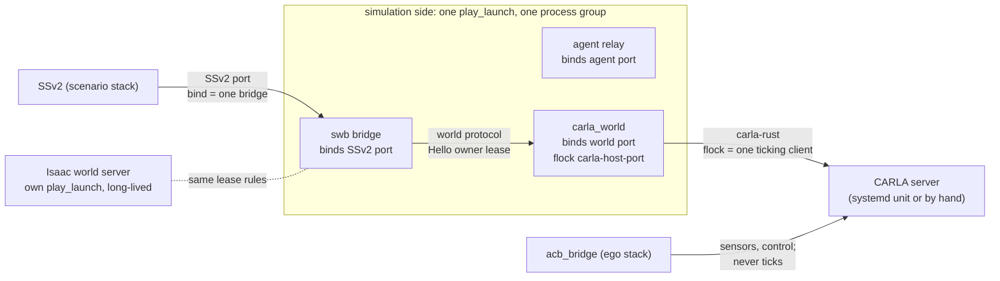

# Phase 046: One World Interface, then the Rename

Make every simulator a world server behind one protocol, with CARLA and Isaac Sim as its two
implementations, prove both still run what they ran, and only then rename the project and
its packages away from "carla". Design: [design/simulator-interface-split.md](../design/simulator-interface-split.md)
(the revised layering: one way in, the world protocol).

**Source**: user direction 2026-10-22 ("change the csb name because it has carla in it;
refactor csb first to have the unified interface and test it against CARLA and Isaac Sim;
then rename csb, both in package name and in the code").
**Depends on**: [044](044-isaac-npcs-and-traffic-lights.md)'s trait changes (landed
2026-10-22; its open items do not block); [035](035-backend-seam.md) (the seam this replaces).
**Feeds**: [039](039-isaac-multi-autoware.md), which then adds its protocol fields to the
unified interface instead of to Isaac's private one; the repository split (design step 8),
a later phase.

Two parts, in order, never interleaved:

- **Part A, unify.** All in this repository, under today's names. CARLA moves out of the
  bridge into its own world server process; the bridge keeps one backend that speaks the
  world protocol. No behaviour change on either simulator, measured.
- **Part B, rename.** Mechanical: package, crate, module, node, service, environment and
  repository names. No behaviour change, checked by a shorter run.

Not in this phase: splitting repositories, moving the Autoware launch profile out of acb
(`scenario_vehicle_launch`), a third simulator. The design lists them; each is its own phase.

## Where it starts (2026-10-22)

| | today |
|---|---|
| bridge | one crate `carla_scenario_bridge`, links carla-rust; `backend` ROS parameter picks `CarlaBackend` (in process, 6 100-line `backend.rs` plus 5 modules) or `IsaacBackend` (ZMQ to the world server) |
| world protocol | `proto/csb_world.proto`, version 3, private to Isaac: `usd` field, `isaac_version`, 60 Hz substep constant in the bridge, motions `KINEMATIC` and `TRACKED` only, no goals, no weather |
| Python server | `src/csb_isaac`: `server.py` and `protocol.py` simulator-free, `world_server.py` Isaac's entry, `world.py` and the rest Isaac's |
| CARLA-only modules in the shared crate | `actor_census`, `blueprint_boxes`, `clock_store`, `epoch_marker`, `lanelet_map`, `sensor_release`, `spawn_ladder`, `tick_gate`, `tick_watchdog`, the Y-flip in `coordinate_conversion` |
| map files | `<map>/carla/traffic_lights.yaml` (read by both), `<map>/carla/map_origin.yaml`, `<map>/isaac/world.yaml`; CARLA's town from the directory name and `map_alias` |
| weather | ROS `/carla/set_weather`, `/carla/get_weather` on CARLA's `Weather.msg`; Isaac `Unsupported` |
| run tooling | `backend:=carla|isaac` in `scenario`, `acceptance`, `e2e`, `run`; `isaac_up.sh` brings up Isaac's stacks; CARLA's are brought up by hand or `demo.launch.xml` |

## Design (as proposed; what changed in the building is under "As built")

### The protocol, version 4

`csb_world.proto` becomes the simulator interface. Changes against v3, every one additive
except the two renames, which the version bump covers:

| message | change |
|---|---|
| `HelloReply` | `isaac_version` renamed `simulator_version`; adds `simulator_name` (`carla`, `isaac`: the `<map>/<name>/world.yaml` directory) and `capabilities` (`SIGNALS`, `AUTOPILOT`, `AGENT_VEHICLES`, `TRACKED_MOTION`, `WEATHER`, `CONTACTS`) |
| `LoadWorld` | `usd` renamed `world` (the server's own string from `world.yaml`: a USD path, a town name); adds `step_time`, `realtime_factor` from SSv2's `Initialize`, and `map_dir` |
| `Spawn` | `Motion` gains `EXTERNAL`: a vehicle the simulator's physics moves, driven by its own vehicle bridge or by the simulator's autopilot (today's `Driver::Ego`, `Agent`, `SimulatorAutopilot`), read back every step; adds `role_name` (CARLA's acb attaches by it) |
| `Step` | adds `substep_dt`: the bridge sends it, the server stops assuming 60 Hz |
| `StepReply` | unchanged; `time` stays the server's and monotonic over its lifetime |
| `SetGoal` (new) | entity handle, waypoints, `clear`, `target_speed`: `UpdateEntityGoal` for an `AUTOPILOT` vehicle |
| `SetWeather`, `GetWeather` (new) | a preset name and a `map<string, double>` of parameters; the reply carries what was applied |

Rules the protocol states, so both servers keep them: entities by handle, the bridge keeps
the SSv2 name; poses at the entity origin in the server's world frame, right-handed, Z up
(the CARLA server flips Y inside itself); the bridge applies `map_origin`; a refusal is
`ok = false` with text, never a success that did not happen (006); a request outside the
declared capabilities is refused by the bridge without being sent.

### The bridge after part A

`carla_scenario_bridge` keeps its name until part B and loses every simulator:

- `IsaacBackend` becomes `RemoteBackend`, the only `SimBackend`; `tracking.rs` and
  `signals.rs` go with it. `SimBackend` stays as the coordinator's internal seam (the fake
  backend still tests the coordinator).
- The coordinator checks `capabilities` before a gated call; `Driver::of_vehicle` demotes
  `simulator_autopilot` to `Scenario` with a logged reason when `AUTOPILOT` is absent.
- Time continuity across `Initialize` (`episode_clock`) stays in the bridge, fed by the
  server's monotonic time.
- Weather: generic ROS services on the bridge node (`~/set_weather`, `~/get_weather`, a new
  `csb_interfaces/WorldWeather` message: preset plus key-value parameters), forwarded as
  `SetWeather`. The bridge re-applies the requested weather after every `LoadWorld` and
  reconnect, as today. `/carla/set_weather` keeps working through part A as an alias that
  maps CARLA's fields to the generic parameters, and is removed in part B.
- `bridge_config.yaml` keeps the adapter's keys and gains `world: {endpoint,
  request_timeout_seconds, load_timeout_seconds}`; `carla:`, `isaac:`, `blueprint_map`,
  `traffic_manager`, `substeps`, `carla_tick_seconds`, `collision_monitor`,
  `npc_contact_sensors`, `sensor_release`, `tick_gate` move to the servers' configs. The
  bridge refuses a config that still carries one, naming where it went (the retired-key
  pattern `CSB_RETIRED_ENV` uses for the environment).
- `Cargo.toml` loses `carla`; a test checks the dependency graph has no simulator crate.
- The bridge's frame budget and wedge handling stay: a world request that misses its
  timeout wedges the bridge, which drains and exits 75, as with Isaac today.

### The CARLA world server

A new Rust package in this workspace, `carla_world` (renamed in part B only if the prefix
changes), a binary that serves the world protocol on carla-rust:

- A small library crate `csb_world_server` (Rust shell): the REP socket loop, request
  decode, `Hello` and version check, and a `World` trait with the protocol's methods.
  `carla_world` implements it; it is also the shell for any future Rust server.
- Today's `CarlaBackend` moves in, with `blueprint_boxes`, `actor_census`, `spawn_ladder`,
  `tick_gate`, `tick_watchdog`, `clock_store`, `epoch_marker`, `sensor_release`,
  `lanelet_map`, the collision monitor, the traffic-light mapper and resolved signals, CARLA
  weather presets, the version check and the Y-flip. It is re-cut from "SSv2 handler" to
  "world method" (`Step` instead of `update_entity_status` then `update_frame`), keeping
  each module's code and tests.
- **Time**: CARLA's frame time restarts on a map load; `carla_world` continues it (today's
  `episode_clock` and epoch marker logic, which acb reads for `/clock`) so its `StepReply`
  time is monotonic over the server's life, as the protocol requires.
- **Hung tick** (034): the tick watchdog and the `_exit(75)` move with the tick. The server
  exits; the bridge's request times out, it drains and exits 75 too; both are respawned.
  The bridge's request timeout must exceed the server's tick bound, and the launch says so.
- **CARLA client lifetime** (CLAUDE.md): the idle probe and "exit when the CARLA connection
  died" move with the client. The bridge holds no CARLA connection any more.
- **Sensor release** (acb's channel, `ssv2_port + 1`, `+ 2`): served by `carla_world`. The
  ports keep their defaults and their derivation from `SSV2_PORT`, so acb changes nothing.
- **Signal table**: `carla_world --generate-signal-table <map dir>` replaces the bridge's
  flag; it writes `<map>/traffic_lights.yaml` (below).
- Launch: inside the simulation side (`carla_simulation.launch.xml`, below), started by
  `scripts/carla_up.sh`, which also starts or reuses CARLA itself (`just carla-start`) and
  `just ego-av`, as `isaac_up.sh` does for Isaac.

### Process lifetime: one owner, no orphans (user question, 2026-10-22)

Moving CARLA out of the bridge adds a process, and the world protocol now lets any number of
clients connect to a server. Four rules keep a run to exactly one SSv2, one bridge, one world
server and one ticking CARLA client, and leave nothing behind.

**1. Where `carla_world` runs: inside the simulation side.** `carla_simulation.launch.xml`
starts the bridge, the relay and `carla_world` in one play_launch, so they share one process
group, one web port (`CSB_WEB_PORT + 4`, as the simulation side has today) and one stop.
`carla_world` is cheap to restart (a CARLA client, seconds), so it needs no life of its own;
the CARLA server stays the long-lived piece, as today. Isaac's world server stays a separate
launch (`+5`) because a restart costs ~7 minutes of preload and ~17.5 GB; it gets the same
rules below. A simulator is free to choose either, and the bring-up script (`up.sh`) knows
which.

**2. Singletons, held by the kernel, never by pid files.** Each one is a resource the kernel
releases when the holder dies, however it dies, so nothing is ever stale:

| what must be one | held by | a second one |
|---|---|---|
| bridge per SSv2 port | `bind` of the SSv2 port (today) | fails at start with `Address already in use` and exits 1 (respawn policy below) |
| world server per world port | `bind` of the world port | same |
| ticking client per CARLA server | `carla_world` holds `flock(LOCK_EX \| LOCK_NB)` on `/tmp/swb-locks/carla-<host>-<port>.lock` (directory mode 1777) for its whole life | refused at start, naming the holder's pid (written in the file, for the message only) |
| bridge per world server | the world server's **owner lease** (below) | refused at `Hello` with the owner's pid and host |

The CARLA lock closes a hole that exists today: two checkouts on one host (csb-seps beside
this one) both default to CARLA port 2000, and two synchronous-mode clients ticking one
server corrupt each other's runs silently. The lock is per host; a CARLA on another host is
protected only by its operator, which the user guide says.

**3. The owner lease in the world protocol.** `Hello` gains `client_id` (host, pid, process
start time from `/proc/<pid>/stat`) and `probe` (a health check that takes nothing). The
server keeps one owner:

- No owner: the first non-probe `Hello` becomes the owner. The server resets its world (every
  entity despawned, signals cleared), so a new bridge never inherits the last one's state.
- Owner present, a `Hello` from another client: taken over at once when the owner is
  provably gone (same host and its pid is dead or has another start time); otherwise taken
  over only when the lease has expired (no request from the owner for `lease_seconds`,
  default 15; the bridge's idle probe sends `Hello` every 5 s between scenarios, so a live
  bridge never lapses). Else refused: `owned by <host>:<pid> since <time>`.
- Every non-`Hello` request carries the owner's id; one from a non-owner is refused, so a
  stale bridge that wakes up cannot step a world it lost.
- `probe` hellos (`just world-health sim:=...`, `up.sh`'s readiness wait) are answered with
  version, capabilities and the current owner, and change nothing.

**4. Orphans.** Three layers, each catching what the one before misses:

- **Parent death signal.** Both world servers and the bridge call
  `prctl(PR_SET_PDEATHSIG, SIGTERM)` at start, then exit at once if `getppid()` is already 1
  (the parent died before the call). When play_launch is SIGKILLed -- the case CLAUDE.md's
  orphan hunt exists for -- its nodes get SIGTERM from the kernel instead of living on.
  Isaac's server does it through `ctypes` (Python 3.12, Linux only, as the rest).
- **Process groups.** `up.sh` starts each stack with `setsid` and records the group, as
  `isaac_up.sh` does today; `just e2e` and `stop` signal groups, never patterns.
- **Self-checks.** `carla_world` exits when its CARLA connection is dead (the idle probe,
  moved from the bridge: "a CARLA client must not outlive its server"); a world server whose
  owner's lease lapsed while it was idle drops to "no owner" and keeps its world loaded, so it
  is reusable, not an orphan. Nothing a run starts outlives its launch.

Respawn policy, so a refusal never becomes a loop: a refused singleton exits **1** with its
reason (the port or lock is held: a second copy was started by mistake, and retrying will not
help); only exit **75** (wedged, server lost) and crashes are respawned. play_launch respawns
on any exit, so the launch files wrap the binaries' `respawn` with `respawn_delay` and the
binaries refuse fast; step 5 checks whether play_launch can respawn on a set of exit codes and
uses that if so.

**5. Availability for SSv2.** What SSv2 sees is one port that is either served or not:

- The bridge does not bind the SSv2 port until its world server has answered an owner `Hello`
  (today's behaviour: the connect loop precedes the bind), so a scenario never reaches a
  bridge without a world.
- A wedge cascades in a fixed order: `carla_world`'s tick watchdog (034's bound) exits 75;
  the bridge's world request times out (its timeout is set above the watchdog's, and the
  launch asserts it), it answers SSv2 and the drain with the error and exits 75; both are
  respawned; the new bridge takes the lease from the dead owner at once (rule 3) and binds the
  SSv2 port when the new `carla_world` answers. The scenario in flight fails with the reason;
  the next one runs. That is today's behaviour, one process wider.
- A CARLA restart: `carla_world` exits 75 when its idle probe fails, respawns, and waits for
  CARLA (infinite retry, as the bridge does today); the bridge's lease survives (it keeps
  probing), so the bridge does not restart for a CARLA restart between scenarios.
- `just scenario` and `run_suite` check the chain before starting SSv2: `world-health` (probe
  hello: up, version, owner is a live bridge) and the SSv2 port bound. Each missing link is
  named.

### The Isaac world server

- `src/csb_isaac` splits: the simulator-free shell (`server.py`, `protocol.py`, the
  descriptor set, a `World` abstract base class, `main(world_factory)`) moves to a new
  Python package `csb_world_server`; Isaac's `world.py` and its modules stay in `csb_isaac`
  and subclass `World`. The shell stays pure Python and reads the descriptor set, not
  generated code, so Isaac's protobuf runtime and the host's both load it (037's reason).
- Isaac-specific constants leave the bridge: the 60 Hz substep comes from the server's
  config and is reported in `HelloReply`; `render` becomes a server option.

### The conformance check

`csb_world_conformance <endpoint>` (Python, in `csb_world_server`): a wire-level client
that runs against any running server. Groups: hello and version; load; spawn by name and
kind; kinematic pose echo; step and read back; tracked motion (if declared); external
vehicle read back (if declared); contacts between two overlapping bodies (if declared);
signals set and read back from the server's own state (if declared); goal accepted (if
`AUTOPILOT`); weather round trip (if declared); time monotonic across two loads; despawn of
an unknown handle refused; a request after `Shutdown` refused; the lease (a second client
refused, a probe answered without taking ownership, takeover after the owner's lease lapses,
a non-owner's `Step` refused). It replaces neither the
coordinator's unit tests nor the scenario runs; it is the check a server passes before a
scenario is worth running.

### The map contract

`<map>/<simulator_name>/world.yaml` is read by the bridge, which takes `map_origin` and
sends the rest as `LoadWorld.world`:

- `carla/world.yaml`: `town` (replaces the directory-name rule and `map_alias`; absent, the
  directory name, so the TUM towns need no file), `map_origin` (replaces
  `carla/map_origin.yaml`).
- `isaac/world.yaml`: unchanged (`usd` read as `world` for one release).
- `<map>/traffic_lights.yaml`: moved up from `carla/`; schema unchanged.

Fallbacks for one release: the old file names are read with a warning naming the new one.
acb's `map_origin_path` and `traffic_light_map_path` defaults follow (an acb commit, pushed
before the pin moves).

## As built (part A, 2026-10-22)

What changed from the design above while building it, and why:

1. **Two round trips per frame, as SSv2 sends them** (`Apply`, then `Step`), not drives
   carried by `Step`. The CARLA backend applies SSv2's poses and reads the ego back inside
   `UpdateEntityStatus`, before the tick; keeping that order exactly is what keeps CARLA's
   behaviour (and its gap trace) unchanged. Isaac's server stages an `Apply` and uses it in
   the next `Step`, so its physics are unchanged too, at one more local round trip.
2. **Who tracks, who reads back, is a capability.** CARLA tracks its NPCs itself, with steer
   and walker control, and measures its own acceleration; Isaac is driven by the bridge's
   velocity and read back by differencing. The protocol carries both: `TRACKED_MOTION` (the
   bridge's law, Isaac) and `TRACKS_TARGETS` (the server's, CARLA, which reports a
   `TrackingSample` per body per frame), `READS_BACK` (the server's read-back with
   acceleration and jerk). A new simulator picks what it can do; the bridge does the rest.
3. **`simulator_autopilot` on a server without `AUTOPILOT` is refused**, naming the
   capability, not demoted to `Scenario`: SSv2 sends no poses for such an entity (its
   behaviour is `do_nothing`), so a demoted vehicle would stand still and look like success
   (006).
4. **The configuration is one struct read from two files** (`bridge_config.yaml`,
   `carla_world.yaml`), each refusing the other's keys by name (`BRIDGE_KEYS`,
   `CARLA_WORLD_KEYS` in `csb_core::config`), rather than two structs: `CarlaBackend` reads
   the same fields it always did. The Traffic Manager's port follows CARLA's (+6000).
5. **The bridge survives a world server restart.** Its idle probe sees a new `instance` and
   forgets the old one's entities; it gives up only after the server has been silent for
   60 s (`WORLD_SERVER_LOST_AFTER`). So a CARLA restart restarts `carla_world` (exit 75) and
   not the bridge.
6. **The conformance check is a Rust binary**, `csb_world_check conformance <endpoint>`
   (and `hello` for health), beside the bridge, not Python: the host's Python has no pyzmq,
   and one tool serves both simulators. The Python shell has its own unit tests.
7. **A refused world server waits 30 s before exiting 1.** play_launch respawns a node on
   any exit and has no exit-code filter (`--disable-respawn` is all or nothing), so the
   pause bounds the loop.
8. **Shutdown when the supervisor is gone.** A bridge whose parent died skips `Release` (its
   world server is going too, or the lease frees it); a world server stopped by a signal
   undoes what it did (CARLA back to asynchronous, lights unfrozen). A server started
   detached (`setsid ... &`) runs on: only a parent lost while starting ends it.
9. **The signal table moved** to `<map dir>/traffic_lights.yaml`; the CARLA server writes it
   there and links `carla/traffic_lights.yaml` to it, so acb's default path keeps working;
   readers fall back to the old file. `carla/world.yaml` names a town when the directory
   name is not one; `carla/map_origin.yaml` is still read.
10. **A cross-checkout leak found on the way**: `just bg-av` and `two-av` put the first
    background AV in domain 2, hard-coded (fixed on main, `BG_ROS_DOMAIN_ID`).

## Results (part A, 2026-10-22, newslab-118-server)

Baseline: main at `438db27` (044 complete as of that day), built fresh; the new stack: branch
`phase-046`. The checkouts ran side by side, each with its own CARLA 0.9.16 (2010 for the
baseline on GPU 1, 2020 for the new stack on GPU 0) and its own ports and ROS domains; the
host also carried csb-seps's stacks and CARLA. Runs marked "concurrent" shared the host with
the other campaign, so their timings are not comparable; the frame budget comparison was run
back to back on a quiet host (below).

**CARLA, verdicts** (`run_suite`, default ego stack):

| | baseline | new stack |
|---|---|---|
| starter: `basic/town01_*`, `town02_episode_change`, `tutorial/town01_follow_to_goal` | 8/8 | 8/8 |
| `multi_av/town01_two_av` (two Autowares, the agent relay) | PASS | PASS |
| AWF UC-ACC-001 (27 variants) | 7/8, then the suite's 600 s cap cut it | **27/27** |
| AWF UC-AEB-001 (9 variants) | 9/9 | 9/9 |
| `town01_rear_contact` | PASS | PASS |
| hung tick (034's hook at frame 40), then `town01_ego_drive` | (034) | fails with the reason, next run PASS |

**CARLA, gap trace.** The 20-NPC bench's trace on the new stack is identical to the
baseline's, record for record, over every frame both reached (1056 of the baseline's 1168;
the runner's 400 s wall-clock cap ends a slow run at a different frame each time), entity
records included, with the method of 035 (episode, `start_unix`, actor ids and CARLA frames
set aside). Contacts are not compared: they differ between baseline runs too.

**Conformance**: `carla_world` 20/20, the Isaac world server 19/19 (`swb_world_check
conformance`, weather skipped on Isaac: not declared).

**Lifecycle drills (CARLA)**, each passing: a second `carla_world` on the same CARLA refused
by its lock, one on the same port refused by the bind (exit 1); a second bridge refused by
the lease; `kill -9` of the bridge, its respawn owning the world again in **2.1 s**; a CARLA
restart restarting `carla_world` (exit 75, waiting for CARLA) and not the bridge; `kill -9`
of the simulation side's play_launch leaving no process 3 s later and CARLA back in
asynchronous mode with its lights unfrozen. Two fixes came out of them (as built, 8).

**CARLA, frame budget**, back to back on one CARLA (2020) on a quiet host (load 4 on 48
cores): the 20-NPC bench three times on each stack, the bridge's whole-run summary per run.

| per frame, ms (p50 / p95) | baseline | new stack |
|---|---|---|
| processing (the bridge's time, the tick excluded) | 0.41 / 0.53 (twice) | 0.78-0.79 / 1.01 (three times) |
| `UpdateEntityStatus` | 0.31 / 0.40-0.41 | 0.39 / 0.56 |
| tick | 5.83-6.33 / 7.71-7.76 | 6.12-6.23 / 7.65-7.85 |

**The processing bound is not met**: p95 is 1.01 ms against 0.53, nearly twice, where the
acceptance allowed 10 %. What it costs in a frame is small: processing plus tick, the
bridge's whole frame, is 6.7 ms on the baseline and 6.9 ms on the new stack at p50 (+3 %),
against SSv2's 50 ms step. A profile of one bench (timers on both sides, since removed)
puts the extra 0.38 ms at p50 here:

| where | p50, us |
|---|---|
| `Apply`'s transport (round trip 360, server 268) | 90 |
| `Step`'s transport (round trip 6735, server 6566) | 170 |
| `carla_world` reading the states for the gap trace (`want_states`) | 60 |
| the bridge after `Step` (states into the trace, the clock) | 55 |

The transport is the wake-up of a sleeping peer, not the bytes. `swb_world_check rtt`
(added) measures a probe `Hello`'s round trip: 37 / 53 us back to back, 56 / 96 us with 1 ms
of idle before each request, 82 / 219 us with 6 ms (a tick's worth). Two round trips a frame
pay that twice. The states are read only when the gap trace records or the server does not
offer `READS_BACK`; on CARLA outside a trace run that 60 us and the larger `Step` reply go.
What would take the rest off: one round trip a frame (`Apply`'s reply is SSv2's
`UpdateEntityStatus` answer, needed before `UpdateFrame`, so this is a protocol change), or
spinning instead of sleeping on both sides (a core each). Neither is worth its cost at 0.4 ms
in 50. Proposed, not yet agreed: restate the bound as the whole frame's (processing plus
tick, p95 within 10 %), which the new stack meets, and keep the per-request numbers here for
the next protocol revision.

**Isaac** (the world server headless with no ego, `ISAAC_KIT_ARGS`: on this host any
rendered Town01 frame faults the GPU, Xid 31/109, `ERROR_DEVICE_LOST`, on either card):

- 20-NPC bench, three runs per stack: all six pass. PhysX is not bitwise repeatable, so the
  traces are compared as a spread: p99 position difference 0.017-0.041 m between baseline
  runs, 0.016-0.091 m between new-stack runs, 0.011-0.088 m across. The new stack is inside
  the baseline's own spread. Per frame on the world server: 13.9 ms baseline, 14.1 ms new.
- Lifecycle: the world server killed, respawned and owned by the same bridge again in 20 s.
- Not run here: `town01_ego_drive` 5/5 and 044's exit set need the Isaac ego, whose sensors
  render, which this host's GPUs fault on. They are owed on a host that renders Town01
  (newslab-server139, where 043-045 ran).

## Results (part B, 2026-10-23, newslab-118-server)

The rename was done by one script, not one commit per kind (step 12): the moves and the word
rules are mechanical, the script was rehearsed on a throwaway worktree first, and a reviewer
reads its rules rather than 280 file diffs. What it did:

- **Moves** (`git mv`): `csb_core` to `swb_core`, `carla_scenario_bridge` to
  `scenario_world_bridge`, `csb_world_check` to `swb_world_check`, `csb_world_server` to
  `swb_world_server`, `csb_isaac` to `isaac_world`, `csb_launch`, `csb_agent`,
  `csb_interfaces` and `csb_examples` to `swb_*`, `proto/csb_world.proto` to
  `swb_world.proto` (package `swb_world`; the wire is unchanged, protocol version 4).
- **Names in code and docs**: the same words everywhere outside the submodules and this
  roadmap's history (000-046 and the index keep the names they were written with).
- **Weather services** leave CARLA's namespace for the bridge node's own:
  `/scenario_world_bridge/set_weather` and `get_weather` (`~/set_weather` in code).
- **Host settings** `CSB_WEB_PORT`, `CSB_VEHICLE_USD`, `CSB_LOG_ROOT`, `CSB_LOG_ARCHIVE`,
  `CSB_MAP_SOURCE`, `CSB_TICK_GATE`, `CSB_TM_SERVE`, `CSB_ISAAC_DIR` become `SWB_*`; the old
  names are refused by every recipe, naming the new one (`SWB_RENAMED_ENV`). Each host's
  `.env` is edited by hand.
- **Kept on purpose**: names that live outside this repository. The Autoware fork's
  `csb/*` branches, existing data paths (`/mnt/disk1/csb-play_log-archive`, the default
  archive; `csb-043-vehicle`, `csb-045`), the CARLA editor's `/Game/CSB*Export/` content
  folders, USD prim names in the Isaac world, and the scenario parameter
  `csbExpectedContacts`, which users' scenarios declare.
- acb (`da283e6`) and aib (`d82ae58`) were pushed first, then the pins moved. acb's agent
  imports `swb_agent` and falls back to `csb_agent`, so an acb checkout works against either
  side of the rename.

Checks after a clean build from an empty `install/`:

| check | result |
|---|---|
| `just check` (fmt, clippy) | pass |
| `just test` | 398 Rust (1 skipped), 202 + 195 pytest, 18 + 20 unittest (2 skipped): pass |
| CARLA 20-NPC bench, gap trace against the part A new stack's | identical, 1202 frames |
| `multi_av/town01_two_av` on CARLA | PASS |
| `swb_world_check conformance`: `carla_world`, Isaac world server | 20/20, 19/19 |
| Isaac 20-NPC bench (headless, no ego) | PASS; trace identical to part A's first run |
| node, services, parameter | `/scenario_world_bridge`, its two weather services, `config_file` |

Not run: `just e2e` on either simulator. On CARLA, the bench, two_av and the suites of
part A cover what it runs; on Isaac it needs the Isaac ego, which this host's GPUs cannot
render (part A results).

## Steps

### Part A

1. **Baseline.** On `main` before any change, both simulators, `just build` fresh, acb
   rebuilt (CLAUDE.md order), stacks started clean:
   - CARLA: `scenarios/bench/town01_npc_20.xosc` 3x with the gap trace on (035's
     comparison); frame budget p50 / p95 from `frame_stats`; `basic/` + `tutorial/`,
     `multi_av/town01_two_av`, AWF UC-ACC and UC-AEB; one demo tour.
   - Isaac: 043's `town01_ego_drive` 5x with `acceptance.py`'s tracking numbers; 044's exit
     set (`town01_traffic_light`, incidents, `UC-AEB-001`); the 20-NPC bench with the trace.
   Record commits, verdicts, times and numbers in this doc. Everything after compares to it.
2. **Protocol v4** in `csb_world.proto`, with both halves of today's Isaac path moved to it
   in one commit (`PROTOCOL_VERSION` 4 on both sides). The CARLA path is untouched.
   Check: `just test`; Isaac's `town01_ego_drive` 1x.
3. **Python shell** `csb_world_server` out of `csb_isaac`; `World` base class; Isaac's world
   subclasses it. **Conformance CLI** written against it and run on a fake `World` in CI and
   on the Isaac server by hand. The owner lease, probe hellos and `PR_SET_PDEATHSIG` land here, in the shell, so every
   server inherits them. Check: conformance passes on Isaac, including its lease group;
   Isaac 1x.
4. **`RemoteBackend`**: `IsaacBackend` renamed and stripped of Isaac constants; capability
   gating in the coordinator; driver demotion. Check: `just test` (new coordinator tests for
   gating on the fake); Isaac 1x.
5. **Rust shell** `csb_world_server` crate and the **`carla_world` binary**: `CarlaBackend`
   and the CARLA-only modules moved, re-cut to world methods; episode clock, hung tick, idle
   probe, sensor release, collision monitor, signals, Traffic Manager goals, weather inside.
   Built beside the old bridge; nothing launches it yet. The CARLA lock and the respawn exit codes land here.
   Check: unit tests moved and passing; conformance passes against `carla_world` on a live
   CARLA; the lifecycle drills (Acceptance) pass.
6. **Switch CARLA over.** The bridge's CARLA path becomes `RemoteBackend` to `carla_world`;
   `CarlaBackend` deleted from the bridge; `carla` removed from its `Cargo.toml`;
   `carla_simulation.launch.xml` (bridge, relay and `carla_world` in one launch), `carla_up.sh`;
   `simulation.launch.xml` takes the world endpoint;
   `demo.launch.xml` and `two-av`, `demo-tour`, `bg-av`, `ego-av` start or require
   `carla_world`. Check: the CARLA baseline set (step 1) in full.
7. **Config split and generic weather.** Retired keys refused with their new home; the
   servers' configs; the generic weather services, `/carla/*` kept as an alias. Check:
   `just test`; weather set and read back on both simulators by service call.
8. **Map contract.** `world.yaml` per simulator, `traffic_lights.yaml` moved up, fallbacks
   with warnings; acb defaults (acb commit first); `download_maps.sh` and the generator
   write the new layout. Check: both simulators on Town01 and Town10HD (the alias case).
9. **One run interface.** `backend:=` becomes `sim:=` in `scenario`, `acceptance`, `e2e`,
   `run`; each simulator's `up.sh` is found by convention; `backend:=` refused naming
   `sim:=`. Check: `just e2e sim:=carla` and `just e2e sim:=isaac`.
10. **Part A exit runs**: the step 1 set again on both simulators, compared (Acceptance).
    Docs: architecture.md, simulator-backends.md, user-guide.md, CLAUDE.md's structure and
    process notes (a fourth CARLA-side process to account for).

### Part B

11. **Name** (decided 2026-10-22): repository `scenario-world-bridge`, prefix `swb_`, bridge
    `scenario_world_bridge`.
12. **Rename inside this repository**, one commit per kind so each is reviewable and
    revertible: Cargo crates and binaries; colcon packages and `package.xml`s; Python
    packages; launch files and their arguments; ROS node and service names (the `/carla/*`
    alias removed); the proto package; config file names; environment variables (`CSB_*`
    to the new prefix, the old names added to `CSB_RETIRED_ENV` so recipes refuse them,
    naming the new one; `.env` on each host updated by its user); log directory kinds;
    docs and CLAUDE.md. History is kept (`git mv`), and code is renamed without reflowing.
13. **Submodules.** acb and aib refer to csb's packages (acb: 38 files, mostly docs and
    `csb_agent` imports; aib: 8). Commit and push each submodule on its tracked branch
    first, then move the pins here (CLAUDE.md order).
14. **Repository rename** on GitHub (outward-facing: the user does it or confirms it;
    GitHub redirects the old URL). Update `.gitmodules` URLs in acb and aib that point here,
    README badges and links.
15. **Part B check**: `just check`, `just test`, a clean `just build` from an empty
    `install/`, then `just e2e sim:=carla`, `just e2e sim:=isaac`, the CARLA 20-NPC bench
    gap trace identical to step 10's, and `multi_av/town01_two_av` on CARLA.

## The name (decided 2026-10-22)

The project is a bridge between SSv2 and any simulator, through one world protocol. Candidates,
all without a simulator in them:

| repository | Rust and colcon prefix | short | note |
|---|---|---|---|
| `scenario-world-bridge` | `swb_`, bridge `scenario_world_bridge` | swb | **chosen** (user, 2026-10-22) |
| `ssv2-sim-bridge` | `ssb_` | ssb | ties the name to SSv2, which the project depends on anyway |
| `scenario-sim-adapter` | `ssa_` | ssa | the design doc's word for L1 |

What keeps its name: `scenario_agent_relay` (already simulator-free), acb and aib (their own
repositories), `carla_world` (CARLA's server, rightly named), `csb_isaac` becomes
`isaac_world`. Design-doc names (`ssv2_world_bridge`, `ssv2_world_protocol`) follow the
chosen prefix: `swb_world_protocol`, `swb_world_server`, `swb_agent`, `swb_launch`, `swb_interfaces`, `swb_examples`; the bridge binary `scenario_world_bridge`; environment `SWB_*`.

## Risks

- **The CARLA hop.** Every frame gains a local ZMQ round trip and a protobuf encode of
  every entity. Isaac measured 3.7 ms p95 round trip with 20 NPCs including its step (037);
  the hop alone should be well under 1 ms. If the budget is worse by more than step 1's
  bound, profile before accepting.
- **Re-cutting `CarlaBackend`** (6 100 lines) from two SSv2 calls per frame to one `Step`
  can move when a pose is applied relative to the tick, which the gap trace would show as a
  one-frame shift. The identical-trace check (035's) is the guard; a shift is a bug, not a
  tolerance.
- **One more process to supervise on CARLA.** Contained by running it inside the simulation
  side's launch (one group, one stop) and by the lifetime rules above; a wedge still takes
  two restarts. CLAUDE.md's process accounting gains `carla_world`.
- **play_launch respawns on every exit.** A refused singleton would loop every
  `respawn_delay`; the fast refusal and the delay bound the cost, and step 5 checks for a
  respawn-on-exit-code option before relying on it.
- **Isaac work in flight.** 044's open items and 039 touch the Isaac path. Land part A step
  2-4 quickly, or hold Isaac protocol changes until step 4 is in.
- **The rename touches every host's `.env`** and every user's muscle memory. The retired-env
  refusal names the new variable; the user guide lists the mapping once.

## Acceptance

Part A:

- `just check` and `just test` pass; the bridge crate has no simulator dependency (test).
- The conformance CLI passes against `carla_world` and the Isaac world server.
- CARLA: the 20-NPC bench's gap trace identical in content to step 1's (server counters set
  aside, as in 035); frame processing p95 not worse than step 1's by more than 10 %, and the
  world round trip p95 recorded; `basic/` + `tutorial/`, `town01_two_av`, UC-ACC, UC-AEB
  with the same verdicts as step 1; one demo tour end to end.
- Isaac: `town01_ego_drive` 5/5 with tracking within `acceptance.py`'s limits; 044's exit
  set with step 1's verdicts; the 20-NPC bench trace identical to step 1's.
- The run tooling knows no simulator by name except through `sim:=` and `<sim>/up.sh`.
- Lifecycle drills, each on CARLA and on Isaac:
  - `kill -9` of the simulation side's play_launch: no bridge, relay or `carla_world` alive
    2 s later (`ppid == 1` check from CLAUDE.md finds nothing).
  - A second `carla_world` against the same CARLA is refused with the holder's pid and does
    not respawn-loop faster than `respawn_delay`; a second simulation side is refused at the
    SSv2 port.
  - A second bridge against a world server with a live owner is refused; `kill -9` of the
    owner bridge, and its respawn owns the world within 5 s.
  - A forced hung tick (034's fault injection) fails the scenario in flight with the
    reason, and the next scenario passes without a hand restart.
  - A CARLA restart between scenarios: `carla_world` reconnects, the bridge does not
    restart, the next scenario passes.

Part B:

- No package, crate, module, binary, node, service or variable this repository owns
  carries `carla` except `carla_world` and CARLA-specific code inside it (a grep in CI,
  with that allowlist), and none carries `csb`.
- Step 15's runs pass; acb and aib build against the renamed packages from their own
  workspaces.
